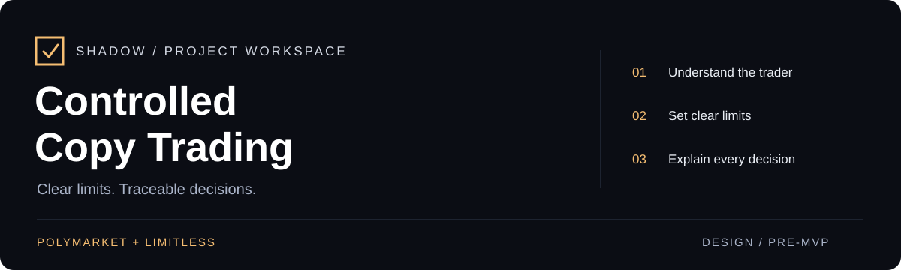
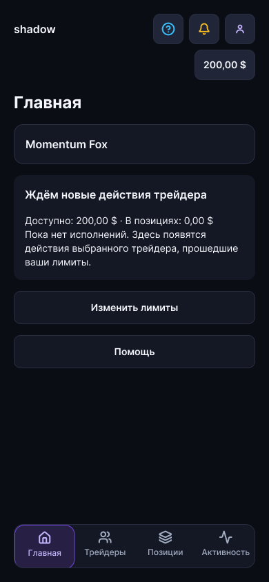
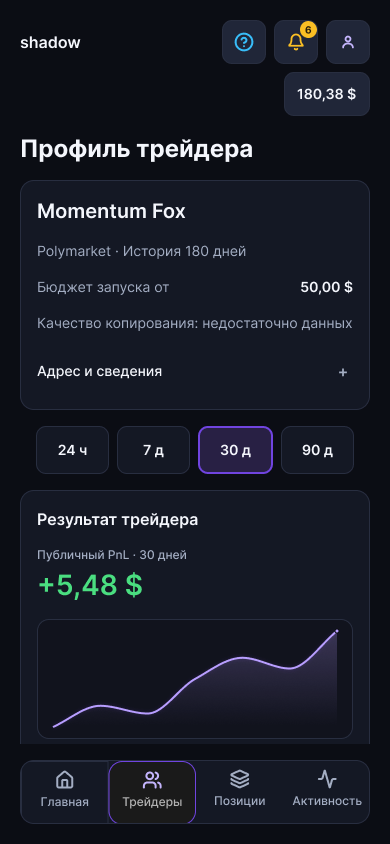

# Controlled Copy Trading

[Русский](README.md) · **English**

[](https://github.com/denius89/polymarket-copy-trading/actions/workflows/repository-check.yml)

A mobile-first product for controlled copy trading on **Polymarket** and **Limitless**. The concept: understand a trader's history, try a virtual-money demo, and set clear copy limits.

[Roadmap](docs/ROADMAP.md) · [Interfaces](docs/design/client/sitemap.md) · [Documentation](docs/README.md) · [Research](research/TRADER_SCORE_README.md) · [Repository guide](docs/REPOSITORY_GUIDE.md)

> **Stage: technical planning · pre-MVP.** Admin v1 is approved; [BI-01–BI-04](docs/design/client/business-rule-fixes-2026-10-27/README.md) are addressed in the client prototypes and documentation. The [technical plan 139](docs/139_shadow_technical_implementation_plan_2026-10-27.md) is proposed. The application and trading adapters are not implemented; real transactions remain disabled. Snapshot: **27 October 2026**. Detailed documents are mostly in Russian.

## Start with your task

| Understand the product | Explore the design | Continue the work |
| --- | --- | --- |
| [MVP business rules](docs/MVP_BUSINESS_LOGIC.md) | [Client map and Final anchors](docs/design/client/sitemap.md) | [Current queue](docs/ROADMAP.md) |
| [Accepted and proposed decisions](docs/decisions/README.md) | [Admin living map](docs/design/admin/sitemap.md) | [Client UI kit handoff](design/client-ui-kit/HANDOFF.md) |
| [Copy Score research and limits](research/TRADER_SCORE_README.md) | [Landing v2, awaiting review](docs/design/landing/hero-2026-10-19/v2/README.md) | [Latest result and history](docs/PROJECT_STATE.md) |

## Current scope

| Area | Status |
| --- | --- |
| Client and admin | [Admin v1 approved](docs/design/admin/rebuild/v1-final/README.md); [client financial states corrected](docs/design/client/business-rule-fixes-2026-10-27/README.md) in all four variants. Full application acceptance remains ahead. |
| First entry | [ADR-0048](docs/decisions/0048_unified_registration_and_first_entry.md) is accepted; [all four Final entry routes are updated](docs/design/client/adr48-entry-fixes-2026-10-19/README.md). Runtime authentication and full end-to-end acceptance remain ahead. |
| Copy Score | Seven research packages and source inputs preserved. A public ranking formula has not been accepted. |
| Venue APIs | [Polymarket](docs/api/polymarket/README.md) and [Limitless](docs/api/limitless/README.md) references. Evidence dated 6 October 2026; freshness must be checked for each task. |
| Application | `apps/` and `packages/` describe future boundaries. Implementation, paper trading and live trading have separate gates. |

Latest design evidence: [admin v1](docs/design/admin/rebuild/v1-final/README.md), [shared client model](docs/design/admin/rebuild/client-alignment/README.md), and [BI-01–BI-04](docs/design/client/business-rule-fixes-2026-10-27/README.md). Next proposal: [technical implementation plan](docs/139_shadow_technical_implementation_plan_2026-10-27.md). Prototype inspection is not runtime acceptance.

## Figma design

[**Open “Start here” →**](https://www.figma.com/design/lxPP2um7FvIbt02K8eeH4T?node-id=3-2)

| Client Final | RU | EN |
| --- | --- | --- |
| Mobile | [Design page](https://www.figma.com/design/lxPP2um7FvIbt02K8eeH4T?node-id=2477-528) | [Design page](https://www.figma.com/design/lxPP2um7FvIbt02K8eeH4T?node-id=2499-2) |
| Desktop | [Design page](https://www.figma.com/design/lxPP2um7FvIbt02K8eeH4T?node-id=2477-529) | [Design page](https://www.figma.com/design/lxPP2um7FvIbt02K8eeH4T?node-id=2499-3) |

These links open design pages. Select specific states and Present routes from the [client map](docs/design/client/sitemap.md) or [admin map](docs/design/admin/sitemap.md).

<details>
<summary>Historical visual snapshot · 6 October 2026</summary>

Earlier illustrative designs; current entry points are listed above.

<table><tr><td></td><td></td></tr></table>

</details>

## Repository map

```text
docs/               product rules, decisions, specifications and navigation
  design/           screen contracts, living maps and design checks
  ai-system/        knowledge, training and skill evaluations
design/             machine-readable UI kit handoff and historical QA packages
research/           research code, saved results, fixtures and manifests
.agents/skills/     project skills and Impeccable
apps/ · packages/   future application boundaries; infra/ — infrastructure plans
artifacts/          published presentations
scripts/            structure, link and storage checks
```

**GitHub** holds current documents and reviewable results. **Google Drive** holds large inputs and private recovery archives. The [external archive catalog](docs/storage/catalog.json) links their manifests and checksums; cloning does not download those archives. The [repository guide](docs/REPOSITORY_GUIDE.md) explains ownership and recovery.

## Working cycle

**Task → branch → checks → PR → main → cleanup.** Preserve each completed block outside the computer. A merged PR branch is removed automatically only if its head still matches the reviewed version; clean up the local worktree after verifying preservation. Unfinished work stays on its branch or in a draft PR.

```bash
npm run check
npm run test:repository
git diff --check
```

Node.js 22+ and Python 3.10+ are required. These validate the repository; they do not run an application. [Contributing](CONTRIBUTING.md) · [Security](SECURITY.md) · [Agent instructions](AGENTS.md) · [Organization review](docs/qa/repository-structure-review-2026-10-19.md).
