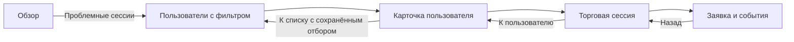

# Первый рабочий маршрут

[План](README.md) · [Требования](requirements.md) · [Навигация](navigation.md)

Статус: сценарная спецификация, не выполненная ручная проверка. Макеты, численные fixtures и точки входа предстоит создать на этапах 1–2.

## Задача

Сотрудник замечает проблему на обзоре, находит пользователя, понимает состояние его торговой сессии и открывает подтверждающие события. Затем возвращается к своей выборке. Он должен ответить: «Кто? На какой площадке? Что известно? Что требует проверки? Что я могу сделать дальше?».

Основной проход: сотрудник операций с явно заданным учебным назначением. Дополнительный: владелец A; затем проверка владельца B, просмотра аудитором и запрета для маркетолога без соответствующего права. Это разные учебные входы, не подмена сотрудника по клику.

## Состав и поведение

| Шаг | Информация | Действия и результат |
| --- | --- | --- |
| F01 Обзор | Выбранные площадка/демо/период, время обновления; предлагаемые показатели: активные сессии, пользователи с активными сессиями, проблемы; динамика активности и состояния сессий | Выбор периода календарём, площадки; подсказка определения показателя; переход к связанным записям. Счётчик сессий не выдаётся за число пользователей |
| F02 Пользователи | Таблица с именем/ID, площадкой, состоянием подключения, демо-средствами, активными сессиями/проблемами, VIP и активностью | Поиск, фильтры, сортировка, колонки, страницы; выбор строки открывает нужного пользователя. Массовых денежных/торговых команд не добавляем |
| F03 Пользователь | Заголовок с ID; сводка средств по площадкам; сессии; проблемы и контекст. Вкладки из карты навигации | Показатель ведёт в соответствующую вкладку; сессия — в F04; возврат восстанавливает F02. VIP — действие по праву, не главный смысл карточки |
| F04 Сессия | Пользователь, площадка, демо, бюджет/версия; доступно, резервы, открытые позиции; заявки и события с датой/статусом | Вкладки, фильтр заявок, открытие заявки; причины ограничений и разрешённый следующий шаг. Параметры сессии не редактируются сотрудником без отдельного права |
| F05 Заявка/события | Запрошено, подтверждённое исполнение, остаток, резерв, время последней проверки, подтверждающие события | Открытие событий и возврат. При неизвестном результате — понятная причина проверки и отсутствие повторной отправки; полная работа сверки — этап 3 |

F01–F05 — логические представления. Детали заявки могут быть боковой панелью; состояния фильтров и подсказок не требуют отдельных самостоятельных экранов. Остальные вкладки карточки наращиваются по пакетам; их не показывать рабочими, пока действие не подготовлено.

## Таблица и финансовая ясность

- Основные столбцы уточняются по доступной ширине. Имя/ID и состояние остаются легко читаемыми; второстепенные поля убираются через настройку колонок, а не ужимаются до нечитаемости.
- Одна строка соответствует пользователю. При выборе одной площадки — сведения этой площадки; при выборе обеих — явно разделённые значения. Не выводить необъяснённый суммарный баланс.
- «Бюджет сессии», «доступно», «резерв» и «стоимость открытых позиций» не взаимозаменяемы. Их определения и учебные расчёты фиксируются до отрисовки сумм.
- Результат торговли показывать только после определения периода, расходов и разделения реализованного/нереализованного результата. Отсутствие надёжной оценки — «Нет подтверждённых данных», а не 0.
- Денежные сведения сотрудник видит в разрешённом объёме. Если нет права, отображается причина ограничения без раскрытия суммы; это не ошибка подключения.

## Учебные данные, которые нужно подготовить

Связанный набор должен содержать достаточное число вымышленных пользователей для нескольких страниц таблицы, обе площадки, пользователя с двумя площадками и стабильные идентификаторы. Один снимок питает обзор, список, карточку и сессию. Числа не подбираются независимо под каждый экран.

| Пример | Что проверяем |
| --- | --- |
| A: обычная демо-сессия | Согласованность показателей и возвратов |
| B: результат заявки неизвестен | Не утверждаем отказ; не повторяем отправку; сохраняем нужный резерв |
| C: частичное исполнение | Исполненная часть отдельно от остатка и состояния его отмены |
| D: устаревшие данные подключения | Возраст данных и причина невозможности достоверной оценки |
| E: новый пользователь без сессий | Пустое состояние не выглядит ошибкой |
| F: ограниченное назначение сотрудника | Скрытые данные не раскрываются через график, поиск или прямую ссылку |

Каждое значение имеет единицу, источник учебного снимка и время; нулевые значения присутствуют отдельно от неизвестных. Полные адреса в необходимых деталях синтетические и помечены как учебные.

## Приёмочные задания

Все пункты пока имеют статус «Не выполнено».

1. Сотрудник выбирает Polymarket, демо и период календарём; показатели и график отражают тот же выбор.
2. Открывает пользователей с проблемными сессиями; объясняет разницу между числом пользователей и сессий. Фильтр явно показан.
3. Добавляет поиск/сортировку, переходит на следующую страницу, открывает пользователя. После возврата всё сохраняется.
4. Открывает Limitless-сессию из пользователя с двумя площадками; нигде не остаётся ошибочная подпись Polymarket и не меняется сотрудник.
5. В заявке с неизвестным результатом находит известные факты, сохранённый резерв и следующий безопасный шаг. Повторной отправки нет.
6. Меняет RU на EN через свой профиль и возвращается в ту же карточку/выборку с прежней ролью и значениями.
7. Открывает и закрывает подсказку мышью, кликом и клавиатурой. Основное действие и последствия понятны без подсказки.
8. Проверяет пустой поиск, отсутствие сессий, устаревшие данные, ошибку загрузки и отсутствие права — состояния различимы.
9. Проходит разрешённые части как владелец A/B и аудитор; маркетолог без права на пользователей не попадает в карточку через прямой переход.
10. Проверяет выбранные ширины ноутбука/монитора и длинные RU/EN подписи: меню, заголовки столбцов, полный адрес в деталях и кнопки не обрезаются.

Допуск к расширению: выполнены заявленные взаимодействия, согласованы показатели и учебные данные, устранены препятствия основного маршрута, владелец продукта проверил композицию. Непройденные сочетания перечислены явно. Приёмка прототипа не подтверждает работоспособность backend, реальный доступ к площадкам или серверное исполнение прав.
