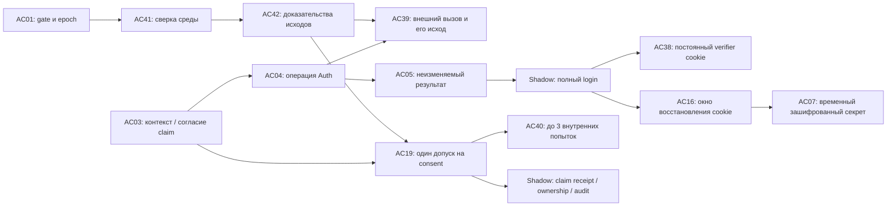

# Единая схема Auth-хранения: бэкенд и БД

02.11.2026 · Исходная сверка main5de65f2 (PR №204); перед публикацией учтён актуальный main `7f8fb3e5566bcc19519d42b14776108a0187f1b8` (PR №205), где владелец принял P01–P05 пакета БД №203. Подготовлено по поручению свести две карты, устранить дублирование, согласовать связи/locks и выделить решения владельца. **Единая принятая документальная схема после U01–U03 (ответ владельца «давай», baseline2165b86/PR №207).** [AC01–37](database-auth-physical-map-proposal.md) сохраняет принятую историю73; [D01-A/18](backend-auth-storage-map.md) — сопоставляемая карта бэкенда. Они не складываются. [Принятие P01–P05](database-auth-acceptance-2026-11-02.md) не открывается заново.

## 1. Итог объединения и приоритет

За основу взят полный AC-каталог БД. Дубли D01-A объединены с ним; добавлены только пять самостоятельных источников AC38–42: verifier полного login, dispatch-история внешнего вызова, внутренние claim attempts и run/items сверки. **Итого42 auth_control +36 Shadow =78 собственных таблиц в принятом документальном проекте.** U01 явно добавил5 таблиц и уточнил связи относительно прежних73.18 D01-A не прибавляются ни к73, ни к78. Provider internals/файлы evidence/witness/test-control в78 не входят.

Данный документ после принятия U01 задаёт единственный текущий вариант полей/отношений/locks; при расхождении с прежней картой73 применяется явно принятая здесь дельта; принятые продуктовые ADR, C04/last_input_receipt_id, C05, строгий C06, Q02/Q06 и Auth PR №199 он не меняет молча. Принятие трёх адресных дельт U01–U03 зафиксировано в §10; принятые P01–P05 не отменяются. Предложения не превращаются в работающие ограничения публикацией Markdown. Код, SQL, миграции, установка и испытания не выполнялись.

Основные связи показаны ниже; стрелка означает связь источников, не порядок выполнения и не полный перечень FK. Карта включает принятые AC38–42 (U01).

## 2. Общие поля, типы и ограничения

Все42 таблицы имеют environment:text,id:uuid v4,created_at:timestamptz NOT NULL, PK(environment,id). AC01 дополнительно U(environment); он один на среду. Environment из trusted descriptor. M содержит version:bigint>0 от1 и updated_at; H — immutable факт либо явно названный однократный terminal-переход, без переписывания результата. U=uuid, V=bigint>0, T=UTC с миллисекундами, S=закрытый text, B=boolean,H=bytea32,BY=bytea,J=jsonb,I=integer. `?` означает NULL только в указанном варианте, остальные поля обязательны. У id/версий нет сброса/повторного использования; переполнение не wrap.

Все FK включают environment, realm/subject/назначение там, где они определяют допуск; target UNIQUE создаются явно. XOR вариантов не обходится NULL частичного FK. N/L — NOT NULL/локальная форма, U/F — unique/FK, D — deferred полнота обеих сторон к commit, W — immutable/права writer, T — общая транзакция и guard. D не называется межтабличным CHECK. Удаление истории/cascade запрещены; erasure verifier/cipher по отдельному разрешённому пути. У каждого writer те же invariants, включая finalizer/reconciler/eraser; UI не enforcement.

Все environment дочерних таблиц дополнительно FK на AC01(environment). Внешний provider ref не FK на непроверенную внутреннюю provider schema и не доказательство сам по себе. Отсутствие обязательной локальной строки после подтверждённого допуска — техническая неисправность, не default/unresolved/успех. Current time не часть immutable FK; сроки проверяются при действии (now≥expiry закрывает), монотонный бюджет включает всю исходную HTTP-попытку.

JSON: AC04 nonsecret_payload≤16384 bytes, AC05 payload≤65536, AC32 safe_details≤16384, компактный UTF-8/depth8/закрытые поля. Это один выбранный storage-профиль: не переносим общий16КиБ D01-A на большой WebAuthn options result и не сохраняем raw attestation в64КиБ history. Общий wire8192 сохранён; отдельное registration65536 принято U02, точные новые DTO — проект D02; storage limit их не увеличивает. Обязательные ссылки и права typed, не JSON. Неизвестный format не читается как v1. Новые Auth record formats не меняют четыре прежних Shadow v1.

## 3. Канонический каталог AC01–AC42

M/H и ссылки определены в §2; приведены все колонки сверх общих. Для ранее предложенных AC01–37 номера сохранены, но поля здесь уже сведены — не накладывать вторую дельту из старой карты.

### 3.1. Контексты и исходные результаты

| ID / таблица | Колонки сверх общих | Ограничения и источник факта |
| --- | --- | --- |
| AC01 `environment_gates` · M | epoch:V; state:S(open/closed); closure_reason:S?; policy_ref:S; witness_checkpoint_ref:S?; witness_checkpoint_digest:H?; closed_at:T?; opened_at:T?; last_reconciliation_id:U?→AC41 | U(environment). Closed требует reason/closed_at; checkpoint может отсутствовать только при закрытом неподготовленном gate. Open требует доказанно свежий checkpoint и разрешение открытия. Epoch монотонна, не обновляется каждым intent. Обычный fence не отзывает независимые login автоматически; restore отзывает их явно. Last run принадлежит среде; связь может NULL только у первоначального bootstrap до первой сверки |
| AC02 `principal_security` · M | realm:S(user/staff); user_id:U?→shadow.users; staff_id:U?→shadow.staff_principals; state:S(active/transition/blocked); active_transition_operation_id:U?→AC04; current_factor_id:U?→AC10; mfa_requirement:S?; webauthn_user_handle:BY?; webauthn_rp_id:S? | XOR user/staff; U(env,user_id) для user и U(env,staff_id) для staff. User mfa_requirement=none/required/enrollment_required; staff NULL, его passkey отдельный. Staff имеет неизменяемые webauthn_user_handle1…64 bytes/RP, user оба NULL; U(env,RP,handle) и target U(env,staff_id,RP,handle) задают один handle нескольким credentials того же staff. Transition требует operation, active не допускает незавершённый transition. Null factor не трактуется как разрешённый email-only при enrollment_required. Изменение поднимает и прежний user/staff guard той же транзакцией |
| AC03 `contexts` · M | kind:S; realm:S(guest/user/staff); user_id:U?→shadow.users; staff_id:U?→shadow.staff_principals; selected_login_id:U?→shadow.auth_sessions; source_context_id:U?→AC03; authorization_context_id:U?→AC03; authorization_login_id:U?→shadow.auth_sessions; case_version_id:U?→AC26; stage:S; purpose:S; created_epoch:V; expires_at:T; revoked_at:T?; revoke_reason:S?; execution_closed_at:T?; access_confirmed_at:T?; bound_identity_id:U?→shadow.user_auth_identities; bound_identity_version:V?; bound_staff_identity_id:U?→shadow.staff_auth_identities; bound_staff_identity_version:V?; email_address_digest:H?; email_address_key_id:S?; email_binding_operation_id:U?→AC04; email_binding_secret_id:U?→AC07; current_email_challenge_id:U?→AC09; current_totp_challenge_id:U?→AC09; current_webauthn_challenge_id:U?→AC09; factor_id:U?→AC10; target_draft_id:U?→shadow.setup_drafts; previous_ownership_id:U?→shadow.draft_ownerships; security_case_id:U?→AC25; bootstrap_handle_id:U?→AC22; recovery_code_set_id:U?→AC23; completed_operation_id:U?→AC04 | Матрица §4 задаёт обязательные варианты. Подтверждённый subject/identity связываются один раз; отдельной context_subject_bindings нет. C01 email binding immutable, нормализованный адрес только в зашифрованной AC07, raw сравнение AC08; отдельной email_bindings нет. Claim consent — этот же typed context, без отдельной claim_consents. Target login и authorizing login различны. Completed operation даёт единственный полный login §5 |
| AC04 `operations` · M | namespace:S(context/bootstrap_handle/recovery_handle/security_case/reset_request/login); context_id:U?→AC03; bootstrap_handle_id:U?→AC22; recovery_code_set_id:U?→AC23; security_case_id:U?→AC25; reset_request_id:U?→AC30; initiating_login_id:U?→shadow.auth_sessions; action:S; client_operation_id:U; nonsecret_payload:J; payload_digest:H; admitted_epoch:V; request_started_at:T; admitted_at:T; execution_deadline_at:T; phase:S(admitted/dispatched/uncertain/resolved/closed_without_dispatch); current_dispatch_id:U?→AC39; result_id:U?→AC05; execution_closed_at:T?; resolution_basis:S?; execution_case_version_id:U?→AC26; execution_approval_1_id:U?→AC28; execution_approval_2_id:U?→AC28 | Ровно один scope FK; U(env,scope-kind,scope-id,action,client_operation_id), отдельные partial U по вариантам без NULL-обхода. До-context scope из существующего handle/request/login, затем не меняется. Resolved⇔matching result, closed_without_dispatch требует доказанное отсутствие dispatch. Seal/performer/provider outcome только AC39, не дублируются здесь. Для case execute фиксируется версия и точный достаточный набор approvals, неизменный после seal. Общий бюджет от request_started_at, не от admission |
| AC05 `operation_results` · H | operation_id:U→AC04; kind:S; record_format:S; resolved_at:T; historical_http_status:I; payload:J; result_digest:H; result_context_id:U?→AC03; result_login_id:U?→shadow.auth_sessions; completion_context_id:U?→AC03; completed_at:T?; target_login_id:U?→shadow.auth_sessions; result_challenge_id:U?→AC09; replaced_challenge_id:U?→AC09; result_factor_id:U?→AC10; result_case_id:U?→AC25; result_case_version_id:U?→AC26; result_credential_id:U?→AC20; result_recovery_set_id:U?→AC23 | U(env,operation_id), target U(env,id,operation_id); partial U(env,result_login_id) и U(env,completion_context_id) только для full completion. Полный login требует оба поля/completed_at; target_login для logout не является новым login. Result_context — созданный ограниченный context, не completion. D публичные ID/версии равны corresponding typed refs; дополнительные внутренние mandatory refs заданы адресной [матрицей D02 §1.1](backend-auth-d02-registry.md), не выводятся по общему имени семейства. Result immutable. Отдельной login_completions нет: её факт хранится здесь и связан с auth_sessions/AC03. Public DTO namespace сохраняется |
| AC06 `proof_verifiers` · M | context_id:U→AC03; purpose:S; digest:H?; key_id:S; digest_format:S; usable_until:T; revoked_at:T?; erased_at:T? | U(env,context_id,purpose). Context kind/purpose согласованы; digest отсутствует только при erased_at, такой proof не даёт нового допуска. Claim read-only recovery опирается на историческую связь AC03, не на восстановленный digest. Общий guest proof и прежний draft-bound HMAC имеют разные purpose и не взаимозаменяемы |
| AC07 `secret_material` · M | owner_kind:S(operation/factor/recovery_set/login/context); operation_id:U?→AC04; factor_id:U?→AC10; recovery_set_id:U?→AC23; login_id:U?→shadow.auth_sessions; context_id:U?→AC03; purpose:S(login_cookie/factor_reveal/recovery_codes_reveal/email_delivery); key_id:S; cipher_format:S; nonce:BY; ciphertext:BY?; reveal_until:T; erased_at:T? | Ровно один typed owner по purpose; U(env,purpose,owner-kind,owner-id), U(env,key_id,nonce). XChaCha20-Poly1305: nonce24, key32 вне БД, tag16 включён в ciphertext; отдельной tag-колонки нет. Nonce и key metadata сохраняются после стирания. AAD env/id/purpose/typed owner/format/deadline. Cipher NULL⇔erased_at NOT NULL. Email_delivery owner=context, срок context expiry, plaintext лишь нормализованный адрес; raw email в history не остаётся |
| AC08 `secret_comparisons` · M | operation_id:U→AC04; purpose:S; key_id:S; comparison_format:S; comparison_tag:H?; usable_until:T; erased_at:T? | U(env,operation_id,purpose). HMAC исходных секретных bytes и raw email, отдельно от canonical nonsecret digest. Domain/environment/namespace/scope/action/client_operation_id и length-prefix всех bytes обязательны. Утрата tag/key не совпадение; стирание только после закрытия всех допустимых replay-proof путей. Read-only result использует исторические связи |

### 3.2. Подтверждения, лимиты, продолжение и окно

| ID / таблица | Колонки сверх общих | Ограничения и источник факта |
| --- | --- | --- |
| AC09 `challenges` · M | context_id:U→AC03; kind:S(email/totp/webauthn_get/webauthn_create); purpose:S; subject_user_id:U?→shadow.users; subject_staff_id:U?→shadow.staff_principals; factor_id:U?→AC10; issued_by_operation_id:U→AC04; issuer_source:S(provider/local_adapter); issuer_ref:S; issued_at:T; expires_at:T; state:S(active/replaced/consumed); replaced_by_id:U?→AC09; consumed_by_operation_id:U?→AC04; consumed_at:T?; code_key_id:S?; code_digest:H?; link_digest:H?; public_challenge:BY?; rp_id:S?; origin:S?; case_version_id:U?→AC26; erased_at:T? | Active без terminal refs; replaced только replacement; consumed требует operation/time. Expiry вычисляется, не state=expired. Email code/link одно consumption; локальные verifier-поля только если адаптер управляет этим proof, иначе authoritative provider ref/доказательство, не выдуманный digest. TOTP требует factor/subject/profile без seed. WebAuthn challenge32/RP/origin/case-purpose, subject discoverable login может NULL до проверки. Все current/replacement/result refs одного context/purpose |
| AC10 `factor_versions` · M | user_id:U→shadow.users; factor_version:V; provider:S; provider_factor_ref:S; profile_code:S; state:S(prepared/active/disabled/revoked); prepared_context_id:U→AC03; activated_by_operation_id:U?→AC04; activated_at:T?; revoked_by_operation_id:U?→AC04; revoked_at:T? | U(env,user_id,factor_version); U(env,provider,provider_factor_ref). Один active фактор user под AC02; подготовленный не позволяет login. Разрешённые переходы и current pointer AC02 согласованы. Seed активного фактора остаётся provider, AC07 лишь временная выдача. Новая версия не переназначает прежний factor |
| AC11 `used_totp_steps` · H | factor_id:U→AC10; time_step:bigint; consumed_by_operation_id:U→AC04; consumed_at:T | U(env,factor_id,time_step), step≥0. Все совпавшие допустимые steps фиксируются атомарно с успешным consumption/result. Конкурентные цели/устройства используют ту же уникальность; обнаружение уже использованного среди совпавших отклоняет всю новую проверку, без частичного расхода |
| AC12 `failure_counters` · M | scope_kind:S(user_purpose/email_family/recovery_handle); user_id:U?→shadow.users; family_context_id:U?→AC03; recovery_set_id:U?→AC23; purpose:S; consecutive_failures:I; paused_until:T?; last_finalized_operation_id:U?→AC04 | Один соответствующий scope FK, U(env,scope-kind,scope-id,purpose), count≥0. Только однократный finalizer результата меняет серию в той же T; exact replay не инкрементирует. Общие user-серии между устройствами; email family не новый resend challenge. Не счётчик транспортных запросов |
| AC13 `quota_scopes` · M | scope_kind:S(user/staff/guest/context/login/email/source_network/environment); purpose:S; user_id:U?→shadow.users; staff_id:U?→shadow.staff_principals; context_id:U?→AC03; login_id:U?→shadow.auth_sessions; subject_digest:H; digest_key_id:S; limit_count:I; window_seconds:I; policy_ref:S | U(env,scope_kind,purpose,subject_digest). Typed subject проверяется по варианту; email/network имеют purpose-bound HMAC от нормализованного значения и не дают авторизацию. Параметры только опубликованной policy, не client input. Положительные limit/window. Смену key нельзя использовать для обнуления активного окна; нужна согласованная перепубликация/закрытый переход |
| AC14 `quota_admissions` · H | quota_scope_id:U→AC13; admission_token:U; admitted_at:T | U(env,quota_scope_id,admission_token). Token внутренний факт одной HTTP admission, не client requestId/operationId. По одному запросу возможны несколько обязательных quota scopes; допуск во все или ни в один, родители X в стабильном порядке. Повтор HTTP расходует новый token; отказ ограничителя не вставляет/не сдвигает окно. Нет произвольного удаления активных admissions |
| AC15 `continuation_bindings` · H | auth_context_id:U→AC03; kind:S(default/setup_draft); draft_id:U?→shadow.setup_drafts | U(env,auth_context_id). Default ⇒ draft NULL, setup_draft ⇒ реальный draft, допуск при вставке/чтении. Binding не удаляется/не переписывается, отсутствие доказано только trusted read. NextAction вычисляется отдельно из текущего slot/draft/access |
| AC16 `cookie_recovery_windows` · M | login_id:U→shadow.auth_sessions; source_result_id:U→AC05; source_context_id:U→AC03; credential_id:U→AC38; secret_material_id:U→AC07; deadline:T; first_confirmed_at:T?; closed_at:T?; close_reason:S(first_confirmation/deadline/login_revoked/context_revoked/reconciled)? | U(env,login_id). D весь source tuple совпадает, AC07 purpose=login_cookie/owner этого login. Deadline=min(completed_at+5min,context expiry), immutable. Closed/time reason целы, reopen запрещён. First current read может быть позже прежнего closed_at: старые reason/deadline не меняются. Все recovery/replay/Q01 берут один X window, erasure AC07 в той же T при явном close. Законно erased cipher не повреждение для обычного действующего login |

### 3.3. Каталог и claim

| ID / таблица | Колонки сверх общих | Ограничения и источник факта |
| --- | --- | --- |
| AC17 `catalog_bindings` · M | realm:S(user/guest); venue_id:U→shadow.venues; current_version_id:U→AC18 | U(env,realm,venue_id); FK current version дополнительно свой binding/venue/realm. Это selector, не новый aggregate version каталога. Отсутствующая разрешённая комбинация скрыта; повреждённый обязательный набор503 |
| AC18 `catalog_binding_versions` · H | binding_id:U→AC17; binding_version:V; realm:S; venue_id:U→shadow.venues; read_scope_id:U→shadow.q02_read_scopes; source_ref:S; policy_version:S; publication_digest:H; publication_signature_ref:S | U(env,binding_id,binding_version); составной FK scope своей venue. Только доверенная публикация, источник не bearer. Родитель/version/current pointer целы до commit. Для замены bindings с возвращением прежних прав требуется новая scopeRevision: publisher повышает guard затронутых scopes либо создаёт новый scope ID, иначе возможен ABA старого cursor |
| AC19 `claim_admissions` · M | consent_context_id:U→AC03; draft_id:U→shadow.setup_drafts; previous_ownership_id:U→shadow.draft_ownerships; actor_user_id:U→shadow.users; selected_login_id:U→shadow.auth_sessions; admitted_epoch:V; request_token:U; request_started_at:T; admitted_at:T; execution_deadline_at:T; executor_id:U; permit_key_id:S; permit_digest:H; state:S(admitted/uncertain/committed/closed_without_effect); claim_receipt_id:U?→shadow.draft_claim_receipts; closed_at:T?; closure_evidence_ref:S?; reconciliation_item_id:U?→AC42 | U(env,consent_context_id) сохраняется из принятой карты; дополнительно U(env,request_token), НЕ U(draft). Одно согласие допускает один серверный HTTP-исполнитель с внутренними attempts, не клиентский ключ; immutable consent/actor/epoch/permit. Все admissions/attempts в G3 под прежним draft guard. Повтор HTTP на том же consent не выдаёт нового permit/бюджета; читает прежний допуск/исход. После доказанного конца новое исполнение возможно только с новым явным согласием по действующим правилам; unknown запрещает обход новым consent. Committed↔полный matching receipt; closed_without_effect требует закрытого исполнителя/всех attempts/evidence. История claim_executions из D01-A объединена здесь |

### 3.4. Staff/MFA/reset/recovery

| ID / таблица | Колонки сверх общих | Ограничения и источник факта |
| --- | --- | --- |
| AC20 `webauthn_credentials` · M | staff_id:U→shadow.staff_principals; credential_id:BY; user_handle:BY; cose_public_key:BY; algorithm:I; rp_id:S; sign_count:bigint; backup_eligible:B; backup_state:B; state:S(limited/active/revoked); registered_by_operation_id:U→AC04; source_case_version_id:U?→AC26; revoked_at:T? | U(env,rp_id,credential_id); credential_id1…1023 bytes/user_handle1…64; stable staff binding, составной FK к handle/RP/subject AC02; несколько credentials сохраняют один handle данного staff. Публичный ключ не секрет, но не public listing. Limited credential пригоден лишь для своей recovery-процедуры; active не заменяет grants. Zero/synced counter не отключает challenge. Обновления counter/flags и outcome согласованы адаптером |
| AC21 `bootstrap_manifests` · H | manifest_version:V; rp_id:S; origin:S; grants_digest:H; source_ref:S; signed_digest:H; signature_ref:S; expires_at:T; accepted_at:T | U(env,manifest_version). D ровно два AC22 разных существующих staff, manifest не создаёт нового человека по UUID; trusted pre-verification отдельно. При выдаче handles manifest неизменяем, подпись/внешнее основание проверены |
| AC22 `bootstrap_handles` · M | manifest_id:U→AC21; staff_id:U→shadow.staff_principals; digest:H?; key_id:S; expires_at:T; consumed_operation_id:U?→AC04; consumed_at:T?; erased_at:T? | U(env,manifest_id,staff_id); два разных staff. Однократное потребление восстанавливает тот же context/result через AC04 handle-scope. Нельзя сначала стереть единственный proof и затем потерять несекретный outcome. Срок/однократность не дают прямой full login |
| AC23 `recovery_code_sets` · M | staff_id:U→shadow.staff_principals; set_version:V; recovery_handle:U; issued_operation_id:U→AC04; issued_at:T; reveal_until:T; revoked_at:T?; superseded_by_set_id:U?→AC23 | U(env,staff_id,set_version), U(env,recovery_handle). Один неотозванный набор под guard staff; новый набор отзывает старый в одной T с result и AC24 children. Число10 принято в P05; выдача реальных кодов не выполнялась |
| AC24 `recovery_codes` · M | code_set_id:U→AC23; ordinal:I; code_digest:H?; key_id:S; consumed_operation_id:U?→AC04; consumed_at:T?; erased_at:T? | U(env,code_set_id,ordinal), ordinal1…10; D ровно10 children при выдаче. Consumption атомарен с ограниченным recovery context/result, не с будущим полным login. Новый HTTP replay не потребляет второй код. Один код не заменяет пару владельцев |
| AC25 `security_cases` · M | kind:S(mfa_reset/staff_recovery_single/staff_recovery_pair); target_user_id:U?→shadow.users; current_version_id:U→AC26; state:S(collecting/authorized/executing/completed/rejected); source_reset_request_id:U?→AC30; completed_operation_id:U?→AC04 | Reset требует user/request, staff cases не user. Source request принадлежит target user; U(env,source_reset_request_id) для reset. Current version своего case обязательна. Authorized/current не замена актуальным approvals/правам при execute; executing unknown не откатывается expiry |
| AC26 `security_case_versions` · H | case_id:U→AC25; decision_version:V; factor_id:U?→AC10; verification_evidence_id:U?→AC29; expires_at:T; required_approvals:I; proposal_digest:H | U(env,case_id,decision_version). Reset factor/evidence одного target, required=2; single/pair связаны с точным составом AC27. Смена цели/ключа/evidence — новая версия и новые approvals. Digest закрытого tuple, не произвольного текста |
| AC27 `security_case_participants` · H | case_version_id:U→AC26; staff_id:U→shadow.staff_principals; role:S(subject/approver); recovery_context_id:U?→AC03; new_credential_id:U?→AC20 | U(env,case_version_id,staff_id,role). Reset: два разных approver; single: один subject и другой approver; pair: ровно два разных subject/approver, у каждого свой proof/new credential. D проверяет cardinality/разные principals и связь credential/context с участником; никакого третьего «pair principal» |
| AC28 `security_case_approvals` · H | case_version_id:U→AC26; participant_id:U→AC27; approving_staff_id:U→shadow.staff_principals; challenge_id:U→AC09; operation_id:U→AC04; credential_id:U→AC20; staff_login_id:U?→shadow.auth_sessions; approved_at:T; valid_until:T | U(env,operation_id), U(env,challenge_id) при однократном consumption; история допускает новые свежие approvals того же staff/версии, не перезаписывая старые. Execute фиксирует конкретные выбранные approval IDs в AC04; два разных staff для reset/pair, актуальные права и exact tuple. Same expired approval не становится свежим. Limited credential только для своего recovery pair; остальные требуют full staff |
| AC29 `verification_evidence` · H | target_user_id:U→shadow.users; evidence_version:V; independent_channel_ref:S; channel_verified_at:T; email_proof_context_id:U→AC03; verified_by_staff_id:U→shadow.staff_principals; verified_at:T; source_document_ref:S; document_digest:H | U(env,target_user_id,evidence_version). Закрытое свидетельство человеческой проверки P-RESET, не новый публичный профиль/контакт. Независимый канал подтверждён до обращения; документ должен позволять проверить это происхождение. FK/хеш не доказывают правдивость человека; raw документы/секреты вне audit/Git, паспортные документы не собираются |
| AC30 `reset_requests` · M | user_id:U→shadow.users; source_auth_context_id:U→AC03; client_operation_id:U; requested_at:T; status:S(requested/under_review/completed/rejected); completed_result_id:U?→AC05 | U(env,source_auth_context_id,client_operation_id). Source email-proven restricted того же user, не полный вход/право reset. Completed требует подтверждённого reset case/result своего user. Внешний status не раскрывает внутренние evidence/состав staff |

### 3.5. Активность, аудит, witness, уведомления

| ID / таблица | Колонки сверх общих | Ограничения и источник факта |
| --- | --- | --- |
| AC31 `activity_tickets` · M | login_id:U→shadow.auth_sessions; route_code:S; target_kind:S(none/draft/session); draft_id:U?→shadow.setup_drafts; session_id:U?→shadow.paper_sessions; expires_at:T; consumed_at:T?; consumed_request_token:U? | XOR target по route, право цели проверено выдачей и потреблением; user_catalog target=none, user_setup/review draft, user_session/staff_session_view session. Одноразовый consume+допустимый idle touch атомарны с разрешённым запросом; не update idle Q01. Ticket30s принят P05, не доказательство присутствия человека |
| AC32 `auth_audit_events` · H | kind:S; operation_id:U?→AC04; result_id:U?→AC05; case_version_id:U?→AC26; context_id:U?→AC03; target_login_id:U?→shadow.auth_sessions; credential_id:U?→AC20; recovery_set_id:U?→AC23; claim_admission_id:U?→AC19; reconciliation_run_id:U?→AC41; actor_user_id:U?→shadow.users; actor_staff_id:U?→shadow.staff_principals; actor_login_id:U?→shadow.auth_sessions; system_actor_ref:S?; occurred_at:T; outcome:S; safe_details:J | Закрытые kind/target/actor варианты §8, без generic target JSON. Reconciler XOR human actor, не фиктивный staff. Grant-based staff действия требуют достаточный AC33; limited pair и self-service используют полный variant evidence по D02 §4.1 без фиктивного grant. Shadow Q06 audit не переиспользуется и не ослабляется. Immutable outcome, технический source ref не доверяется без publisher authorization |
| AC33 `auth_audit_evidence` · H | event_id:U→AC32; staff_assignment_id:U→shadow.staff_assignments; assignment_version:V; grant_id:U→shadow.staff_assignment_grants; authorized_action:S; approving_staff_id:U→shadow.staff_principals; approval_id:U?→AC28 | U(env,event_id,authorized_action,approving_staff_id). Целый grant/assignment соответствующего actor либо selected approver по варианту; для grant-based final case event обязательны точные выбранные approvals из execution AC04, той же версии/участников. Limited pair имеет 0 AC33 и обязательную полную AC04/28/27/09/20/context цепочку; ноль grants не отсутствие evidence. Reset final — 3 строки (execute+2 review approval), single final — 1 approval grant, pair final — 0, как в проекте точной D-матрицы [реестра §4.1](backend-auth-d02-registry.md). D достаточности от event, нельзя собрать право из половин разных grants |
| AC34 `witness_batches` · M | witness_id:U; admitted_epoch:V; intent_sequence:V; intent_digest:H; external_intent_ref:S; declared_change_count:I; declared_target_digest:H; state:S(intent_registered/local_committed/confirmed/no_effect_proven/uncertain); local_committed_at:T?; external_confirmed_ref:S?; resolution_evidence_ref:S? | U(env,witness_id), U(env,intent_sequence). Count>0 и digest фиксируют полный объявленный change-set, не один произвольный child. Local_committed+AC35 с эффектом в одной T. External ack не меняет succeeded/rejected и не новый бизнес-отказ. Gate checkpoint не обновляется каждым batch. Обязательность внешнего witness принята в P04, реализация не испытана |
| AC35 `witness_changes` · H | batch_id:U→AC34; ordinal:I; target_kind:S; command_receipt_id:U?→shadow.command_receipts; claim_receipt_id:U?→shadow.draft_claim_receipts; review_id:U?→shadow.setup_reviews; auth_login_id:U?→shadow.auth_sessions; cookie_window_id:U?→AC16; claim_admission_id:U?→AC19; secret_material_id:U?→AC07; reconciliation_run_id:U?→AC41; auth_operation_id:U?→AC04; security_id:U?→AC02; context_id:U?→AC03; binding_version_id:U?→AC18; read_scope_id:U?→shadow.q02_read_scopes; staff_assignment_id:U?→shadow.staff_assignments; factor_id:U?→AC10; credential_id:U?→AC20; case_version_id:U?→AC26; catalog_source_id:U?→shadow.catalog_sources; trader_id:U?→shadow.traders; paper_control_id:U?→shadow.paper_controls; login_policy_control_id:U?→shadow.login_policy_controls; user_identity_id:U?→shadow.user_auth_identities; staff_identity_id:U?→shadow.staff_auth_identities; key_publication_ref:S?; state_digest:H; previous_version:V?; resulting_version:V? | U(env,batch_id,ordinal). Ровно один target по закрытому target_kind, сопоставленные ссылки обязательны. Историческая version не FK на mutable current version. Published grant set/version входит в digest и поля версии, не просто ссылка на assignment. D local_committed batch имеет полный declared change-set, не пустой parent. External key publication имеет свой подписанный ref, не FK к секрету |
| AC36 `notification_jobs` · M | source_result_id:U→AC05; purpose:S; recipient_identity_id:U?→shadow.user_auth_identities; recipient_staff_id:U?→shadow.staff_principals; template_version:S; state:S(pending/dispatching/sent/uncertain/failed); current_attempt_id:U?→AC37 | U(env,source_result_id,purpose,typed-recipient); ровно один recipient, адрес извлекается защищённо. Только уведомления о security-изменении, не OTP C01 и не Shadow observer. Сбой отправки не повторяет factor/reset. Нет implicit automatic retry после uncertain |
| AC37 `notification_attempts` · H | job_id:U→AC36; attempt_number:I; dispatch_sealed_at:T; performer_ref:S; provider_request_ref:S?; outcome:S(pending/accepted/not_sent_proven/uncertain); resolved_at:T?; evidence_ref:S? | U(env,job_id,attempt_number). Однократный финальный переход с доказательством; следующий attempt только после доказанного not_sent либо отдельного принятого правила безопасной доставки. HTTP/timeout не доказательство доставки или отсутствия эффекта. Числа retries H04 сюда не переносятся |

### 3.6. Недостающие самостоятельные факты

| ID / таблица | Колонки сверх общих | Ограничения и источник факта |
| --- | --- | --- |
| AC38 `login_cookie_credentials` · H | login_id:U→shadow.auth_sessions; source_result_id:U→AC05; source_context_id:U→AC03; realm:S(user/staff); credential_format:S(login-cookie-v1); key_id:S; secret_digest:H; issued_at:T | U(env,login_id), U(env,source_result_id). Постоянный verifier ровно исходной cookie полного login; не временный context proof AC06 и не recovery cipher AC07. D source result/context/realm/principal совпадают. Digest сохраняет ограниченный logout proof после expiry/revoke; текущие guards/login/slot всё равно обязательны. Закрытие recovery-window credential не отзывает |
| AC39 `operation_dispatches` · M | operation_id:U→AC04; ordinal:I; executor_id:U; permit_key_id:S; permit_digest:H; admitted_epoch:V; sealed_at:T; provider_code:S; provider_request_ref:S?; outcome:S(sealed/uncertain/confirmed_not_sent/confirmed_effect); outcome_recorded_at:T?; evidence_ref:S? | U(env,operation_id,ordinal), ordinal≥1. Seal до сети, исполнитель один, lease takeover нет. Next ordinal только после confirmed_not_sent всех предыдущих/живого исходного допуска/остатка бюджета. Provider ref обычный индекс, не выдуманный external unique. Сведения о сетевом исходе только здесь; operation.phase — про локальную разрешённость результата, не копия outcome |
| AC40 `claim_attempts` · M | admission_id:U→AC19; attempt_no:I; executor_id:U; admitted_epoch:V; admitted_at:T; outcome:S(admitted/committed/proved_rollback/unknown); ended_at:T?; rollback_cause:S(serialization/deadlock/no_effect_before_start)?; evidence_ref:S?; claim_receipt_id:U?→shadow.draft_claim_receipts | U(env,admission_id,attempt_no), 1…3. Предметный commit с receipt и AC19.committed в одной T. Proved rollback записывается после подтверждённого полного отката; потеря записи оставляет unknown. Только serialization/deadlock разрешают внутренний retry в прежнем5s бюджете; время/timeout не proof. Attempt immutable identity, terminal transition один |
| AC41 `reconciliation_runs` · M | purpose:S(claim_unknown/environment_restore); draft_id:U?→shadow.setup_drafts; from_epoch:V; to_epoch:V; phase:S(fenced/draining/verified/reopened/blocked); fenced_at:T; drained_at:T?; verified_at:T?; reopened_at:T?; inventory_evidence_ref:S?; inventory_digest:H?; drain_evidence_ref:S?; verification_evidence_ref:S?; authorization_evidence_ref:S?; witness_sequence:V; witness_head_digest:H | U(env,to_epoch), to_epoch>from_epoch. Claim_unknown требует draft, restore NULL. Inventory содержит все прежние исполнители/permits/DB-T/external dispatch, не только затронутый draft. Нет verified при unresolved target. Run/gate closed новой epoch одной T; reopen только по завершённому run/внешней свежести/инфраструктурной авторизации |
| AC42 `reconciliation_items` · H | run_id:U→AC41; claim_admission_id:U?→AC19; auth_dispatch_id:U?→AC39; verdict:S(committed/not_committed_and_fenced/unresolved); claim_receipt_id:U?→shadow.draft_claim_receipts; auth_result_id:U?→AC05; evidence_ref:S; evidence_digest:H; checked_at:T | Ровно один target, U(env,run,target-kind,target-id) через typed partial U. Claim committed требует matching receipt; Auth committed означает документированный исход эффекта, local result может ещё отсутствовать: verified требует отдельного завершения безопасной финализации/принятого U03. Unresolved item не даёт reopen. Новая оценка — новый run/item, старый evidence immutable |

## 4. Контексты, typed связи и устранённые дубли

### 4.1. Единственная матрица AC03

Субъект/identity связывается однократно по проверенному источнику, realm никогда не меняется. Все поля вне варианта NULL; active ограниченного процесса не полный login. Исторические source/target/purpose/первичная expiry неизменяемы; только guest имеет принятое P05 продление от разрешённых действий. Revoked/execution_closed запрещают новые действия, но не удаляют историческое основание разрешённого read-only recovery.

| Kind / realm | Обязательная связь и стадия | Что не допускается |
| --- | --- | --- |
| user_auth / user | До email user/identity NULL; после проверки ровно один user+bound_identity/version. Stage ready/email_verification/totp_verification/totp_enrollment/completed. Current email только email-stage, current totp только totp-stage; expiry30min | Selected login/draft/case NULL; email proof не полный login; чужая identity по совпадению адреса |
| guest / guest | Stable ID=actor_guest_context_id, общий proof AC06, stage active | User/staff/login/identity/draft/case NULL; один guest не один draft |
| mfa / user | Stage email_required/email_verification/factor_prepare/totp_verification/completed; enroll/disable требуют свой selected full login+identity/version; reenroll source restricted user_auth того же user; factor появляется при prepare | Reenroll не требует уже полного login; source сам по себе не разрешает новый factor без server enrollment_required |
| mfa_result / user | Source_context=исходный mfa, authorization_context=новый email-proven restricted user_auth того же user; purpose=result_read, stage active | Две роли контекста не склеиваются, нет исполнения factor-change/cookie recovery |
| logout / user; staff_logout / staff | Selected_login — неизменная цель; source_context optional прежний logout той же цели; authorization_login — отдельный проверявший login B при continue. Stage active; expiry15min | D01-A user_logout не второй разрешённый storage kind, имя сведено к logout; login B не цель отзыва |
| user_claim / user | User/selected full login/target draft/previous guest ownership и identity закреплены; expiry10min, stage active | Нет отдельной claim_consents, никакого client operation ID; исходный guest ID читается через previous ownership |
| staff_auth / staff | Ready/challenge/completed; до discoverable verify staff NULL, затем правильный principal/identity. Current_webauthn в challenge; expiry10min | User/draft NULL; pending не auth_session |
| staff_registration / staff | Свой staff, purpose bootstrap/recovery; bootstrap_handle либо recovery source/case/version; stage ready/challenge/completed, expiry10min | Ограниченный зарегистрированный ключ не full login |
| staff_recovery / staff | Staff/recovery code set, затем свой case/version; stage limited/awaiting_approvals/committing/completed/expired | Pair через участников двух контекстов, не третий principal; истечение не откат committing |
| staff_recovery_codes / staff | Staff/selected current full login, fresh WebAuthn challenge; stage ready/challenge/completed, expiry10min | Offline code не заменяет свежий passkey выдачи нового набора |

Названия новых kind/stage/purpose здесь — закрытый storage-проект; их wire-отображение идёт в D02. Context.source только уже существующий родитель; запрет self/cycle, immutable ссылки. Намеренные циклы operation→result→созданный context проверяются deferred completeness и не являются source-cycle. Новый context до выдачи полного login допустим, неизвестный kind запрещён.

### 4.2. Результат и subject/source связи

AC04.context namespace использует context до операции; bootstrap_handle/recovery_handle/reset_request/login/case — существующее основание до создания результата-контекста. Нельзя после потерянного ответа переименовать namespace в новый context и снова потратить одноразовый proof. AC30.client_operation_id равен клиентскому ID source операции; reset_request создание и его source result замкнуты атомарно. AC04.scope остаётся исходным после появления context.

AC03 email-binding заменяет отдельную email_bindings: первое допущенное C01 сохраняет адресный HMAC и AC07(email_delivery/context), operation ref и expiry. Unknown не меняет адрес; повтор сравнивает raw email/locale через AC08+AC04, даже если нормализация одинакова. Ciphertext хранит только нормализованный адрес до expiry context; затем erasure, subject identity в Shadow живёт по отдельным правилам. Нет email plaintext в новом AC04/history. Email digest/key предназначены для стабильного quota scope и не user ID.

AC05.login_completed/staff_login_completed/mfa_reenrolled требуют result_login_id+completion_context_id+completed_at, matching principal/realm/full-auth evidence и result.operation. Все остальные result kinds эти три поля NULL. Logout имеет отдельный target_login_id. U(result_login_id) и U(completion_context_id) не дают второму verify ID создать второй login. AC03.completed_operation_id совпадает с этим result.operation; время completed_at=shadow.auth_sessions.authenticated_at. Resolved_at — время финализации результата, не время внешнего эффекта. Отдельная login_completions была бы дублем этих фактов и не создаётся.

AC05 typed refs соответствуют ровно закрытому DTO своего namespace; payload не универсальный completion. Исторический result не включает current navigation, requestId/observedAt/restrictedGroups. Исторический status401 неверного кода не мешает GET result200; logout прямой204 не получает JSON из storage. Ранние400/403/409/429/503 не сохраняются как verification_rejected. Отсутствие final result в разрешённом scoped поиске даёт прежнее202, недоступность/повреждение — технический отказ.

### 4.3. Обязательные target keys и completeness

Все target U ниже scoped environment: AC03(id,kind,realm), (id,user_id), (id,staff_id); AC04(id,context_id,action) и соответствующий typed namespace; AC05(id,operation_id), (id,result_login_id,completion_context_id); AC09(id,context_id,purpose); AC10(id,user_id,factor_version); AC16(id,login_id,source_result_id); AC19(id,consent_context_id,draft_id,actor_user_id), (id,admitted_epoch,executor_id); AC26(id,case_id,decision_version); AC27(id,case_version_id,staff_id); AC28(id,case_version_id,approving_staff_id); AC38(id,login_id,source_result_id,source_context_id); AC39(id,operation_id); AC41(id,to_epoch). Nullable target варианты поддерживаются отдельными typed U/F и обязательной проверкой полноты, не NULL bypass.

На Shadow сохраняются прежние scoped login/identity/ownership/receipt keys; добавляются нужные supporting U без изменения смысла: auth_sessions(id,realm,user_id,user_identity_id) и staff-вариант; draft_ownerships(id,draft_id,owner_kind,guest_context_id); draft_claim_receipts(id,draft_id,actor_user_id,previous_ownership_id). Для ссылок с пропущенными nullable actor полями используется соответствующий целый вариант, не один общий FK, который исчезает из-за NULL. Нет переопределения прежнего unique(environment,draft_id) claim receipt.

D до commit проверяет: resolved operation↔единственный result; full result↔session/context/credential/window/secret metadata и staff slot; context proof/тип; case version/participants/достаточные approvals; issue codes↔ровно10 детей+result+старый набор revoked; claim committed↔полный CLAIM-OK и matching attempt; witness committed↔весь declared change-set. Parent без детей запрещён так же, как чужой child. При создании IDs назначаются заранее, отсутствие child не оправдывает промежуточный commit.

### 4.4. Где теперь находится каждая таблица D01-A

| Прежнее имя бэкенда | Единственный источник объединённой схемы |
| --- | --- |
| environment_gates | AC01 |
| contexts + context_subject_bindings | AC03 (once-bound typed subject) + AC06 (proof) |
| context_email_bindings | Typed поля AC03 + AC07(email_delivery), raw comparison AC08 |
| challenges / continuation_bindings | AC09 / AC15 |
| operations / operation_dispatches / operation_results | AC04 / AC39 / AC05 |
| login_completions | Completion-вариант AC05 + completed_operation AC03 + auth_session; отдельной таблицы нет |
| login_cookie_credentials | AC38 |
| cookie_recovery_windows / cookie_recovery_secrets | AC16 / AC07(login_cookie) |
| claim_consents | AC03(user_claim); отдельной таблицы нет |
| claim_executions / claim_execution_attempts | AC19 / AC40; нет второго admission-журнала |
| reconciliation_runs / reconciliation_items | AC41 / AC42 |

## 5. Транзакционные границы и восстановление

### 5.1. Auth admission → внешний вызов → локальный outcome

Transport quota AC13/14 фиксируется отдельно до предметной T; все обязательные scopes X в стабильном порядке, admission во все или ни в один. Повтор HTTP расходует новый token, внутренний retry нет. Failure counters AC12 меняются с финальным результатом, не transport admission. Недоступный quota/state не разрешает действие.

Первая короткая T под текущими guards закрепляет scoped AC04/AC08 и при C01 email AC03/07. Вторая короткая seal-T создаёт AC39, AC04.current_dispatch и phase=dispatched вместе. Только конкретный executor/permit выполняет один внешний вызов; SQL locks отпущены перед сетью. Confirmed_not_sent может разрешить следующий ordinal только внутри живого допуска/оставшегося бюджета; timeout/5xx/crash после seal этого не доказывают. Нет lease takeover/exactly-once обещания.

Finalizer получает доказанный provider outcome, заново читает текущий допуск и одной локальной T сохраняет AC39 terminal, AC05/AC04.resolved и нужные stage/challenge/steps/counters/security/session/window/audit. Публичный result не живёт отдельно от своего эффекта. Parent guard повышается вместе с изменяемыми детьми. Отсутствие достаточного provider proof оставляет uncertain; pin версии не закрывает BR08. Если допуск не позволяет full completion, применяется отдельное предложение U03, не ложный login/неверный OTP.

Request_started_at задаётся доверенным серверным началом исходного HTTP; deadline=request_started_at+принятые5/10s по действию. Ни admission, ни dispatch, ни retry не начинают бюджет заново. Поздняя безопасная сверка может записать установленный outcome вне HTTP-бюджета, но не повторить эффект или продлить старое право выполнения. Монотонные часы исполняющего процесса — механизм бюджета, сохранённый UTC сам по себе им не является.

### 5.2. Полный login, cookie и Q01

Completion-T целиком сохраняет session+AC05 full-result+AC03.completed+AC04.resolved+AC38+AC16+AC07, для staff ещё текущий slot/отзыв предыдущего. Provider effect отдельно, никакой общей HTTP/DB транзакции. Полнота проверяется с обеих сторон; синтетический fixture также обязан дать полный комплект, не fake provider evidence для legacy login.

Три факта различны: **AC38 verifier** проверяет уже выданную cookie, **AC16 window** разрешает либо запрещает восстановление, **AC07 cipher** позволяет повторить исходный secret короткое время. Исторический full-result в AC05 не доказывает текущего доступа. Secret≥256bit, другой чем context-proof; HMAC domain связывает env/realm/login/format, key вне БД. AC38 не стирается по5min и позволяет только предусмотренное доказательство logout после expiry/revoke; общий доступ всё равно проверяет current login/identity/security/slot.

Q01/current-staff: заранее X AC16 под уже защищённым login; подтвердить cookie и current access; закрыть window/поставить first_confirmed/стереть cipher в AC07 одной T; только после подтверждённого commit200 с проверенным login header. Idle не продлевается. Неизвестный commit не даёт обещанного200; повтор подтверждения идемпотентен.

Recovery/replay full completion: исходный proof/context/result, current principal/login/slot, expiry и window; X того же AC16, decrypt AC07, сравнить с AC38, завершить T, затем Set-Cookie только того же имени/секрета. Q01 первой→новая выдача CLOSED; recovery первой→разрешённый HTTP может дойти после Q01, но не оживить отозванный login. Сеть не объявляется отзываемой. Отзыв берёт X login заранее, затем window/secret; не late S→X upgrade.

Deadline immutable=min(completed_at+5min,context expiry). На границе recovery закрыто даже если eraser задержался. Первый Q01 по живой cookie после deadline допустим; first_confirmed может быть позже прежнего closed_at и не переписывает reason. Законно стёртая recovery-копия не ломает такой Q01. Недостающая до допуска обязательная запись не маскируется CLOSED/NOT_APPLICABLE. Erasure ciphertext не стирает старые backups/WAL; key/restore правила обязательны отдельно.

### 5.3. Claim: единица admission и общий guard

**Сохранён принятый UNIQUE(environment,consent_context_id).** Один AC19 соответствует одному согласованному consent и одному исходному допущенному HTTP-исполнителю; AC40 хранит до3 внутренних доказанных rollback-попыток этого исполнения. Это выбранная адаптация D01-A к P03, а не отмена принятой кардинальности. Repeat POST с тем же consent не создаёт новый AC19/permit/budget; возвращается разрешённый исход/unknown. Request_token внутренний, клиент его не выбирает. После доказанного закрытия без эффекта старый consent закрывается для исполнения; новое явное согласие допускается только по действующим правилам. При unknown смена consent не обход; требуется fence/drain и доказанная сверка.

Подготовка AC03(user_claim) связывает выбранные user/login/identity, draft и прежнее guest ownership, не создаёт AC19 и не меняет draft. Сервер проверяет first_confirmed window именно выбранного login и текущий guest proof. Consent expiry10min закрывает исполнение, но сохраняет ограниченное чтение200/202 под новым полным login того же user по исторической связи. Успех читается только из прежнего Shadow receipt+ownership; AC19.state сам по себе не success API.

Прежде внутренней очереди/передачи исполнителю trusted ingress захватывает epoch для запроса; приостановленный handler не может прочитать новую epoch и назвать её исходной. Admission-T: G0…G2, прежний G3 draft guard, scoped predicate по всем AC19 этого draft, затем AC19+AC40 attempt1. Permit не выдаётся до подтверждённого commit. Unknown admission-commit→поиск по consent/внутреннему request_token, не новый permit. Чужой pending/unresolved закрывает новое выполнение. Одновременные невидимые admission должны завершиться конфликтом/консервативной остановкой, а не признанием отсутствия: Serializable predicate/конкурирующие вставки и все соответствующие writers входят в будущую проверку. Нет partial UNIQUE активного draft, новой permanent guard-таблицы или зависимости защиты только от одного SELECT.

Effect-T: G0 проверяет сохранённый epoch; G1/G2 текущие права, source proof/срок; G3 advisory guard →AC19 →AC40; затем G5 draft/ownership. Проверяется собственный permit/нет нового неизвестного конкурента; несовместимый snapshot не становится fresh от ожидания. Полный прежний CLAIM-OK/receipt/audit + AC19.committed/AC40.committed сохраняются вместе. Unique receipt и draft ownership остаются последней независимой защитой однократности.

Внутренние попытки1…3 — AC40 одного admission и того же5s бюджета. После подтверждённого serialization/deadlock rollback отдельная T записывает proof, затем разрешает следующую попытку. Crash до такой записи→unknown, не свободный token. После terminal no-effect исполнитель закрыт, история не переиспользуется. Уже найденный receipt этому user возвращается без создания нового admission. Чужой receipt скрыт. Устаревший guest digest после смены current ownership не доступ, даже если криптографически верен.

### 5.4. Fence/drain и закрытый reconcile-only

По принятому P03 отдельная T X G0: gate closed, epoch увеличена, AC41.fenced создан; нельзя держать X gate, ожидая сеть. Inventory включает все старые handlers до/после DB admission, очереди, permits, DB-T и внешние dispatch. Ingress не должен скрыто копить исполнимые запросы до capture epoch. Если запрос ещё не имеет AC19, закрытие всех затронутых старых consent и доказанный drain старых handlers всё равно обязательны; отсутствие строки не no-effect.

Обычные изменяющие paths/observer при closed gate не стартуют. Разрешены только выделенные reconcile-only процедуры: прочитать доказанный исход, записать AC39/42/AC32, закрыть старый admission/consent, безопасно завершить ранее установленный результат без нового внешнего эффекта/full login/cookie. Это не общий bypass для staff. Evidence source процесса/соединения должен доказывать прекращение, не только «timeout истёк».

После доказанного drain — новая primary T со свежим snapshot и G3, сверка receipt/ownership/audit/fullness. Свободный guard в старом snapshot не подходит. AC42 фиксирует каждый outcome; все unknown закрывают reopening. Если эффекта нет и старый writer исключён, AC19.closed_without_effect+consent.execution_closed+evidence целы. Если эффект есть, связывается прежний receipt. User ownership без полного claim — повреждение, не новый шанс исполнения.

AC41 verified требует полного inventory/всех outcome и текущего внешнего checkpoint/разрешения. Новая короткая T X G0 открывает новую epoch, старые permits не возобновляет. Обычный claim fence не отзывает независимые login лишь по created_epoch; restore отдельно отзывает старые proofs/login и проверяет внешние key/access/scope факты. Пока доказательства нет, изменение среды остаётся закрытым по P03; уменьшение области остановки не вводится неявно.

### 5.5. Witness: атомарный local change-set, неизменный исход

Принятый P04: внешний intent → AC34(intent_registered) → предметная T с полным эффектом+AC35+AC34(local_committed) → внешний confirmed → отдельная отметка confirmed. Нет сети под долгими SQL locks. Current guards/epoch перепроверяются перед локальным эффектом. AC34.declared_change_count/target_digest соответствуют всему набору корневых изменений; D требует полных дочерних комплектов каждого root, не произвольного одного child.

После local commit original receipt уже succeeded/rejected; lost external ack не меняет его на unknown business outcome и не разрешает новый ключ/эффект. Current-authorized fresh primary replay возвращает исходный результат. Неизвестная свежесть восстановленной копии/допуска закрывает выдачу, даже если локальная строка есть. Pending external intent после restore разбирается по независимому evidence; пустая восстановленная таблица не доказательство rollback.

Чистые ack/drain/outcome metadata связываются с исходным batch/run без рекурсии «witness для ack witness». Erasure внутри объявленного closure выполняется в той же T; самостоятельное последующее erasure имеет собственный intent/batch и typed root по W07: AC07 → secret_material; AC06/09 → context; AC08/24/потреблённый AC22 → auth_operation с полным closure. Для непотреблённого AC22 writer отсутствует. Это не исключение P04. Предметная безопасная финализация также требует полного собственного незавершённого batch; уже local_committed closure не расширяется. Закрытая таблица W01–W10 — [D02 реестр §4.2](backend-auth-d02-registry.md). Typed refs приняты U01, точный перечень узких процедур отражается в D02 в пределах принятого P04. Отказ witness до intent запрещает новое покрываемое изменение; цена доступности и5s/10s измеряется отдельно, не голосуется как достигнутая.

### 5.6. Staff/reset/recovery

P-RESET уже принят: свежий email, независимый ранее подтверждённый канал, оба владельца одной версии; нет основания→отказ, без паспортных документов. Reset grants/audit уже приняты P02 для отражения в D02; новые поля/полнота этой карты входят в U01. Bootstrap/consume code/issuance нового набора и его children/result замкнуты одной локальной T. Pair completion меняет обе стороны вместе, limited credential не полный staff login. Ни одна роль Owner сама по себе не инфраструктурное право чтения ключей.

Устранена ещё одна коллизия прежней карты: UNIQUE(case_version,staff) для immutable approvals запрещала новое свежее подтверждение той же версии после5min. Здесь история AC28 допускает несколько отдельных approvals, каждый от уникальной операции/challenge; execution AC04 фиксирует ровно нужные approval IDs. Старая запись не обновляется, чужая версия/тот же staff дважды не составляют пару. После executing case version не переназначается. Freshness проверяется на допустимом начале исполнения, expiry не откатывает уже совершённый внешний эффект. Актуальные права/transition barriers проверяются на нужных границах finalizer.

Reset/disable сначала AC02.transition с исходной операцией, внешний factor effect отдельно; finalizer меняет security/factor/revokes/result/audit/notification вместе. Enroll сохраняет прежние login; disable→none, reset→enrollment_required. Повтор старого result не отзывает новые login, появившиеся позже. AC36/37 доставляют уведомление, не повторяют reset и не являются вторым AC39 Auth dispatch.

## 6. Единственный принятый порядок блокировок

Принятый [порядок G0–G6](database-concurrency-locks.md) сохранён по группам. Принятая адресная дельта U01 уточняет подпорядок новых строк и переносит AC04 operation из хвоста G2 в собственную Auth-ветвь G3 вместе с AC39. Claim AC19 остаётся в принятом G3 после advisory. После U01 это один действующий документальный порядок вместо смешения двух карт; работоспособность ещё не испытана. S — совместимая блокировка guard, X — исключительная; сильнейший нужный режим выбирается сразу, без позднего S→X. Внутри класса блокируется полный отсортированный набор ключей environment/type/id. Для неизменяемой истории защищается её изменяемый родитель, а не создаётся фиктивный update истории.

| Ранг | Обязательный порядок |
| --- | --- |
| До предметной T | Transport quota: X всех AC13 по полному ключу → записи AC14, одна отдельная короткая T. Все scopes учитываются атомарно; внутренний DB retry не новый HTTP расход. Ни один quota lock не переносится в предметную T/сетевой вызов |
| G0 | AC01 S для обычной операции, X для fence/reopen. Проверка исходной epoch; никакого повторного допуска старого исполнителя по новой epoch. Reconcile-only — отдельный закрытый writer (§5.4) |
| G1 | Scope parents → paper_controls → catalog_sources → traders → login_policy_controls. Весь необходимый набор, включая Q02, до G2. Publisher состава защищает parent, reader не довольствуется случайно найденными member rows |
| G2.1 | AC17 catalog binding; затем Shadow user/identity либо staff/principal/identity/assignments/grants; затем AC02 security. Все участники одной операции заранее входят в упорядоченный набор |
| G2.2 | Shadow auth_sessions/staff_login_slots → AC03 contexts → AC25 cases → AC10 factors → AC20 staff credentials → AC22 bootstrap handles → AC23 recovery sets → AC24 codes → AC12 verification failures |
| G2.3 | AC09 challenges → AC16 cookie windows → AC31 activity tickets → AC07 secret materials → AC36 notification jobs → AC34 witness batches → AC41 reconciliation runs. Изменяемые AC06 proof verifiers защищаются своим AC03 parent; AC15 continuation proofs — source context. AC26–28/history/AC38 читаются под соответствующим parent; собственные новые children создаются внутри его границы |
| G3 — ровно одна предметная ветвь | Auth: AC04 operation → AC39 dispatch. Claim: прежний временный advisory guard одного draft → AC19 admission → AC40 attempt. C04/C06: прежний scoped command key. Claim admission не блокируется в G2, Auth operation больше не G2. Два claim или Auth execution+claim execution в одной T запрещены |
| G4 → G5 → G6 | Прежний slot → draft/ownership → session и полный комплект/обязательный audit/outbox. Новые result/children/Audit/witness changes создаются под уже полученными guards; поздний возврат за существующим ранним parent запрещён |

Чтение locator до guards не разрешает действие: после защиты сверяются исходные version/subject/target и снимок. Если обнаружена новая ранняя цель, текущая попытка откатывается целиком; никаких дополнительных G1/G2 после G3. Дальнейший повтор допустим только там, где его уже разрешает контракт, с исходным scope/бюджетом. Новые собственные строки не разрешают захват чужого существующего раннего parent через скрытый FK. Реальные FK/unique/index locks входят в будущую проверку полного графа, не объявлены безопасными одним этим порядком.

| Путь | Необходимые guards и итог |
| --- | --- |
| Q01/current staff, cookie recovery | G0 → необходимые G1 → G2 subject/security/login/context → X AC16 → при erasure X AC07. Проверка/закрытие/подготовка recovery происходят под одной window; Q01 не touch idle. Eraser использует тот же порядок window→secret, а не наоборот |
| Auth admission/seal/finalizer | G0/G1 → полный G2 набор → G3 operation/dispatch. У seal и finalizer разные короткие T, сеть между ними. Finalizer заново проверяет current guards, исходный scope не меняет |
| Claim admission/attempt | G0/G1 → G2 user/login/consent/security → G3 draft advisory/admission/attempt → G5 draft/ownership при предметной проверке. Поздний writer не берёт admission перед advisory. Для отсутствующей AC19 проверяется весь draft predicate, не один consent |
| Reset/парное recovery | G0/G1 → все G2 principals/grants/security/login/context/case/factors/credentials/challenges заранее отсортированы → G3 исходная operation. Exact approvals фиксируются перед эффектом; audit с достаточными grants обязателен |
| Q02 | Candidate locator → G0 → полный candidate G1 → G2 binding/access/login; повторная проверка binding и единый Serializable-снимок. Смена locator не разрешает движение назад к G1 |
| Публикация binding | G0 → X всех old/new scope parents G1 → X AC17 G2; новая AC18 и повышение затронутых scope revisions атомарны. A→B→A не возвращает прежний fingerprint; формат cursor не расширяется |
| Fence/reopen | Короткая X G0 T с AC41; затем locks отпускаются до drain/внешнего evidence. Нельзя ждать внешнего исполнителя, удерживая ресурс, нужный для его завершения |
| Reconcile/ack/erasure | Минимальный разрешённый профиль, тот же порядок G0…G6. Ни один служебный writer не начинает с AC04/AC19/AC07 и затем запрашивает ранний subject/window/gate. AC34 ack не берёт новый глобальный head lock после batch |

## 7. Источники чтения, форматы и сроки

| Что читаем | Единственный источник |
| --- | --- |
| Current Auth-context | AC03 + действующий AC06 proof, актуальные security/identity/selected login по варианту. AC05 не разрешает доступ сам по себе |
| Исходный результат Auth | AC04 namespace/action/client ID → AC05; AC39 отдельно доказывает внешний outcome. Current requestId/observedAt/navigation добавляются сейчас, не переписывают результат |
| Полный login | Shadow auth_sessions и актуальные security/slot/identity + AC38 verifier. AC16/AC07 нужны только для повторной выдачи cookie, не для действительности уже имеющейся cookie |
| Claim recovery | Исторический AC03 consent → AC19/40 и прежний Shadow claim receipt/ownership/audit. Нет второго результата claim в AC05 и нет Q05/CommandReceipt для claim |
| Reset/recovery approval | AC25/26/27/28 + exact AC04 approval tuple и AC33 sufficient grants. JSON approvedBy не источник полномочий |
| Сверка среды | AC01 + AC41/42 + независимый witness checkpoint; локальная копия после restore не доказывает собственную свежесть |

HMAC использует отдельные purpose/key domains, environment/типизированный scope и однозначное кодирование с длинами; секреты не хешируются простым SHA. Поля raw-sensitive payload сравниваются через AC08, не через нормализованную JSON-копию; nonsecret payload/digest хранит только разрешённые поля. Для draft-bound guest proof принят U01 формат guest-draft-proof-v1 (физическое уточнение B1-D2, часть U01); общий guest proof AC06 имеет другое назначение и не подставляется вместо него. Его байтовый формат и проверяемый key ID сохраняются из [D01-A §7.1](backend-auth-storage-map.md), без нового wire-формата в этой консолидации.

AC07 — единственная временная зашифрованная копия секрета выбранного назначения, ключ вне БД; nonce не удаляется и не используется повторно после стирания ciphertext. Для восстановления full cookie хранятся те же исходные байты, не новый секрет/срок. Контекстные proof digest, raw comparison HMAC, постоянный full-login verifier и recovery ciphertext имеют разные назначения и не объединяются в один токен.

Принятые30min Auth-context,5min cookie window/закрытие первым Q01,10min claim consent и15min logout context сохраняются. Истечение срока действия не удаляет контекст/операцию/result/dispatch/audit. Действующий M04 не разрешает автоматический архив/очистку этой истории. Cipher/verifier erasure выполняется только по разрешённой политике своего класса, с меткой и проверяемым текущим запретом использования; исчезновение обязательного секрета до допустимой границы — повреждение. Стирание в live БД не стирает backup/WAL: необходимы отдельные ключевой lifecycle и restore quarantine. Конкретные ключевые системы/версии/ACL ещё не доказаны.

Имена wire-полей сохраняются: requestSchemaVersion=v1 и отдельный requestVersion для версии процедуры. Сокращённое «version» в раннем prose не новое поле API. Неизвестные record formats/enum/повреждение обязательной связи дают технический отказ, а не пустой массив или фиктивный успех. Guest/staff сроки и limits приняты P05 и повторно не обсуждаются; точное издание API/реестра D02 ещё требуется.

## 8. Права, аудит и граница witness

Принятые P02 отдельные reset grants: action=mfa_reset_review либо mfa_reset_execute, screen=ADM-02, field_group=user.mfa_reset_case, mode=paper, scope=all, venue_id=NULL. Это принятый документальный scope, не реально выданные полномочия. Их область позволяет безопасную работу с аккаунтом пользователя, а не «сброс только paper-фактора»: factor общий, ожидаемое закрытие прежних login охватывает аккаунт. Владелец 1 и владелец 2 равноправны; разные staff IDs без независимой проверки реальных участников не доказывают два человека.

AC32 содержит обязательные actor/typed target/operation/case-version или иной предусмотренный вариант. Login revoke/window confirmation/claim admission/reconciliation имеют typed ссылки, не произвольный resourceId в safe_details. AC33 сохраняет достаточные grants, их версии и использованное approval; проверка current прав выполняется отдельно. Parent без обязательного audit/evidence/participant не допускается к commit. Подробные kind/action проекта для полной дельты D02 перечислены в [API-проекте §4](backend-review-api-spec.md) и [карте БД §5](database-auth-physical-map-proposal.md); перенос в действующий закрытый реестр — в полном D02, не этой публикацией.

AC35 хранит ровно один типизированный root изменения: command/claim/review/Auth operation/security/context/binding/scope/grant/factor/credential/case/catalog/control/identity/key publication либо отдельно login/window/admission/secret/reconciliation run. declared_change_count — число объявленных roots, не число физических строк. Digest включает тип, ключ, версии и требуемый полный набор children каждого root. Если Auth operation создаёт login/result/window/credential, они входят в её closure; их отсутствие нельзя скрыть счётчиком1. Самостоятельный Q01 closure имеет root window со своим стиранием; отдельный erasure имеет собственный intent/batch и typed root по W07: secret_material только для AC07, context для AC06/09, auth_operation для AC08/24/потреблённого AC22, каждый с полным closure. Для непотреблённого AC22 writer отсутствует. Один и тот же эффект не объявляется второй независимой операцией ради witness.

Служебные ack/drain/evidence записи ссылаются на исходный batch/run и не запускают бесконечную цепочку witness-свидетельств друг о друге. Закрытый список W01–W10 отражён проектом D02 §4.2; только W01–W05 — metadata без рекурсивного intent: он не разрешает менять factor/login/ownership/grants вне предметного защищённого пути. Внешний key publication ref подписан и проверяется вне БД; SQL FK не делает внешний ref доверенным. Реальные роли БД writer/reconciler/eraser, внешние ключи и доступ к evidence требуют отдельного операционного назначения, не выводятся из product Owner.

## 9. Что устранено и что проверять дальше

| Исходное замечание | Результат объединения |
| --- | --- |
| BR01–02 | §6: весь G1 до G2, binding/scope ABA закрыт новой revision; не меняется принятый cursor |
| BR03 | §§3–4: namespace до context, отдельные source/authorization/target, один consent и один completion источник |
| BR04 | §§5.3–5.4: исходная epoch до очереди, AC19/40, полный drain, закрытый reconcile-only. Цена доступности принята P03; новые поля U01 |
| BR05 | §§5.5/8: typed полный change-set, witness ack не меняет receipt. Обязательность принята P04; точные связи U01 |
| BR06 | Принятый P05: guest продлевает только C04 created/updated; unchanged/exact replay/ошибки/GET исключены. Исходная семантика C04/receipt не меняется |
| BR07 | §§5.6/8: typed pair/approval/grant evidence, повторное свежее approval той же версии возможно. Права приняты P02; изменение уникальности approval — U01 |
| BR08 | **Открыто:** реальная корреляция provider и точные TOTP steps. Таблицы/документы не доказывают capability; без proof неизвестный исход не разрешает повтор |
| BR09 | §7: requestSchemaVersion, секреты отдельно от истории, backup не считается стёртым. D02/компоненты/ключи/restore всё ещё требуют работы |

Существующие [ASC01–ASC18](backend-auth-storage-cases.md), MAP01–MAP08 из пакета БД и DA/E/CC остаются исходными сценариями, а §4.4 задаёт замену имён. ASC01–03 относятся к AC03–09/39; ASC04–09 — к AC05/07/16/38 и Shadow login/security; ASC10–11 — к AC03/04/05/15 и разным target/authorizing login; ASC12–17 — к AC01/03/19/40–42 и прежней цепочке claim; ASC18 — к AC04/05/39, current security и U03. Их старые имена не второй каталог. MAP01 теперь должен проверять42 таблицы и новые XOR/deferred closure; принятые37 Auth и36 Shadow служат отдельными исходными срезами; расширение до42 входит только в план U01. Сценарии не запускались.

Дополнительно обязательны будущие проверки: UST01 — approval expired→новое approval той же версии без изменения истории; UST02 — execution сохраняет выбранную пару, другой staff/version не подменяет её; UST03 — конкурентные admissions разных consent одного draft, включая stale Serializable snapshot; UST04 — full-login verifier остаётся после удаления recovery cipher; UST05 — late confirmed external effect без права выдать login (U03); UST06 — полный witness root без обязательного child отвергается; UST07 — eraser/Q01/recovery и все неявные FK locks соблюдают §6; UST08 — после глобального fence ни один заранее захваченный request не получает новую epoch. Всё **«не выполнялось»**.

Документальная сверка подтверждает единственный каталог/ссылки/описанный порядок и разделение принятого/предложенного. Она не подтверждает отсутствие deadlock, работоспособность адаптера, атомарность, криптографию, бюджеты или восстановление. Физическая реализация и изолированные испытания требуют отдельного поручения.

## 10. Решения владельца и следующий шаг

[U01–U03 приняты](auth-storage-unified-decisions.md) ответом владельца «давай» на предложение согласовать эти три дополнения. Текущий каталог78; P01–P05, global fence/witness, lifecycle/reset grants/P-RESET не переоткрывались. Принятый U03 определяет семантику, его exact wire projection оформлен в [проекте D02](backend-auth-d02-contracts.md).

[Проект полного v6](backend-auth-d02-registry.md) и API D02 готовы для одной пакетной вычитки; v5 пока действующий. Новые дополнительные технические детали D02 не включаются в принятие U01–U03 задним числом. BR08/D03/реальные проверки остаются открытыми. Публикация/принятие документов не разрешают код, SQL, миграции, установку или развёртывание.
