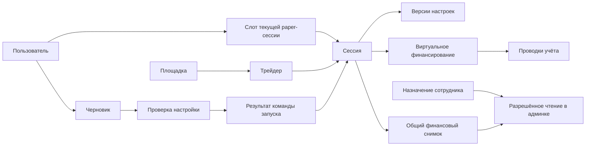

# Логическая схема данных первого сценария

28.10.2026 · Часть [проекта T0](README.md). **Логические решения приняты в [ADR-0064](../../decisions/0064_first_session_database_contract.md); физические имена/типы и механизмы проверок ещё проектируются. Не SQL, не миграция и не реализованная БД.** Принятая основа — ADR-0062; денежная семантика — ADR-0048/0051/0055–0059. Baseline обсуждения: main `f2d8a6b9f3107105a8dfe4fac1cb1c7bdddd11b5`.

Для первого полигона принята одна PostgreSQL БД с отдельными схемами Auth/Shadow и служебными ролями с минимальными правами. Совместимость конкретного Supabase ещё проверить. Собственные user/session IDs не заменяются provider subject; удаление записи Auth не удаляет историю приложения каскадно.

## 1. Как связаны основные объекты

Один человек имеет аккаунт; черновик хранит ещё не запущенную настройку. Запуск создаёт paper-сессию с первой версией настроек и единственным начальным финансированием. Клиент и админка читают её общий финансовый снимок. Доступ сотрудника — отдельное назначение, а не право любого вошедшего пользователя.

Стрелки показывают отношения, не порядок сетевых запросов. Служебные auth/audit/outbox записи раскрыты в таблице. Обозначения не задают окончательные имена таблиц.

## 2. Сущности и ограничения

Для каждого ресурса — непрозрачный ID, серверные даты и область окружения; для изменяемого ресурса — version. Внешний ID всегда вместе с venue и источником/окружением. Язык — параметр представления, не часть финансового ключа.

| Сущность | Основные поля и связи | Ограничение / смысл |
| --- | --- | --- |
| User | id, status, locale; ссылка на подтверждённый email identity | Один подтверждённый identity связывается с одним user. Создание конкурентными verify не размножает пользователя; нормализация email по принятой auth-policy (регистр незначим, trim краёв, точки/+ не удаляются), без автоматического слияния аккаунтов |
| AuthIdentity | provider, subject, verifiedEmail, userId; отдельное пространство staff identity | Уникальный environment+provider+subject+realm; отдельная привязка к постоянному аккаунту Shadow, удаление Auth не удаляет его историю; email не принимается из браузера как доказанная личность. Секреты провайдера вне прикладных таблиц |
| AuthChallenge | challengeId, purpose, expiry, usedAt, attempts | Если challenge ведёт провайдер, не дублировать его проверку локально. Однократное потребление; только digest/защищённые ссылки, без plaintext-кода или bearer в журналах |
| AuthSession | loginId, principalId/realm, loginPolicyVersionId, effective maxLifetime/inactivity, authenticatedAt, lastUserActivityAt, expiresAt, revokedAt/reason | Отдельная запись каждого входа с закреплённой политикой. Refresh не новый вход. Пользовательские устройства независимы; это не PaperSession |
| StaffLoginSlot | staffPrincipalId, environment, currentLoginId | Предлагаемое физическое выражение принятого одного рабочего входа. После passkey и проверки назначения новый login, отзыв старого и pointer сохраняются атомарно. Назначения не размножают слоты |
| LoginPolicyVersion | id, realm, immutable limits, publication reference; active pointer отдельно | Политика входа отделена от денежных настроек; обычная публикация не меняет старые login |
| StaffPrincipal / Assignment | principalId, existing role/preset ref, scope, validity, status, authorizationVersion | Отдельно от User. Административный просмотр требует актуального разрешения на конкретного пользователя/сессию; владелец определяется действующим назначением, не переданным role |
| Venue / Trader | venueId, sourceEnvironment, externalTraderId, sourceRef, catalogRevision, eligibility, observedAt | Уникальность venue+sourceEnvironment+externalTraderId. Один и тот же адрес на разных площадках не один объект. Eligibility для тестового сценария не активирует профиль рынка |
| PolicyVersion | id, immutable payload/ref/hash, publication status; отдельно active pointer | Для чисел — `paper-mvp-settings-v1`; системные ограничения и источник их значений отдельно. Неопубликованный/устаревший policy нельзя выдать за действующий |
| SetupDraft | id, ownerUserId **или** guestContextDigest, version, locale, entryContext, step, venueId, traderId, selectedMode, введённые fixed/percent, B/p/d, proposedTimezone, expiresAt | Несколько независимых draft на user допустимы. Только актуальный ввод/version, без полной истории правок; usedAt/usedBySessionId фиксируют использование при старте. До входа не UserSession. Сохраняет неактивный ввод для возврата в форму, но в effective settings входит только выбранный mode. Трейдер, язык и шаг сохраняются; секретов нет |
| SetupReview | id, draftId/version, authenticated owner или guest context, normalized selected values, policy/catalog/control versions, expectedSlotGeneration, warnings, expiresAt | Неизменяемая собственная копия того, что показывали перед подтверждением, со временем проверки и сроком 10 минут. draftVersion — зафиксированный номер, не FK к изменяемому текущему номеру draft. Guest review нельзя использовать для запуска после входа без новой привязки и проверки. Не гарантирует будущий допуск |
| UserSessionSlot | userId, environment, mode=paper, generation, currentSessionId nullable | Unique(userId, environment, mode), **не** по площадке. Один пользователь не получает вторую сессию через другую venue. Одна строка блокируется на время запуска; generation защищает от старого review после освобождения слота |
| PaperSession | id, userId, venueId, traderId, environment, dataOrigin, lifecycle, controlState, startedAt, IanaTimezone, currentSettingsRevisionId, version | Первый успешный запуск — активная сессия с пустым содержимым. EMPTY — наполненность, не разрешение live. dataOrigin различает test fixture и подтверждённый источник; fixture не маскируется как реальные данные |
| SettingsRevision | id, sessionId, sequence, previousRevisionId, B, sizingMode, selected F **или** q, p/d, effective P/D, policy/calculation refs, commandId, actor, createdAt | Полный неизменяемый snapshot; unique(sessionId, sequence). Первая sequence=1. Для fixed — валидный F, для percent — валидный q, не два действующих способа сразу; возраст сигнала 30 с из принятой политики |
| FundingFlow | id, sessionId, kind=initial_paper_funding, amount, asset=virtual_USD, commandId, journalId | Одна initial-flow на sessionId. Это виртуальное финансирование, не прибыль, не движение кошелька. Последующие ΔB — другой тип/этап |
| Journal / JournalEntry | journalId, sessionId, commandId, type, entries с account/ref, amount, unit, evidenceRef | Для старта пара уравновешенных записей: paper cash и источник virtual funding. Проводки не редактируются; коррекция отдельной записью. Источник денежных сумм. Перед commit база проверяет точный баланс по unit=0, обязательные связи и одну initial-flow; начальный journal имеет одну единицу virtual_USD. Межстрочный баланс нельзя обеспечить одним CHECK отдельной строки, конкретный механизм ещё выбрать. Нельзя второй раз прибавлять FundingFlow поверх ledger |
| CommandReceipt | receiptId, clientCommandId, actor scope, commandType, keyDigest, requestHash, outcome, resultResourceId/version, createdAt | Unique(environment, actorRealm, постоянный actorId, commandType, keyDigest), не loginId. Ключ создаётся до отправки; хранится успешный результат либо окончательный бизнес-отказ. Один key+один payload возвращает тот же итог; тот же key+другой payload — конфликт. Чужой receipt недоступен |
| SessionSnapshot | sessionId, version, settingsRevisionId, ledgerSequence, asOf, lifecycle, coverage/dataOrigin, amounts, counts | Неизменяемая общая финансовая проекция из одного согласованного состояния, unique(sessionId, version). Стартовый snapshot фиксируется вместе с запуском. Админка добавляет только разрешённые поля, не отдельные суммы |
| AuditEvent | immutable eventId, actor, resource/version, commandId, occurredAt, safe result/payload | Неизменяемый факт/результат действия; start audit внутри транзакции запуска. Нет email-кодов, cookies и секретов |
| OutboxEvent | persistent eventId, resource/version, commandId, safe payload, delivery state | Отдельная сущность с изменяемым состоянием доставки. Запись start внутри той же транзакции; повтор распознаётся consumer по eventId. Не выполняет повторный start/funding; состояние обработки потребителя проектируется отдельно |

Поле session user/venue scope проверяется составными ссылками: нельзя сослаться на settings/journal/snapshot другой сессии или Trader другой venue. Текущая settings revision принадлежит той же сессии. `currentSessionId` принадлежит владельцу слота и той же среде/mode. Кольцевые ссылки session↔revision/slot заполняются внутри транзакции с подходящим порядком/отложенной проверкой, не промежуточными публичными записями.

Для login-состояния сохраняются версия политики входа и эффективные maxLifetime/inactivity, выбранные при полном входе. Это принятая область изменения сроков по ADR-0063: обычная новая политика не переписывает старые входы, refresh не новый вход. Пространство login-policy не смешивается с `paper-mvp-settings-v1`/настройками денег; точная физическая сущность/связь ещё проектируется. Срок доступности draft 7 дней после последнего сохранения изменений [принят](auth-policy.md#8-незавершённая-настройка-демо-принято); повторное чтение не продлевает expiresAt, session/settings/ledger и command dedup от этого TTL не удаляются.

## 3. Деньги, версии и пустое состояние

Принятое представление денег/внутренних долей: нормализованная пара целых numerator/denominator; denominator>0, gcd=1, ноль=0/1. DTO передаёт целые как строки. Это продолжает точную арифметику [ADR-0055](../../decisions/0055_exact_rational_position_attribution.md), не фиксирует без проверки предельную длину/производительность. Переполнение отклоняется, не округляется. Проценты формы хранятся целыми сотыми процентного пункта: q=3% → 300, 3,5% → 350; расчёт через /10000 точно. Допустимый диапазон/шаг по ADR-0058 проверяется отдельно; денежные величины и доли не IEEE float. Округление интерфейса не меняет сравнение лимитов. PostgreSQL NUMERIC без дробной части для компонентов дроби — кандидат, конкретный тип/пределы ещё не приняты и требуют проверки. Формат хранения процентов не меняет молча единицы API: decimal-строки формы и внутренние целые имеют явное точное преобразование; имена/версия DTO ещё совместно проектируются.

Контрольный пример запуска: B=200 USD, fixed F=20 **либо** percent q=3%, p=10%, d=15%; P=20, D=30. Snapshot: free=200, reserved=0, positionCost=0, positionValue=0, equity=200, число сделок/позиций/ордеров=0. Результат торговли нулевой, достаточности данных для рейтинга нет. В альтернативном тесте B=300 принимается как выбранный валидный бюджет, а не молча заменяется на preset200. Источники цены при пустых позициях не нужны для их нулевой стоимости; это не разрешает считать неизвестную цену ненулевых позиций нулём.

Служебные funding/audit/outbox записи не являются скопированными действиями трейдера и не наполняют пустую торговую историю. Начальное финансирование само по себе не ставит отметку «Баланс изменён» для последующего ΔB. Методы расчёта доходности после пополнений здесь не выбираются.

## 4. Неделимая транзакция запуска

До неё сервер проверяет вход, request shape, ownership review и числовые параметры. Внешняя почта и API площадок внутри транзакции не вызываются.

1. Захватить уникальный ключ команды. Уже завершённый ключ с тем же requestHash возвращает receipt после текущей проверки доступа; другой payload отклоняется. Конкурирующий одинаковый ключ ждёт commit либо получает проверяемый статус ожидания, но не запускает вторую транзакцию исполнения.
2. Создать при отсутствии слот через уникальное ограничение и заблокировать его строку. Проверить generation/current session и **все** препятствия ADR-0051. STOPPED не означает разрешённое освобождение слота. До реализации финала слот остаётся занят; тесты с историческими препятствиями задаются изолированно.
3. Прочитать/зафиксировать версии draft/review, identity status, действующих политик, каталога и разрешений на запуск. Их изменение сериализуется с записью запуска через блокировку соответствующего pointer/control ресурса либо эквивалентную проверенную транзакционную схему. Просто проверить версии до BEGIN недостаточно. Отозванный доступ/изменённый trader/policy не замещается молча.
4. Если проверка изменилась — сохранить согласованный отказ receipt без денежных/сессионных записей. Если всё подходит — создать session, revision1, initial FundingFlow, уравновешенный Journal, общий snapshot1, slot pointer/generation, отметку использованного draft, отдельные audit/outbox и успешный receipt.
5. Commit публикует **всё** или ничего. Только после него клиент получает sessionId/snapshot. Ошибка до commit не оставляет бюджета без сессии. После неизвестного ответа клиент ищет receipt/повторяет тот же ключ, не новый.

Предлагаемая стратегия PostgreSQL: короткая транзакция, уникальные ключи + явные блокировки в общем порядке. Точный isolation/lock order/retry budget фиксируется перед реализацией и проверяется гонками; backend не обещает безопасность одним словом SERIALIZABLE. При serialization/deadlock повтор сохраняет исходное намерение/ключ; внешние side effects не повторяются.

Отказ с новым ключом при занятом слоте возвращает ссылку на **свою** текущую сессию; старый successful receipt возвращает исходную сессию даже при изменившейся политике, но требует заново проверенного права чтения. Внутренний сбой без commit не является долговечным бизнес-отказом.

## 5. Черновик, административное чтение и границы

Принятое хранение черновика: server-side запись с непрозрачным guest handle в защищённой cookie, затем перенос владельца только через подтверждённое продолжение авторизации. Переданный draftId не доказательство владения; нельзя присвоить чужой черновик знанием ID. Межустройственное восстановление не обещается до фактического связывания; login link не публикует email/черновик в URL. При нескольких draft продолжать тот, из которого начат вход, без слияния; запуск отмечает использованным только свой draft. TTL уже принят; точный протокол claim и очистка ещё проектируются.

Истечение draft/review/auth не удаляет session/funding/audit. Retention receipt и command dedup проектируется вместе с финансовой историей: удаление тяжёлого ответа не должно позволить заново исполнить старый ключ (нужен сохраняемый dedup/tombstone). Для синтетического полигона 28.10.2026 принято [хранение истории/receipt до отдельной плановой очистки](README.md#история-тестового-полигона-принято), без автоматического удаления в период тестирования и с проверенной копией перед очисткой. По ADR-0064 истёкшие draft/review синтетического полигона тоже сохраняются до плановой очистки, но уже недоступны для продолжения/запуска. Физический cleanup не должен удалять настройки сессий, финансовую историю и защиту от повторного исполнения. Это не отменяет dedup и не разрешает удалять незавершённые обязательства; обычный reset сессии историю не стирает. Удаление реальных персональных данных и сроки рабочего сервиса — отдельное решение до реализации соответствующей части, без обещания бесконечного хранения email.

Чтение клиента и сотрудника использует одинаковый builder финансовой проекции и согласованный DB snapshot. Каждое чтение отдельно проверяет текущую identity/assignment/status/scope. Если обновления асинхронны, версия обязательна: нельзя склеить free старой версии с новым reserve или сравнить разные версии как расхождение. Стартовая проекция не зависит от прихода фонового события. Кэш не обходит отзыв прав; staff-доступ фиксируется в журнале без лишних персональных полей.

В T3–T7 добавляются signal/decision, intent/order/fill, positionPart, reservation, reconciliationCase, reportVersion и прочие сущности из 139. Они не создаются пустыми «на всякий случай» в первом срезе. Их отсутствие закрывает торговые команды; не разрешает сброс с незавершёнными обязательствами.

Миграции первого среза будут отдельным review вместе с API: разворот на чистой test-БД, уникальные/FK/check constraints, минимальные индексы по ownership/slot/receipt, план совместимого расширения и восстановление backup. Применение к общей/production БД, SQL-файлы и физический ERD этим документом не выполнялись.

## 6. Кардинальности и границы проверок

Названия остаются логическими. FK/unique/check ниже — требования будущей физической схемы, не выполненные ограничения.

| Связь | Кардинальность / проверка |
| --- | --- |
| User → AuthIdentity / AuthSession | Свои привязки / несколько login; каждая identity ведёт ровно к одному User, staff realm отдельно |
| StaffPrincipal → Assignment / AuthSession | Несколько назначений допустимы по v1; один действующий рабочий login, отдельный от user login |
| User → SetupDraft → SetupReview | Несколько независимых draft; несколько неизменяемых проверок, каждая содержит собственный payload и номер проверенной редакции |
| Venue + sourceEnvironment → Trader | Внешний trader ID уникален только в своей площадке/источнике |
| User → UserSessionSlot → PaperSession | Один слот на user/environment/paper; 0 или 1 current session, история сессий отдельно |
| PaperSession → SettingsRevision / SessionSnapshot | Неизменяемые версии с уникальными sequence/version; текущая ссылка принадлежит той же сессии |
| PaperSession → initial FundingFlow → Journal → JournalEntry | Ровно один initial flow после успешного старта; одна связанная начальная операция учёта с двумя сбалансированными entries |
| Actor → CommandReceipt | Много команд; одна окончательная запись результата на составной ключ, не на login |
| Start command → AuditEvent / OutboxEvent | Отдельные записи одного запуска; outbox consumer не повторяет денежную часть |

Ownership/environment и составные ссылки проверяются самой БД дополнительно к API. Review хранит историческую draftVersion как значение; ссылка на draftId не требует хранения каждого прежнего draft. При старте текущий version сравнивается с проверенным. Guest claim не меняет прежний guest review: после входа создаётся новый review владельца. Неизменяемый старый guest review нельзя связать FK с текущим изменяемым ownerUserId и затем переписать при claim. Способ сохранить доказательство прежнего guest-владения и связать его с неизменяемой проверкой остаётся частью открытого протокола claim; противоречащий этому FK не применять.

Для login → policy, session → revision и current pointers требуются ссылки на ресурсы того же realm/scope; точные составные ключи и порядок отложенных проверок проектируются вместе с API. Прикладная принадлежность не заменяет отзыв/проверку актуальных прав.

## 7. Открытая физическая детализация и минимальный план проверки

- До реализации: формат непрозрачных ID, типы/пределы exact numbers, DTO/schemaVersion, разрешённые состояния, claim guest draft и неоднозначный исход Auth. Числовые пределы не угадываются и не округляются при превышении.
- Индексы сначала для уже определённых unique/FK и чтений Q03–Q06: owner/draft, user/environment/slot, actor/type/key, session/version/sequence. Остальные — только по фактическому запросу и плану; окончательный набор пока не принят.
- До commit проверить межстрочный journal balance и обязательную полноту start; продумать права записи/отложенные ограничения, общий lock order и отказ/повтор. Isolation сам по себе не заменяет доказательство сценариев A11–A20.
- Для receipt после отката нет долговечного успеха/отказа; после неопределённого commit читать исходный key. Для outbox конкретный протокол фиксации результата consumer/повтора ещё выбрать, не обещать exactly-once внешнего эффекта.
- Миграции только вместе с использующим API: совместимое расширение, затем код/backfill при необходимости, удаление старого после проверки. Здесь только порядок обсуждения, без SQL и применения.
- Restore в изолированной среде сверяет Auth/Shadow, назначения/отзыв login, slot/session/settings, journal/funding/snapshot и receipt/outbox. Старые доступы/задачи не активируются автоматически; реализация барьера сверки ещё открыта.
- История синтетического полигона, включая expired draft/review, сохраняется до отдельной очистки. План очистки обязан сохранить доказательства и dedup: удаление тяжёлого payload не должно оживить старый ключ. Конкретный tombstone/архив/граница новой среды не выбраны.

Общая проверка: [A01–A34](acceptance.md). Выполнена сверка документов с решениями чата; проверки приложения/БД пока запланированы.
