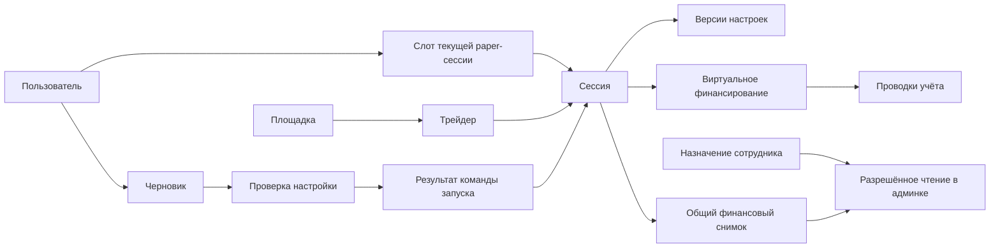

# Логическая схема данных первого сценария

27.10.2026 · Часть [проекта T0](README.md). **Предложение структуры, не SQL, не миграция и не реализованная БД.** Принятая основа — [ADR-0062](../../decisions/0062_paper_first_modular_backend_and_first_slice.md); денежная семантика — ADR-0048/0051/0055–0059.

## 1. Как связаны основные объекты

Один человек имеет аккаунт; черновик хранит ещё не запущенную настройку. Запуск создаёт paper-сессию с первой версией настроек и единственным начальным финансированием. Клиент и админка читают её общий финансовый снимок. Доступ сотрудника — отдельное назначение, а не право любого вошедшего пользователя.

Стрелки показывают отношения, не порядок сетевых запросов. Служебные auth/audit/outbox записи раскрыты в таблице. Обозначения не задают окончательные имена таблиц.

## 2. Сущности и ограничения

Для каждого ресурса — непрозрачный ID, серверные даты и область окружения; для изменяемого ресурса — version. Внешний ID всегда вместе с venue и источником/окружением. Язык — параметр представления, не часть финансового ключа.

| Сущность | Основные поля и связи | Ограничение / смысл |
| --- | --- | --- |
| User | id, status, locale; ссылка на подтверждённый email identity | Один подтверждённый identity связывается с одним user. Создание конкурентными verify не размножает пользователя; canonicalization email определить до реализации, без произвольного удаления точек/суффиксов |
| AuthIdentity | provider, subject, verifiedEmail, userId; отдельное пространство staff identity | Уникальный provider+subject+realm; email не принимается из браузера как доказанная личность. Секреты провайдера вне прикладных таблиц |
| AuthChallenge / AuthSession | challengeId, purpose, expiry, usedAt, attempts; sessionId, principalId, expiresAt, revokedAt | Если challenge ведёт провайдер, не дублировать его проверку локально. Однократное потребление; только digest/защищённые ссылки на токены, без plaintext-кода или bearer в журналах. Новый вход не равен новой paper-сессии |
| StaffPrincipal / Assignment | principalId, existing role/preset ref, scope, validity, status, authorizationVersion | Отдельно от User. Административный просмотр требует актуального разрешения на конкретного пользователя/сессию; владелец определяется действующим назначением, не переданным role |
| Venue / Trader | venueId, sourceEnvironment, externalTraderId, sourceRef, catalogRevision, eligibility, observedAt | Уникальность venue+sourceEnvironment+externalTraderId. Один и тот же адрес на разных площадках не один объект. Eligibility для тестового сценария не активирует профиль рынка |
| PolicyVersion | id, immutable payload/ref/hash, publication status; отдельно active pointer | Для чисел — `paper-mvp-settings-v1`; системные ограничения и источник их значений отдельно. Неопубликованный/устаревший policy нельзя выдать за действующий |
| SetupDraft | id, ownerUserId **или** guestContextDigest, version, locale, entryContext, step, venueId, traderId, selectedMode, введённые fixed/percent, B/p/d, proposedTimezone, expiresAt | До входа не UserSession. Сохраняет неактивный ввод для возврата в форму, но в effective settings входит только выбранный mode. Трейдер, язык и шаг сохраняются; секретов нет |
| SetupReview | id, draftId/version, authenticated owner или guest context, normalized selected values, policy/catalog/control versions, expectedSlotGeneration, warnings, expiresAt | Неизменяемая запись того, что показывали перед подтверждением. Guest review нельзя использовать для запуска после входа без новой привязки и проверки. Не гарантирует будущий допуск |
| UserSessionSlot | userId, environment, mode=paper, generation, currentSessionId nullable | Unique(userId, environment, mode), **не** по площадке. Один пользователь не получает вторую сессию через другую venue. Одна строка блокируется на время запуска; generation защищает от старого review после освобождения слота |
| PaperSession | id, userId, venueId, traderId, environment, dataOrigin, lifecycle, controlState, startedAt, IanaTimezone, currentSettingsRevisionId, version | Первый успешный запуск — активная сессия с пустым содержимым. EMPTY — наполненность, не разрешение live. dataOrigin различает test fixture и подтверждённый источник; fixture не маскируется как реальные данные |
| SettingsRevision | id, sessionId, sequence, previousRevisionId, B, sizingMode, selected F **или** q, p/d, effective P/D, policy/calculation refs, commandId, actor, createdAt | Полный неизменяемый snapshot; unique(sessionId, sequence). Первая sequence=1. Для fixed — валидный F, для percent — валидный q, не два действующих способа сразу; возраст сигнала 30 с из принятой политики |
| FundingFlow | id, sessionId, kind=initial_paper_funding, amount, asset=virtual_USD, commandId, journalId | Одна initial-flow на sessionId. Это виртуальное финансирование, не прибыль, не движение кошелька. Последующие ΔB — другой тип/этап |
| Journal / JournalEntry | journalId, sessionId, commandId, type, entries с account/ref, amount, unit, evidenceRef | Для старта пара уравновешенных записей: paper cash и источник virtual funding. Проводки не редактируются; коррекция отдельной записью. Баланс суммы проводок по unit=0. Нельзя второй раз прибавлять FundingFlow поверх ledger |
| CommandReceipt | receiptId, clientCommandId, actor scope, commandType, keyDigest, requestHash, outcome, resultResourceId/version, createdAt | Unique(environment, actor, commandType, keyDigest). Один key+один payload возвращает тот же итог; тот же key+другой payload — конфликт. Чужой receipt недоступен |
| SessionSnapshot | sessionId, version, settingsRevisionId, ledgerSequence, asOf, lifecycle, coverage/dataOrigin, amounts, counts | Общая финансовая проекция из одного согласованного состояния, unique(sessionId, version). Стартовый snapshot фиксируется вместе с запуском. Админка добавляет только разрешённые поля, не отдельные суммы |
| AuditEvent / OutboxEvent | immutable eventId, actor, resource/version, commandId, occurredAt, safe payload; outbox delivery state | Audit и событие session-start — часть той же транзакции. Повторная доставка outbox не создаёт новую сессию/финансирование. Нет email-кодов, cookies и секретов в payload |

Поле session user/venue scope проверяется составными ссылками: нельзя сослаться на settings/journal/snapshot другой сессии или Trader другой venue. Текущая settings revision принадлежит той же сессии. `currentSessionId` принадлежит владельцу слота и той же среде/mode. Кольцевые ссылки session↔revision/slot заполняются внутри транзакции с подходящим порядком/отложенной проверкой, не промежуточными публичными записями.

## 3. Деньги, версии и пустое состояние

Предложение физического представления: нормализованная пара целых numerator/denominator на PostgreSQL NUMERIC без дробной части; denominator>0, gcd=1, ноль=0/1. DTO передаёт целые как строки. Это продолжает точную арифметику [ADR-0055](../../decisions/0055_exact_rational_position_attribution.md), не фиксирует без проверки предельную длину/производительность. Переполнение отклоняется, не округляется. Проценты формы можно хранить целыми базисными пунктами: q=3% → 300; денежные величины и доли не IEEE float. Округление интерфейса не меняет сравнение лимитов.

Контрольный пример запуска: B=200 USD, fixed F=20 **либо** percent q=3%, p=10%, d=15%; P=20, D=30. Snapshot: free=200, reserved=0, positionCost=0, positionValue=0, equity=200, число сделок/позиций/ордеров=0. Результат торговли нулевой, достаточности данных для рейтинга нет. В альтернативном тесте B=300 принимается как выбранный валидный бюджет, а не молча заменяется на preset200. Источники цены при пустых позициях не нужны для их нулевой стоимости; это не разрешает считать неизвестную цену ненулевых позиций нулём.

Служебные funding/audit/outbox записи не являются скопированными действиями трейдера и не наполняют пустую торговую историю. Начальное финансирование само по себе не ставит отметку «Баланс изменён» для последующего ΔB. Методы расчёта доходности после пополнений здесь не выбираются.

## 4. Неделимая транзакция запуска

До неё сервер проверяет вход, request shape, ownership review и числовые параметры. Внешняя почта и API площадок внутри транзакции не вызываются.

1. Захватить уникальный ключ команды. Уже завершённый ключ с тем же requestHash возвращает receipt после текущей проверки доступа; другой payload отклоняется. Конкурирующий одинаковый ключ ждёт commit либо получает проверяемый статус ожидания, но не запускает вторую транзакцию исполнения.
2. Создать при отсутствии слот через уникальное ограничение и заблокировать его строку. Проверить generation/current session и **все** препятствия ADR-0051. STOPPED не означает разрешённое освобождение слота. До реализации финала слот остаётся занят; тесты с историческими препятствиями задаются изолированно.
3. Прочитать/зафиксировать версии draft/review, identity status, действующих политик, каталога и разрешений на запуск. Их изменение сериализуется с записью запуска через блокировку соответствующего pointer/control ресурса либо эквивалентную проверенную транзакционную схему. Просто проверить версии до BEGIN недостаточно. Отозванный доступ/изменённый trader/policy не замещается молча.
4. Если проверка изменилась — сохранить согласованный отказ receipt без денежных/сессионных записей. Если всё подходит — создать session, revision1, initial FundingFlow, уравновешенный Journal, общий snapshot1, slot pointer/generation, audit/outbox и успешный receipt.
5. Commit публикует **всё** или ничего. Только после него клиент получает sessionId/snapshot. Ошибка до commit не оставляет бюджета без сессии. После неизвестного ответа клиент ищет receipt/повторяет тот же ключ, не новый.

Предлагаемая стратегия PostgreSQL: короткая транзакция, уникальные ключи + явные блокировки в общем порядке. Точный isolation/lock order/retry budget фиксируется перед реализацией и проверяется гонками; backend не обещает безопасность одним словом SERIALIZABLE. При serialization/deadlock повтор сохраняет исходное намерение/ключ; внешние side effects не повторяются.

Отказ с новым ключом при занятом слоте возвращает ссылку на **свою** текущую сессию; старый successful receipt возвращает исходную сессию даже при изменившейся политике, но требует заново проверенного права чтения. Внутренний сбой без commit не является долговечным бизнес-отказом.

## 5. Черновик, административное чтение и границы

Предложение черновика: server-side запись с непрозрачным guest handle в защищённой cookie, затем перенос владельца только через подтверждённое продолжение авторизации. Переданный draftId не доказательство владения; нельзя присвоить чужой черновик знанием ID. Межустройственное восстановление не обещается до фактического связывания; login link не публикует email/черновик в URL. TTL/согласия/очистка требуют решения до реализации.

Истечение draft/review/auth не удаляет session/funding/audit. Retention receipt и command dedup проектируется вместе с финансовой историей: удаление тяжёлого ответа не должно позволить заново исполнить старый ключ (нужен сохраняемый dedup/tombstone). Удаление персональных данных и сроки — отдельное решение до реализации, без обещания бесконечного хранения email.

Чтение клиента и сотрудника использует одинаковый builder финансовой проекции и согласованный DB snapshot. Каждое чтение отдельно проверяет текущую identity/assignment/status/scope. Если обновления асинхронны, версия обязательна: нельзя склеить free старой версии с новым reserve или сравнить разные версии как расхождение. Стартовая проекция не зависит от прихода фонового события. Кэш не обходит отзыв прав; staff-доступ фиксируется в журнале без лишних персональных полей.

В T3–T7 добавляются signal/decision, intent/order/fill, positionPart, reservation, reconciliationCase, reportVersion и прочие сущности из 139. Они не создаются пустыми «на всякий случай» в первом срезе. Их отсутствие закрывает торговые команды; не разрешает сброс с незавершёнными обязательствами.

Миграции первого среза будут отдельным review вместе с API: разворот на чистой test-БД, уникальные/FK/check constraints, минимальные индексы по ownership/slot/receipt, план совместимого расширения и восстановление backup. Применение к общей/production БД, SQL-файлы и физический ERD этим документом не выполнялись.
