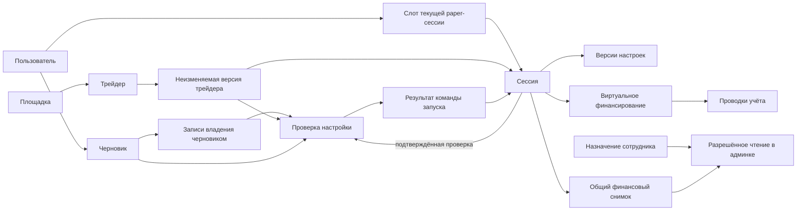

# Логическая схема данных первого сценария

29.10.2026 · **Физическая детализация этой логической модели согласована целиком.** [Четыре блока](database-physical-design.md) и [сводная передача](database-backend-handoff.md) фиксируют колонки/связи/ограничения и оставшиеся инженерные зависимости H01–H06; [ADR-0064 §33](../../decisions/0064_first_session_database_contract.md). Исторические упоминания ещё не выбранной физической формы ниже читаются вместе с этим пакетом. Логический смысл сохранён; код, SQL и миграции пока не начинать.

28.10.2026 · **Логическая модель первого сценария согласована целиком**, [ADR-0064 §29](../../decisions/0064_first_session_database_contract.md), [итог](database-final-review.md). Все четыре завершающих блока приняты. Упомянутая ниже физическая/машинная детализация остаётся инженерной работой внутри общего контракта; она не разрешает менять принятый смысл. Код, SQL и миграции пока не начинать.

28.10.2026 · Часть [проекта T0](README.md). **Логические решения приняты в [ADR-0064](../../decisions/0064_first_session_database_contract.md); базовые физические типы уточнены в разделе 8; окончательные имена/пределы и механизмы проверок ещё проектируются. Не SQL, не миграция и не реализованная БД.** Принятая основа — ADR-0062; денежная семантика — ADR-0048/0051/0055–0059. Baseline обсуждения: main `f2d8a6b9f3107105a8dfe4fac1cb1c7bdddd11b5`.

Для первого полигона принята одна PostgreSQL БД с отдельными схемами Auth/Shadow и служебными ролями с минимальными правами. Совместимость конкретного Supabase ещё проверить. Собственные user/session IDs не заменяются provider subject; удаление записи Auth не удаляет историю приложения каскадно.

## 1. Как связаны основные объекты

Один человек имеет аккаунт; черновик хранит ещё не запущенную настройку. Запуск создаёт paper-сессию с первой версией настроек и единственным начальным финансированием. Клиент и админка читают её общий финансовый снимок. Доступ сотрудника — отдельное назначение, а не право любого вошедшего пользователя.

Стрелки показывают отношения, не порядок сетевых запросов. Служебные auth/audit/outbox записи раскрыты в таблице. Обозначения не задают окончательные имена таблиц.

## 2. Сущности и ограничения

Собственные ID ресурсов и команд — UUID v4: ресурсы создаёт сервер, command ID — клиент до отправки. У ресурса есть серверные даты и область окружения; у изменяемого — version. Внешний ID всегда вместе с venue и источником/окружением. Язык — параметр представления, не часть финансового ключа.

| Сущность | Основные поля и связи | Ограничение / смысл |
| --- | --- | --- |
| User | id, status, locale; ссылка на подтверждённый email identity | Один подтверждённый identity связывается с одним user. Создание конкурентными verify не размножает пользователя; нормализация email по принятой auth-policy (регистр незначим, trim краёв, точки/+ не удаляются), без автоматического слияния аккаунтов |
| AuthIdentity | provider, subject, verifiedEmail, userId; отдельное пространство staff identity | Уникальный environment+provider+subject+realm; отдельная привязка к постоянному аккаунту Shadow, удаление Auth не удаляет его историю; email не принимается из браузера как доказанная личность. Секреты провайдера вне прикладных таблиц |
| AuthChallenge | challengeId, purpose, expiry, usedAt, attempts | Если challenge ведёт провайдер, не дублировать его проверку локально. Однократное потребление; только digest/защищённые ссылки, без plaintext-кода или bearer в журналах |
| AuthSession | loginId, principalId/realm, loginPolicyVersionId, effective maxLifetime/inactivity, authenticatedAt, lastUserActivityAt, expiresAt, revokedAt/reason | Отдельная запись каждого входа с закреплённой политикой. Refresh не новый вход. Пользовательские устройства независимы; это не PaperSession |
| StaffLoginSlot | staffPrincipalId, environment, currentLoginId | Предлагаемое физическое выражение принятого одного рабочего входа. После passkey и проверки назначения новый login, отзыв старого и pointer сохраняются атомарно. Назначения не размножают слоты |
| LoginPolicyVersion | id, realm, immutable limits, publication reference; active pointer отдельно | Политика входа отделена от денежных настроек; обычная публикация не меняет старые login |
| StaffPrincipal / Assignment | principalId, existing role/preset ref, scope, validity, status, authorizationVersion | Отдельно от User. Административный просмотр требует актуального разрешения на конкретного пользователя/сессию; владелец определяется действующим назначением, не переданным role |
| Venue / Trader | venueId, sourceEnvironment, externalTraderId, currentRevisionId, current eligibility/control version | Уникальность venue+sourceEnvironment+externalTraderId. Один и тот же адрес на разных площадках не один объект. Eligibility для тестового сценария не активирует профиль рынка |
| TraderRevision | id, traderId, venueId/sourceEnvironment, displayedName, dataOrigin/sourceRef, catalogRevision, observedAt | Неизменяемые использованные сведения. Review/session ссылаются на конкретную revision того же Trader/venue/source; текущая доступность проверяется отдельно, полная статистика не дублируется |
| PolicyVersion | id, immutable typed parameters/ref/hash, safe context, publication status; отдельно active pointer | Для чисел — `paper-mvp-settings-v1`; системные ограничения и источник их значений отдельно. Неопубликованный/устаревший policy нельзя выдать за действующий |
| DraftOwnership | id, draftId, ownerKind, ownerUserId либо guestContextDigest/reference, previousOwnershipId, createdAt, claim reference | Неизменяемое доказательство guest/account владения. Guest secret не хранится. Review ссылается на историческую запись; доступ разрешает только действующая запись Draft |
| SetupDraft | id, currentOwnershipId, version, locale, entryContext, step, venueId, traderId, selectedMode, введённые fixed/percent, B/p/d, proposedTimezone, expiresAt | Несколько независимых draft на user допустимы. Начальная version=1, успешное изменение +1; чтение/точный повтор/те же данные не повышают её, неудачное сохранение тоже. Только актуальный ввод/version, без полной истории правок; usedAt/usedBySessionId фиксируют использование при старте; после успешного start ввод закрыт для изменений и сохраняется для разрешённого просмотра. До входа не UserSession. Сохраняет неактивный ввод для возврата в форму, но в effective settings входит только выбранный mode. Трейдер, язык и шаг сохраняются; секретов нет |
| SetupReview | id, recordSchemaVersion, draftId/version, ownershipId, traderRevisionId, normalized selected values, policy/catalog/control versions, expectedSlotGeneration, warnings, expiresAt | Неизменяемая собственная копия того, что показывали перед подтверждением, со временем проверки и сроком 10 минут. draftVersion — зафиксированный номер, не FK к изменяемому текущему номеру draft. Guest review нельзя использовать для запуска после входа без новой привязки и проверки. Не гарантирует будущий допуск |
| UserSessionSlot | userId, environment, mode=paper, generation, currentSessionId nullable | Unique(userId, environment, mode), **не** по площадке. Один пользователь не получает вторую сессию через другую venue. Одна строка блокируется на время запуска; generation защищает от старого review после освобождения слота |
| PaperSession | id, startedFromDraftId, startedFromReviewId, userId, venueId, traderId, traderRevisionId, environment, dataOrigin, lifecycle, controlState, startedAt, evaluationDeadlineAt, deadlineCalculationVersion, IanaTimezone, currentSettingsRevisionId, currentSnapshotVersion, version | Первый успешный запуск — активная сессия с пустым содержимым; обязательные startedFromDraftId/startedFromReviewId фиксируются при start и неизменны; каждая ссылка уникальна в своей environment-области по всей истории. EMPTY — наполненность, не разрешение live. dataOrigin различает test fixture и подтверждённый источник; fixture не маскируется как реальные данные |
| SettingsRevision | id, recordSchemaVersion, sessionId, sequence, previousRevisionId, B, sizingMode, selected F **или** q, p/d, effective P/D, policy/calculation refs, commandId, actor, createdAt | Полный неизменяемый snapshot; unique(sessionId, sequence). Первая sequence=1. Для fixed — валидный F, для percent — валидный q, не два действующих способа сразу; возраст сигнала 30 с из принятой политики |
| FundingFlow | id, sessionId, kind=initial_paper_funding, amount, asset=virtual_USD, commandId, journalId | Одна initial-flow на sessionId. Это виртуальное финансирование, не прибыль, не движение кошелька. Последующие ΔB — другой тип/этап |
| Journal / JournalEntry | journalId, sessionId, commandId, type, entries с account/ref, amount, unit, evidenceRef | Для старта пара уравновешенных записей: paper cash и источник virtual funding. Проводки не редактируются; коррекция отдельной записью. Источник денежных сумм. Перед commit база проверяет точный баланс по unit=0, обязательные связи и одну initial-flow; начальный journal имеет одну единицу virtual_USD. Межстрочный баланс нельзя обеспечить одним CHECK отдельной строки, конкретный механизм ещё выбрать. Нельзя второй раз прибавлять FundingFlow поверх ledger |
| CommandReceipt | receiptId, recordSchemaVersion, clientCommandId, actor scope, commandType, requestHash, outcome, reasonCode/safeReasonData для отказа, resultResourceId/version, createdAt; подробный ответ отдельно от обязательного ядра | Unique(environment, actorRealm, постоянный actorId, commandType, clientCommandId), не loginId. Ключ создаётся до отправки; хранится успешный результат либо окончательный бизнес-отказ. Один key+один payload возвращает тот же итог; тот же key+другой payload — конфликт. Чужой receipt недоступен. При будущем разрешённом удалении подробностей обязательное ядро сохраняет key/fingerprint/outcome/result ID; старый ключ не исполняется снова |
| SessionSnapshot | sessionId, recordSchemaVersion, version, settingsRevisionId, ledgerSequence, asOf, createdAt, lifecycle, coverage/dataOrigin, amounts, counts | Неизменяемая общая финансовая проекция из одного согласованного состояния, unique(sessionId, version). AsOf — время данных, createdAt — время создания записи; чтение не заменяет первое вторым. Стартовый snapshot фиксируется вместе с запуском. Обычный просмотр сохраняет version/asOf; новый снимок — при изменении входящих в него данных/состояния. Админка добавляет только разрешённые поля, не отдельные суммы |
| AuditEvent | immutable eventId, actor, resource/version, commandId, occurredAt, safe result/payload | Неизменяемый факт/результат действия; start audit внутри транзакции запуска. Для Q06 запись разрешённой выдачи (staff/assignment, session/snapshot, time/requestId) сохраняется до ответа; сбой журнала закрывает выдачу. Нет email-кодов, cookies и секретов |
| OutboxEvent | persistent eventId, resource/version, commandId, safe payload, delivery state | Отдельная сущность с изменяемым состоянием доставки. Запись start внутри той же транзакции; повтор распознаётся consumer по eventId. Не выполняет повторный start/funding; состояние обработки потребителя и ConsumerEventReceipt определены в разделе 23 |
| ConsumerEventReceipt | environment, consumerName, eventId, result reference, processedAt | Уникальная отметка обработки; локальный эффект и receipt одной транзакцией. Повтор не повторяет эффект; очистка не уничтожает защиту до прекращения возможности доставки этого eventId |

Поле session user/venue scope проверяется составными ссылками: нельзя сослаться на settings/journal/snapshot другой сессии или Trader другой venue. Текущая settings revision принадлежит той же сессии. `currentSessionId` принадлежит владельцу слота и той же среде/mode. Кольцевые ссылки session↔revision/slot заполняются внутри транзакции с подходящим порядком/отложенной проверкой, не промежуточными публичными записями.

Для login-состояния сохраняются версия политики входа и эффективные maxLifetime/inactivity, выбранные при полном входе. Это принятая область изменения сроков по ADR-0063: обычная новая политика не переписывает старые входы, refresh не новый вход. Пространство login-policy не смешивается с `paper-mvp-settings-v1`/настройками денег; точная физическая сущность/связь ещё проектируется. Срок доступности draft 7 дней после последнего сохранения изменений [принят](auth-policy.md#8-незавершённая-настройка-демо-принято); повторное чтение не продлевает expiresAt, session/settings/ledger и command dedup от этого TTL не удаляются.

## 3. Деньги, версии и пустое состояние

Принятое представление денег/внутренних долей: нормализованная пара целых numerator/denominator; denominator>0, gcd=1, ноль=0/1. DTO передаёт целые как строки. Это продолжает точную арифметику [ADR-0055](../../decisions/0055_exact_rational_position_attribution.md), не фиксирует без проверки предельную длину/производительность. Переполнение отклоняется, не округляется. Проценты формы хранятся целыми сотыми процентного пункта: q=3% → 300, 3,5% → 350; расчёт через /10000 точно. Допустимый диапазон/шаг по ADR-0058 проверяется отдельно; денежные величины и доли не IEEE float. Округление интерфейса не меняет сравнение лимитов. Для n/d принят numeric без объявленного scale с проверкой конечных целых. Numeric(p,0) не подходит как замена валидации: он может округлить ввод до проверки. Для первого пустого демо принят предел 64 цифры на каждый n/d (ADR-0064, раздел 26); производительность и будущие торговые расчёты ещё требуют проверки. Формат хранения процентов не меняет молча единицы API: decimal-строки формы и внутренние целые имеют явное точное преобразование; имена/версия DTO ещё совместно проектируются.

Контрольный пример запуска: B=200 USD, fixed F=20 **либо** percent q=3%, p=10%, d=15%; P=20, D=30. Snapshot: free=200, reserved=0, positionCost=0, positionValue=0, equity=200, число сделок/позиций/ордеров=0. Результат торговли нулевой, достаточности данных для рейтинга нет. В альтернативном тесте B=300 принимается как выбранный валидный бюджет, а не молча заменяется на preset200. Источники цены при пустых позициях не нужны для их нулевой стоимости; это не разрешает считать неизвестную цену ненулевых позиций нулём.

Служебные funding/audit/outbox записи не являются скопированными действиями трейдера и не наполняют пустую торговую историю. Начальное финансирование само по себе не ставит отметку «Баланс изменён» для последующего ΔB. Методы расчёта доходности после пополнений здесь не выбираются.

## 4. Неделимая транзакция запуска

До транзакции выполняются предварительные проверки входа, формы запроса и идентификаторов; они не заменяют проверки внутри. Внешняя почта и API площадок внутри транзакции не вызываются. Приняты Serializable и общий порядок ресурсов из раздела 22.

1. Определить необходимые ресурсы по запросу/review. Для нового исполнения защитить действующие policy/catalog/trader controls, затем текущую identity/login/authorization в общем порядке. Проверить доступ внутри транзакции. Для возврата ранее завершённого receipt достаточно ресурсов актуального доступа и исходного ключа: новые торговые правила не переоценивают старый результат.
2. Захватить уникальный составной ключ команды. Завершённый ключ с тем же requestHash возвращает receipt после текущей проверки доступа; другой payload — конфликт. Захват должен защищать и отсутствие receipt: блокировка несуществующей строки сама по себе этого не делает. Конкурентное исполнение не получает второго права на запись результата.
3. Создать при отсутствии слот через уникальное ограничение и заблокировать его строку, затем draft; сравнить ownership/version/used state, review и generation/current session, все препятствия ADR-0051. STOPPED не освобождает слот. Проверить, что защищены именно controls использованного review; изменившиеся ссылки не подменяются молча.
4. После ожидания блокировок непосредственно перед созданием сессии заново проверить сроки draft/review/login по текущему серверному времени. Подтверждённый бизнес-отказ фиксируется receipt со стабильной причиной без запуска. При допуске создать session с startedFromDraftId/startedFromReviewId, revision1, initial FundingFlow, сбалансированный Journal, snapshot1 и currentSnapshotVersion=1, slot pointer/generation, отметку использованного draft, отдельные audit/outbox и successful receipt.
5. Проверить обязательную полноту и отложенные связи/баланс. Commit публикует всё или ничего; ответ с sessionId/snapshot только после него. После неизвестного ответа используется исходный ключ, не новый.

Принятая стратегия PostgreSQL: короткая Serializable-транзакция, уникальные ключи и явные блокировки. Для C06 не более трёх автоматических попыток, включая первую, только при подтверждённом serialization/deadlock rollback; полный повтор проверок с теми же key/payload. Общий бюджет 5 секунд, паузы 50–150 мс и монотонный таймер остаются прежними (ADR-0064, разделы 17–18). Бизнес-отказ не повторяется автоматически; unknown commit сначала выясняется. Ошибки ограничений не объявляются автоматически serialization/deadlock. После отката конфликта уникальности результат исходного ключа проверяется в свежей транзакции, без произвольного расширения перечня автоматических повторов. Реализацию таймеров/блокировок ещё проверить управляемыми гонками.

Отказ с новым ключом при занятом слоте возвращает ссылку на **свою** текущую сессию; старый successful receipt возвращает исходную сессию даже при изменившейся политике, но требует заново проверенного права чтения. Внутренний сбой без commit не является долговечным бизнес-отказом.

## 5. Черновик, административное чтение и границы

Принятое хранение черновика: server-side запись с непрозрачным guest handle в защищённой cookie, затем однократный claim через полный подтверждённый вход и доказательство владения. Атомарно создаётся новая DraftOwnership аккаунта, переключается currentOwnershipId, закрывается доступ прежнего guest handle и сохраняется факт передачи. Историческая guest-запись остаётся неизменяемой. Повтор тем же аккаунтом возвращает прежний результат; присвоение другим аккаунтом запрещено. Переданный draftId не доказательство владения; нельзя присвоить чужой черновик знанием ID. Межустройственное восстановление не обещается до фактического связывания; login link не публикует email/черновик в URL. При нескольких draft продолжать тот, из которого начат вход, без слияния; запуск отмечает использованным только свой draft. TTL уже принят; точный протокол claim и очистка ещё проектируются.

Истечение draft/review/auth не удаляет session/funding/audit. Retention receipt и command dedup проектируется вместе с финансовой историей: удаление тяжёлого ответа не должно позволить заново исполнить старый ключ (нужен сохраняемый dedup/tombstone). Для синтетического полигона 28.10.2026 принято [хранение истории/receipt до отдельной плановой очистки](README.md#история-тестового-полигона-принято), без автоматического удаления в период тестирования и с проверенной копией перед очисткой. По ADR-0064 истёкшие draft/review синтетического полигона тоже сохраняются до плановой очистки, но уже недоступны для продолжения/запуска. Физический cleanup не должен удалять настройки сессий, финансовую историю и защиту от повторного исполнения. Это не отменяет dedup и не разрешает удалять незавершённые обязательства; обычный reset сессии историю не стирает. Удаление реальных персональных данных и сроки рабочего сервиса — отдельное решение до реализации соответствующей части, без обещания бесконечного хранения email.

Чтение клиента и сотрудника использует одинаковый builder финансовой проекции и согласованный DB snapshot. Каждое чтение отдельно проверяет текущую identity/assignment/status/scope. Если обновления асинхронны, версия обязательна: нельзя склеить free старой версии с новым reserve или сравнить разные версии как расхождение. Стартовая проекция не зависит от прихода фонового события. Кэш не обходит отзыв прав. Для Q06 проверка актуального назначения, выбор целого снимка и запись события «Данные разрешены к выдаче» согласованы; ответ только после сохранения события. Если запись журнала не удалась, защищённые данные не выдаются. Событие не доказывает доставку ответа или просмотр человеком; лишних персональных полей нет.

В T3–T7 добавляются signal/decision, intent/order/fill, positionPart, reservation, reconciliationCase, reportVersion и прочие сущности из 139. Они не создаются пустыми «на всякий случай» в первом срезе. Их отсутствие закрывает торговые команды; не разрешает сброс с незавершёнными обязательствами.

Миграции первого среза будут отдельным review вместе с API: разворот на чистой test-БД, уникальные/FK/check constraints, минимальные индексы по ownership/slot/receipt, план совместимого расширения и восстановление backup. Применение к общей/production БД, SQL-файлы и физический ERD этим документом не выполнялись.

## 6. Кардинальности и границы проверок

Названия остаются логическими. FK/unique/check ниже — требования будущей физической схемы, не выполненные ограничения.

| Связь | Кардинальность / проверка |
| --- | --- |
| User → AuthIdentity / AuthSession | Свои привязки / несколько login; каждая identity ведёт ровно к одному User, staff realm отдельно |
| StaffPrincipal → Assignment / AuthSession | Несколько назначений допустимы по v1; один действующий рабочий login, отдельный от user login |
| User → DraftOwnership → SetupDraft → SetupReview | Несколько независимых draft; история владения отдельно от актуального ввода; несколько неизменяемых review со своими значениями/draftVersion/ownershipId |
| Venue + sourceEnvironment → Trader → TraderRevision | Внешний trader ID уникален только в своей площадке/источнике; несколько неизменяемых revisions, review/session ссылаются на использованную |
| User → UserSessionSlot → PaperSession | Один слот на user/environment/paper; 0 или 1 current session, история сессий отдельно |
| SetupDraft → PaperSession | 0 или 1 сессия по всей сохранённой истории; session.startedFromDraftId обязателен, неизменен и уникален в своей environment-области; usedBySessionId указывает на эту же сессию |
| SetupReview → PaperSession | 0 или 1 сессия по всей сохранённой истории; session.startedFromReviewId обязателен, неизменен и уникален в своей environment-области; review принадлежит startedFromDraftId, согласованы owner/environment и использованные параметры/версии |
| PaperSession → SettingsRevision / SessionSnapshot | Неизменяемые версии с уникальными sequence/version; currentSettingsRevisionId и обязательный currentSnapshotVersion указывают на записи той же сессии. Snapshot выбирается по (sessionId, currentSnapshotVersion); ссылка не движется назад |
| PaperSession → initial FundingFlow → Journal → JournalEntry | Ровно один initial flow после успешного старта; одна связанная начальная операция учёта с двумя сбалансированными entries |
| Actor → CommandReceipt | Много команд; одна окончательная запись результата на составной ключ, не на login |
| Start command → AuditEvent / OutboxEvent | Отдельные записи одного запуска; outbox consumer не повторяет денежную часть |

Ownership/environment и составные ссылки проверяются самой БД дополнительно к API. Review хранит историческую draftVersion как значение; ссылка на draftId не требует хранения каждого прежнего draft. При старте текущий version сравнивается с проверенным. Guest claim не меняет прежний guest review: после входа создаётся новый review владельца. Неизменяемый старый guest review связан с прежней DraftOwnership, а не с текущим изменяемым владельцем. Составные связи Review → (draftId, ownershipId) и Draft → (id, currentOwnershipId) должны указывать на записи того же draft/environment. Историческая связь не даёт текущего доступа; атомарность claim и общий порядок блокировок приняты в разделе 22; физические ограничения проверяются до реализации.

Для login → policy, session → revision и current pointers требуются ссылки на ресурсы того же realm/scope; составные ключи оформляются вместе с API; циклические связи допускают проверку в конце транзакции по разделу 22. Прикладная принадлежность не заменяет отзыв/проверку актуальных прав.

## 7. Открытая физическая детализация и минимальный план проверки

- До реализации: проверка числовых пределов для последующих торговых этапов, детализация ограничений остальных запросов, точные DTO и полные спецификации общего реестра форматов (лимит поля 16 КиБ, тела C06 64 КиБ и глубины C06 8 уровней приняты ниже), разрешённые состояния/переходы, исполнение claim guest draft и неоднозначный исход Auth. Базовые типы приняты ниже. Числовые пределы не угадываются и не округляются при превышении.
- Принят минимальный индекс-план: ключи/уникальность slot, receipt, settings/snapshot versions, identity, trader, initial funding и источников session.startedFromDraftId/startedFromReviewId по всей истории. Дополнительные индексы под FK и чтения Q03–Q06 — по конкретному запросу и его проверенному плану; их набор не объявляется выбранным заранее.
- Приняты Serializable, общий lock order и проверки полноты/межстрочного journal balance до commit (раздел 22). Физические ограничения и права записи ещё реализовать и проверить; isolation не заменяет доказательство сценариев гонок.
- Для receipt после отката нет долговечного успеха/отказа; после неопределённого commit читать исходный key. Для outbox принят протокол раздела 23; он не обещает exactly-once внешнего эффекта.
- Миграции только вместе с использующим API: совместимое расширение, затем код/backfill при необходимости, удаление старого после проверки. Здесь только порядок обсуждения, без SQL и применения.
- Restore в изолированной среде сверяет Auth/Shadow, назначения/отзыв login, slot/session/settings, journal/funding/snapshot и receipt/outbox. Барьер сверки принят в разделе 23; его реализация и проверка ещё не выполнены.
- История синтетического полигона, включая expired draft/review, сохраняется до отдельной очистки. План очистки обязан сохранить доказательства и dedup: удаление тяжёлого payload не должно оживить старый ключ. Принято сохраняемое компактное ядро команды: scope/key/fingerprint/outcome/result ID. Размещение ядра в receipt либо отдельной физической таблице, архив/очистка и граница новой среды ещё проектируются.

Общая проверка: [A01–A66](acceptance.md). Выполнена сверка документов с решениями чата; проверки приложения/БД пока запланированы.

## 8. Принятые базовые типы и форма полей

Дополнение ADR-0064 после PR №136. Это описание будущей схемы, без SQL/миграций; лимиты дополнительного JSON, C04/C06, n/d первого запуска и числового ввода приняты; общий словарь состояний/полей и реализация проверок ещё оформляются.

| Семейство полей | PostgreSQL / API | Обязательная проверка |
| --- | --- | --- |
| Собственные resource IDs и clientCommandId | uuid / стандартная строка UUID v4 | Серверные ID ресурсов; клиентский ID команды до отправки. PK/unique проверяют коллизии; UUID не авторизация. Проверка версии UUID при приёме отдельная |
| Provider subject / externalTraderId | Отдельные поля внешнего ID с provider/venue/source | Формат провайдера сохраняется; уникальность в своей области, не глобально по строке |
| created/started/expires/revoked/asOf/deadline | timestamptz / UTC ISO8601 с Z | Серверные моменты с точностью до миллисекунды в БД/API/интерфейсе; точный round-trip драйвера подлежит проверке. Не считать время часов доказательством порядка вместо version |
| IANA-зона сессии | Отдельное текстовое поле | Проверенная именованная зона; неизменна после start. Timestamptz не хранит исходное имя зоны |
| n/d денежных величин | Два numeric без объявленного scale / строки целых | Оба конечные целые, d>0, gcd=1, zero=0/1. Без округляющего приведения до проверки; допустимый знак n зависит от поля/счёта. Для первого пустого демо максимум 64 цифры на компонент без знака; превышение без округления |
| q/p/d процентов формы | integer / внешняя единица по общему DTO | Сотые процентного пункта, точное /10000; диапазоны/шаги ADR-0058 отдельно |
| version/sequence/generation | bigint / всегда строки целых, включая "1" | Монотонность и границы по ресурсу; при переполнении техническая ошибка без изменения/сброса счётчика |
| status/kind/mode | text с ограниченным набором | Полный перечень состояний и разрешённых переходов ещё уточняется; свободный неизвестный статус не принимается |
| Дополнительный контекст | jsonb + версия формата | Не более 16 384 байт UTF-8 сериализованного JSON на поле; превышение — ошибка без обрезания. Явная структура, безопасные поля, без секретов. Компактное UTF-8 представление по разделу 21; JSON-корректность не заменяет контракт |

Владельцы, ссылки, денежные суммы, настройки, статусы, версии и сроки — типизированные колонки. JSONB допустим для дополнительного контекста предупреждений, объяснений и событий; он не содержит вторую независимо изменяемую копию authoritative денег/владельца. Существующие предложения payload для PolicyVersion/review/snapshot уточняются так: обязательные поля имеют колонки, дополнительный контекст — JSONB. Точный состав колонок каждой policy ещё проектируется.

Обязательные значения заполнены (NOT NULL вместе с проверками, а не один nullable CHECK). NULL имеет определённый смысл: свободный current slot, неотозванный login, невыбранный F/q. Для effective settings ровно один выбранный способ: fixed → F заполнено/q пусто; percent → q заполнено/F пусто. Это не мешает draft сохранять оба исходных ввода для возврата в форму. У созданной сессии обязательные суммы известны и заполнены; EMPTY нули не подменяют unknown. Для отозванного login обязательны revokedAt/reason. Для гостя owner задаётся guest-вариантом DraftOwnership, а не пустым обязательным владельцем.

Входные числовые строки проверяются до приводящих/округляющих преобразований, включая integer/bigint; сохранённое целое не доказывает допустимость исходного ввода. Числовые version/sequence/generation передаются строками при любом размере; сравниваются как целые, не лексикографически.

Принятая граница срока: draft/review/login недействительны при serverNow >= expiresAt, включая точное равенство. Login проверяет абсолютный срок и неактивность по своей закреплённой политике; отзыв независим. Проверка использует серверное время с согласованной точностью, не часы клиента. Истечение не удаляет историю/receipt и не освобождает слот paper-сессии. См. ADR-0064, раздел 9; повторная проверка после ожидания непосредственно перед созданием сессии принята в ADR-0064, раздел 10; функция времени и реализация ещё проектируются.

Принято 28.10.2026: evaluationDeadlineAt вычисляется при start через 14 календарных дней в сохранённой IANA-зоне. Отсутствующее целевое местное время → первый существующий момент после пропуска; повторяющееся → первое вхождение. UTC-результат, зона и deadlineCalculationVersion сохраняются атомарно с сессией; клиент/админка читают одну сохранённую границу, без скрытого перерасчёта уже начатой оценки. См. ADR-0064, раздел 8, и A42; версия библиотеки/базы зон и её проверка ещё не выбраны.

При публикации схемы backend DTO должны соблюдать принятые UUID v4, exact strings, UTC/миллисекунды и всегда строковые числовые версии. Принцип стабильного кода причины и безопасных поясняющих данных принят: перевод RU/EN не является идентификатором результата. Единицы процентов на входе, точные имена/структура DTO и полный словарь причин ещё согласуются. Текущая проверка документов не подтверждает реализацию этих преобразований. Официальные источники типов и даты чтения — в ADR-0064, раздел 7.

Принято в ADR-0064, раздел 11: SetupReview, SettingsRevision, SessionSnapshot и CommandReceipt содержат обязательное отдельное обозначение формата записи. Имя recordSchemaVersion и текстовая метка v1 закреплены в ADR-0064, раздел 26. Это типизированное поле, а не только значение внутри дополнительного JSON, и не счётчик изменений. Формат закреплён при сохранении; исторические записи не получают новый формат молча. Каждому поддерживаемому обозначению должны соответствовать проверенные правила чтения. Ограничение 16 КиБ не разрешает перенос обязательных колонок/неизвестных настроек в JSON.

Принято в ADR-0064, раздел 12: Q04/Q06 не создают snapshot от факта просмотра и не меняют его version/asOf; административный audit ведётся отдельно. Если обязательный снимок найденной доступной сессии отсутствует/повреждён, ответ сообщает временную недоступность данных и фиксируется техническая ошибка. Не подставлять EMPTY/нулевые суммы и не создавать замену автоматически; исходные записи сохраняются для проверки. Отказ от автоматического исправления и барьер восстановления приняты в разделе 23; механизмы обнаружения/ручного исправления ещё реализовать и проверить.

SetupDraft.version=1 при создании; одно успешное изменение данных → +1 в том же сохранении. Чтение, точный повтор команды, сохранение тех же данных и неуспешное сохранение не повышают version. Ранее принятое непродление expiry при чтении/одинаковых данных сохраняется. Принято в ADR-0064, раздел 13: у нового сохранения expectedDraftVersion проверяется до сравнения ввода; устаревший номер конфликтует даже при одинаковых значениях. Строки ввода сравниваются точно: "20" и "20.00" различаются, review нормализует их отдельно. После successful start новые C04 запрещены, даже без изменения значений; used draft остаётся для разрешённого просмотра. Точный повтор прежней команды возвращает receipt без новой записи. Защита доступа/срока обязательна.

## 9. Вычисляемое состояние SetupDraft и связь запуска

Принято в ADR-0064, раздел 14. Это правила будущей модели, не SQL.

| Состояние | Условие для согласованной записи | Значение |
| --- | --- | --- |
| Использованный | Зафиксирована согласованная пара usedAt/usedBySessionId | Приоритет над expiry; новые изменения запрещены, разрешённый просмотр сохраняется |
| Истёкший | Не использован, serverNow >= expiresAt | Продолжение настройки/start недоступны |
| Редактируемый | Не использован, serverNow < expiresAt | Изменения возможны при выполнении правил доступа/версии; валидность настроек и допуск start проверяются отдельно |

Вычисление использует серверное время и сохранённые факты, без отдельного изменяемого флага «истёк» и без ожидания фоновой задачи. usedAt/usedBySessionId должны быть одновременно заполнены либо одновременно отсутствовать; неполная пара означает несогласованность данных, не редактируемость. Получение состояния не повышает draft.version. Точные машинные коды/DTO ещё выбрать.

PaperSession.startedFromReviewId — обязательная неизменяемая ссылка на подтверждённый SetupReview, сохраняемая атомарно со start. Она обеспечивает прямую связь с показанными параметрами/предупреждениями и проверенными версиями; права доступа не обходятся исторической ссылкой. Соответствие review/draft/owner/environment и настройкам старта проверяется вместе с остальными связями. Конкретные составные FK и ограничения ещё проектируются.

## 10. Уникальность источников и защита истории от удаления

Принято в ADR-0064, раздел 15: одна сессия имеет один исходный draft и один подтверждённый review; каждый из этих источников используется максимум одной сессией в своей среде, включая завершённые. Уникальность не является частичным ограничением только для активных сессий. Для выражения инвариантов PaperSession содержит обязательный неизменяемый startedFromDraftId рядом со startedFromReviewId.

БД проверяет согласованность всей цепочки: session.startedFromReviewId → review того же startedFromDraftId/environment/owner; draft.usedBySessionId → та же session. Нельзя скрестить review одного черновика с ID другого ради обхода уникальности. Точные составные FK, уникальные ключи и порядок отложенных проверок ещё выбрать; флаг used/проверка сервера не заменяют эти ограничения.

При существующих ссылках нельзя удалить исходный использованный draft, подтверждённый review или SettingsRevision. Для этих связей запрещены каскадное удаление истории и обнуление обязательной ссылки. Будущая очистка сохраняет согласованность истории по отдельному плану; она не включена в первый сценарий. Команда завершения сессии не снимает уникальность её источников.

## 11. Текущий снимок и время данных

Принято в ADR-0064, раздел 16: PaperSession.currentSnapshotVersion — обязательная ссылка на SessionSnapshot по ключу (sessionId, version), принадлежащий этой же сессии/среде. При start она равна 1. Последующее создание нового снимка и смена ссылки атомарны: сбой не публикует половину операции. Q04/Q06 выбирают снимок по ссылке; поиск максимального asOf/createdAt её не заменяет.

Смена указателя проверяет актуальное значение: больший version той же сессии допустим, тот же — без изменения, меньший отклоняется. Нельзя сослаться на чужой или несуществующий снимок. При гонке проверка и обновление согласуются в одной транзакции; конкретный lock/условное обновление ещё проектируется. Обычный просмотр ничего не меняет. Прежнее правило недоступности при повреждённом/отсутствующем снимке сохраняется.

У SessionSnapshot два обязательных неизменяемых времени: asOf для актуальности данных, createdAt для создания записи. Оба имеют принятую миллисекундную точность; createdAt не используется как замена asOf или как порядок версий. Получение времён в транзакции и отображение в окончательных DTO ещё проверить; технический createdAt не добавляется автоматически в пользовательский интерфейс.

## 12. Бюджет попыток и сохранение неизвестного исхода

Принято в ADR-0064, раздел 17: до трёх автоматических попыток C06 делят общий бюджет 5 секунд с ожиданием БД и случайными паузами 50–150 мс между подтверждёнными откатами из-за конфликтов. Новую попытку после исчерпания времени не начинать. Это ограничение обработки команды; оно не изменяет срок review, draft или сессии.

Истечение времени во время сохранения не доказывает rollback. До выяснения исхода сохраняется прежний ключ; интерфейс сообщает «Уточняем результат запуска». Успешный receipt ведёт к уже созданной сессии, без повторного журнала/funding. Не создавать окончательный бизнес-отказ только из-за таймаута; не добавлять по этому основанию состояние PaperSession. При подтверждённом откате и исчерпанном бюджете — временная недоступность. Механизм выяснения исхода и реализация принятого в ADR-0064, раздел 18, таймера ещё проектируются; это не обещание завершить восстановление за 5 секунд.

## 13. Таймер и ограничения ожидания

Принято в ADR-0064, раздел 18: общий бюджет C06 измеряется монотонным серверным таймером с начала обработки, до ожидания БД. Перевод системных часов и переход к следующей автоматической попытке не сбрасывают отсчёт. Этот таймер не заменяет UTC-поля истории или текущую проверку expiry draft/review/login.

Каждое ожидание БД получает максимум актуальный остаток общего бюджета. После подтверждённого отката из-за конфликта выбранная пауза 50–150 мс, не помещающаяся в остаток, завершает повторы временной недоступностью; сокращать её ради новой попытки не нужно. После состоявшейся паузы бюджет проверяется снова. При неизвестном исходе сохранения действует восстановление по прежнему ключу, а не предположение об откате по истечению таймера. Конкретные средства ограничения/отмены ожидания и проверка поведения драйвера ещё открыты; новых состояний сессии или изменяемых финансовых записей эти правила не добавляют.

## 14. Размер запроса запуска и диагностика превышения

Принято в ADR-0064, раздел 19: тело C06 ограничено 64 КиБ (65 536 байт). Проверяется полный JSON в UTF-8 до разбора, включая имена полей, значения и пробелы. Для первого стенда C06 только несжатый по разделу 20 ADR-0064; условие размера после распаковки относится к возможному отдельному расширению. Равенство лимиту допустимо по размеру; остальные ограничения обязательны. Лимит всего тела не заменяет 16 КиБ на дополнительное JSON-поле и не задаёт пределы других команд.

Превышение отклоняет текущий запрос без обрезания, создания сессии/funding и потери сохранённого черновика. Техническая диагностика содержит только факт, серверное время, идентификатор запроса и безопасную причину, без тела или его фрагментов. Она не изменяет финансовую историю и не отменяет ранее сохранённый receipt; неизвестный результат прежней передачи выясняется по исходному ключу. Место хранения диагностики, точная схема события и реализация ограничений чтения/разбора ещё проектируются.

## 15. Однозначность и вложенность запроса запуска

Принято в ADR-0064, раздел 20: повтор имён полей внутри одного JSON-объекта C06 отклоняется даже при совпадающих значениях. Нельзя выбрать первое/последнее значение или потерять повтор при преобразовании и затем считать вход проверенным. Одноимённые поля разных объектов сами по себе не нарушают это правило.

Глубина контейнеров ограничена 8 уровнями: корневой объект — 1, каждый вложенный объект/массив добавляет 1, скаляр отдельный уровень не добавляет. Глубина 9 отклоняется; ограничение не разрешает неподдерживаемые поля/структуру. Первый стенд принимает только несжатый JSON C06, сжатый запрос получает понятный отказ. Эти проверки не создают session/funding, не меняют сохранённый draft и не стирают прежний receipt. Parser/точные коды и HTTP-ответы ещё выбрать; новые колонки/SQL этим дополнением не создаются.

## 16. Единый реестр форматов записей

Принято в ADR-0064, раздел 21. Этот раздел — общая точка реестра для бэкенда и БД. Каждая запись реестра описывает пару «тип записи + версия формата», обязательные поля и правила чтения. У четырёх типов независимые линии версий. Имя поля — recordSchemaVersion, тип — text; приняты в ADR-0064, раздел 26. Начальные обозначения v1 для всех четырёх типов приняты в ADR-0064, раздел 22; ни один декодер пока не реализован.

Таблица фиксирует уже принятые смысловые требования из основной схемы, не объявляет завершённый перечень физических колонок/DTO. Полные форматы, условия обязательности и допустимые NULL детализируются до реализации; существующие инварианты продолжают действовать.

| Тип записи | Версия формата / статус | Обязательные сведения по принятой модели | Правила чтения |
| --- | --- | --- | --- |
| SetupReview | v1 принято; спецификация в проектировании | Собственный ID и формат; draft/проверенная version/ownership; trader revision, копия выбранных значений, версии правил/каталога/контролей, slot generation, время проверки/expiry | Неизменяемая копия показанного; текущие доступ/сроки/допуск проверяются отдельно, старый guest review не подменяет проверку после claim |
| SettingsRevision | v1 принято; спецификация в проектировании | ID/формат, sessionId/sequence, B и выбранный mode с F либо q, p/d и effective P/D, ссылки правил/расчёта, команда/actor/createdAt | Полная неизменяемая версия своей session; только выбранный способ размера, точные величины, sequence не версия формата |
| SessionSnapshot | v1 принято; спецификация в проектировании | sessionId/формат/version, settingsRevisionId, ledgerSequence, asOf/createdAt, состояние/происхождение/coverage, суммы и счётчики | Целая разрешённая проекция по currentSnapshotVersion; asOf не подменяется временем чтения, клиент и админка используют один снимок |
| CommandReceipt | v1 принято; спецификация в проектировании | receiptId/формат, scope постоянного actor и команды, clientCommandId, requestHash, outcome/createdAt; причина и безопасные данные для отказа, ссылка на созданный результат при успехе | Тот же key/payload возвращает исходный итог после проверки доступа; неизвестный формат не превращает существующую команду в отсутствующую |

Для каждой конкретной версии обязательны согласованные правила чтения; одна метка формата не подтверждает, что сервер умеет её читать. Изменение формата одного типа не повышает версии других. Новые обозначения не переписываются у исторических записей.

Если сервер не поддерживает встретившийся формат, затронутая операция возвращает временную недоступность и фиксирует техническую причину. Исходная запись сохраняется; чтение «как другой версии», подстановка EMPTY/нулей и повторное выполнение команды из-за непрочитанного receipt запрещены. Это не новая бизнес-причина отказа запуска. Точные DTO/HTTP и механизм диагностики ещё определить.

## 17. Развитие формата и чтение сохранённой истории

Принято в ADR-0064, раздел 22: начальные пары SetupReview/v1, SettingsRevision/v1, SessionSnapshot/v1 и CommandReceipt/v1 имеют независимые спецификации. Метка v1 не подменяет числовые version/sequence и их строковую передачу в API.

Изменение состава полей, их смысла или правил чтения требует новой версии только затронутого формата. Редакционная правка описания без изменения контракта не требует новой версии. Старые записи и их обозначения не переписываются автоматически.

Перед обновлением сервера подтверждается, что кандидат умеет читать все форматы, уже присутствующие в сохранённой истории четырёх типов. Если хотя бы один существующий формат не поддержан или совместимость не проверена, обновление не допускается. Проверка на изолированной копии тестовой БД с записью результата принята в ADR-0064, раздел 23. Способ инвентаризации и точный регламент ещё проектируются; реестр с метками v1 сам по себе не подтверждает работоспособность чтения или готовность к развёртыванию.

## 18. Возврат версии сервера и проверочная копия

Принято в ADR-0064, раздел 23: предыдущая версия сервера допускается к возврату только после подтверждённого чтения всех форматов текущей сохранённой истории, в том числе появившихся после обновления. Неподдерживаемый формат блокирует возврат; исходные записи сохраняются.

Возврат программы не запускает автоматическое восстановление старой резервной копии БД. Такое восстановление — отдельная процедура с отдельно согласованными последствиями; новые записи не удаляются ради того, чтобы старый сервер смог прочесть прежний набор данных.

Перед обновлением/возвратом чтение проверяется на изолированной копии базы тестового стенда, результат записывается. Основная база от этой проверки не меняется. Состав и применимость отчёта приняты в ADR-0064, раздел 24; способ создания/изоляции копии, инвентаризация форматов и техническое оформление доказательств ещё проектируются; копии и проверки в текущей задаче не создавались.

## 19. Отчёт проверки совместимости

Принято в ADR-0064, раздел 24. Отчёт содержит собственный ID прогона/отчёта, точную версию проверяемого сервера, версию схемы БД, идентификатор и дату проверочной копии, найденные пары тип/формат и результат чтения каждой. Это логическое описание доказательства проверки; физическое хранилище/таблица и точные имена полей ещё не выбраны.

Каждый прогон создаёт отдельный неизменяемый отчёт. Исправление ошибки в отчёте или проверяемом результате требует нового прогона и нового отчёта, прежний остаётся историей. Если версия сервера, схема БД или набор сохранённых форматов изменились, старый отчёт не является подтверждением для нового сочетания; совместимость проверяется заново. Обновление/возврат не допускается на основании утратившего применимость отчёта.

## 20. Фактический перечень форматов и охват проверки

Принято в ADR-0064, раздел 25: на изолированной копии тестовой БД перечень пар тип/формат собирается по фактическим записям SetupReview, SettingsRevision, SessionSnapshot и CommandReceipt, затем сверяется с реестром. Неизвестные найденные форматы не исключаются из отчёта и блокируют подтверждение совместимости.

Для типа без записей результат — «Нет данных для проверки», без отметки об успешном чтении. Наличие формата в реестре не заменяет данные для проверки. Отсутствие данных само по себе не доказывает поддержку или неисправность декодера; дополнительные проверки такого случая ещё проектируются.

Первый тестовый стенд проверяет чтение всех сохранённых записей четырёх типов, не выборки примеров. Ошибка любой записи отражается в отчёте и блокирует подтверждение совместимости. Полноту нельзя заявлять по частично выполненному обходу. Реализация обхода и детализация диагностики ещё открыты; существующие записи не изменяются проверкой.

## 21. Закреплённые поля и технические пределы первого среза

Принят блок 1 из 4, ADR-0064, раздел 26. Ниже детализация для общего контракта БД/бэкенда; диапазоны/шаги ADR-0058 не меняются.

| Предмет | Правило |
| --- | --- |
| recordSchemaVersion | Обязательное text у review/settings/snapshot/receipt; первые значения v1, смысл только вместе с типом записи |
| Exact n/d первого пустого демо | Каждый компонент — конечное целое, максимум 64 десятичные цифры без знака; нормализованная дробь и правила знака сохраняются. Не использовать округляющее приведение для прохождения проверки |
| Исходное числовое поле draft | До 64 символов исходной строки, включая пробелы; считать Unicode code points одинаково на сервере и клиенте. Невалидный ввод в пределах лимита допустим как ввод, не effective settings. Превышение — отказ сохранения без обрезания/частичного обновления |
| version/sequence/generation | bigint с принятой монотонностью, в API строки; выход за границу останавливает изменение технической ошибкой, без reset/wraparound и частичного commit |
| Тело C04 и C06 | Несжатый JSON UTF-8, максимум 65 536 байт до разбора, глубина контейнеров 8 с корнем 1, без дубликатов имён в одном объекте. Ошибка C04 сохраняет прежний draft |
| Дополнительное JSON-поле | Максимум 16 384 байта единого компактного UTF-8 представления: без пробелов между элементами, Unicode записывается напрямую, обязательные JSON-экранирования сохраняются. Смысловые пробелы внутри строк не удаляются. Это измерение отдельного поля после проверки структуры, не входящего HTTP-тела |

Для измерения JSON нужен один общий серверный сериализатор и проверяемые примеры байтов; выбор библиотеки и реализации отдельно. Преобразование не округляет точные деньги и не переносит обязательные значения в JSON. Граница цифр задаётся для первого пустого запуска; перед торговыми расчётами она пересматривается по их фактическим требованиям, не скрытым округлением.

В отчёт ошибки чтения записи входят её тип, полный ID (составной при необходимости), recordSchemaVersion и безопасный код причины; полное содержимое не копируется. Правила неизменяемых отчётов/копий и отсутствия автоматического ремонта сохраняются.

## 22. Транзакционные границы и общий порядок блокировок

Принят блок 2 из 4, ADR-0064, раздел 27. Это общий контракт БД/бэкенда; конкретный адаптер и SQL пока не реализованы.

| Операция | Неделимая граница |
| --- | --- |
| C04: сохранение draft | Текущий доступ/владение, expectedVersion перед сравнением содержимого, запрет used/expired, изменение ввода/version/TTL либо полный no-op |
| Claim guest draft | Доказательства входа/guest владения, новая DraftOwnership, смена currentOwnershipId, закрытие guest handle и результат claim; старый guest review не получает нового владельца |
| C05: review | Согласованные draft/version/ownership, controls/policy/trader revision, slot generation и собственная неизменяемая копия результата проверки |
| C06: запуск | Весь комплект раздела 4, окончательный receipt и проверки обязательной полноты до commit |
| Замена staff login | После подтверждения passkey — актуальное назначение, отзыв старого входа, новый вход и общий StaffLoginSlot; сбой сохраняет прежнее состояние |
| Q06: чтение админки | Текущие login/Assignment/scope, целый неизменяемый snapshot и audit «Данные разрешены к выдаче»; защищённый ответ только после commit |

Для этих критических операций и конкурирующих изменений их controls/доступа используется Serializable. Обычная предварительная проверка до BEGIN не является допуском. Изменяемый ресурс, который определяет разрешение, блокируется до окончания транзакции; его изменение использует конфликтующий режим. Читающие одну политику пользователи могут иметь совместимые блокировки — не нужна глобальная последовательная очередь всех пользователей.

Общий порядок нужных ресурсов (ненужные группы пропускаются):

1. Активные policy/catalog pointers и trader/system controls.
2. Постоянный principal/identity и guards его актуального доступа, затем login и Assignment; guard родителя покрывает также появление/удаление назначения, не только существующие строки.
3. Составной ключ команды/claim и его результат.
4. UserSessionSlot либо StaffLoginSlot.
5. SetupDraft и текущая привязка владения.
6. PaperSession, затем связанные версии, funding/journal, snapshot, audit/outbox.

Внутри группы ресурсы берутся в стабильном порядке по полному ключу, включая environment/realm/type/ID. Нужный режим блокировки выбирается сразу; обработчики не получают более ранний ресурс после более позднего. Неизменяемые review/revisions читаются по точной ссылке и проверяются на принадлежность. Если набор ссылок изменился, старое чтение не становится разрешением; применяется соответствующий отказ или подтверждённый конфликт транзакции. Порядок охватывает явные блокировки; скрытые блокировки FK/unique и deadlock всё равно проверяются тестами. Если guard защищает состав дочерних записей (например, появление/удаление Assignment), такое изменение также повышает версию guard в своей транзакции. Одна блокировка неизменившегося родителя не обновляет Serializable-снимок; устаревшее чтение должно завершиться конфликтом, а не пропустить уже изменившийся доступ.

Захват впервые встреченного ключа и отсутствующего слота защищается уникальным резервированием в той же транзакции, не одним чтением «строки нет». До commit результат команды должен стать окончательным; отдельный долговечный pending receipt этим проектом не вводится. Если ожидание завершилось чужим commit, устаревший Serializable-снимок не используется для вывода об отсутствии результата: конфликт разрешается после отката в свежей транзакции. Нельзя считать любую unique violation бизнес-отказом или автоматически повторять её как serialization failure.

Полнота start и баланс journal проверяются до commit на уровне БД вместе с ownership/environment/FK/unique/check. Циклические ссылки session/settings/snapshot и draft/ownership/session проверяются отложенно там, где необходимо; это не делает обязательные связи необязательными после commit. Прикладные version/sequence/generation меняются транзакционно, не через PostgreSQL sequence с неоткатываемыми пропусками. Прямые пути записи не обходят ограничения и принятый порядок.

Техническое основание: [PostgreSQL — Transaction Isolation](https://www.postgresql.org/docs/current/transaction-iso.html), [Explicit Locking](https://www.postgresql.org/docs/current/explicit-locking.html), прочитаны 28.10.2026. Выбор принятого механизма не доказывает выполненные проверки будущего приложения. A100–A105 запланированы. Регламент unknown outcome/outbox/restore — следующий блок.

## 23. Сбои, обработка событий и восстановление

Принят блок 3 из 4, ADR-0064 §28. Ниже техническая детализация в границах принятого решения.

### Исход команды и входа

Q05 — наблюдение, а не доказательство отмены отсутствующего ключа. Пока исход прежнего C06 неизвестен, интерфейс сохраняет ключ и намерение; повтор идёт по общей сериализуемой защите этого ключа. Чтение выполняется из основного согласованного хранилища, не из потенциально отстающей реплики/кэша. После получения права исполнения на исходный ключ и проверки актуального состояния можно продолжить допустимое намерение с теми же параметрами; старый receipt всегда имеет приоритет. Неизвестный формат receipt не равен отсутствию команды. Недоступность БД сохраняет неопределённость, не даёт успешный ответ или окончательный отказ. Закрытие страницы не отменяет сохранённый запуск.

Auth-provider и Shadow не объявляются одной атомарной внешней системой. После неоднозначного verify сервер устанавливает действительную identity по проверенному механизму провайдера; уникальная связь environment/provider/subject/realm восстанавливает тот же постоянный аккаунт. При отсутствии подтверждённого полного входа нужен безопасный повтор входа, без обхода MFA/одноразовости. Claim после этого разрешает исходный draft по серверному доказательству/результату claim; другой аккаунт не получает его. При неоднозначной замене staff login проверяется действующий StaffLoginSlot, не создаётся пара рабочих входов. Конкретная совместимость Auth ещё не проверена.

### Outbox: устойчивый результат внутри нашей БД

OutboxEvent сохраняет неизменяемые eventId/resource/version/commandId/тип/формат/payload и изменяемые deliveryState, attemptCount, nextAttemptAt, leaseToken, leaseUntil, lastSafeErrorCode. Состояния: pending → processing → processed; временный сбой → retry_wait → processing; исчерпание попыток/неподдерживаемый формат/постоянная ошибка → needs_review. Needs_review не является автоматическим разрешением повторно выдать эффект. Аудит действия остаётся отдельным неизменяемым AuditEvent.

Попытка учитывается при успешном захвате; падение worker тоже расходует её. Повторы после временной ошибки либо истёкшего захвата: максимум 5 общих попыток, паузы 1/5/30/120 секунд. Конкретные длительность lease и продление — параметры будущего worker; они ограничены и проверяются тестами. Истёкший worker не имеет права завершать новую попытку: перед commit сверяются действующий leaseToken и время. Наличие lock/lease не является единственной защитой от дубля.

Для каждого потребителя сохраняется уникальная отметка ConsumerEventReceipt(environment, consumerName, eventId) с результатом/временем. Локальный эффект и отметка фиксируются одной транзакцией; её успешный результат позволяет завершить доставку. Если worker упал после commit эффекта до отметки outbox processed, повтор видит ConsumerEventReceipt и лишь завершает служебную доставку. Если всё сохраняется в одной БД/транзакции, processed можно зафиксировать одновременно. Обработчик не создаёт повторно начальные деньги/сессию и не строит обязательный стартовый snapshot заново. Новые проекции не получают заднюю версию от позднего события: точная версия ресурса проверяется до записи.

Эта атомарность относится к локальным изменениям БД. Внешний эффект не включается в неё обещанием exactly-once; его протокол требует отдельного проекта. В первом пустом демо outbox не выполняет торговые команды. Задержка служебного события не отменяет уже подтверждённый запуск и не меняет его receipt.

### Повреждение, restore и очистка

Отсутствующий обязательный snapshot, неподдерживаемый формат или нарушение связей закрывают затронутое чтение/действие с безопасной технической причиной. Диагностика содержит тип/ID/формат/код, без полного содержимого записи. Исходные данные сохраняются; нет автоматического обнуления, пересоздания funding либо молчаливой перезаписи истории.

Восстановленная копия сначала изолирована, с выключенной обработкой очереди и запретом рабочих входов/запуска. Проверяются Auth/Shadow и актуальность отзывов/назначений, slot/session/draft/review/settings, funding/journal/snapshot, receipt/dedup и outbox/consumer receipts; для четырёх форматов выполняется принятый полный обход. Отчёт фиксирует точку копии и непокрытый ею период. Нельзя считать отсутствовавшую в старой копии команду никогда не выполненной; нельзя возвращать отозванный после копии credential лишь потому, что он присутствует в копии.

Открытие работы требует подтверждённой сверки последних изменений и разрешений с доверенными сохранёнными доказательствами. Если доказательств недостаточно, затронутые запуски/доступы/повторы остаются закрыты. Истёкшие leases восстановленной очереди не запускают worker автоматически: сначала проверка выполненных эффектов и явный выпуск после сверки. Проверка копии не разрешает заменить рабочую БД и не обещает восстановить утраченные после backup данные.

Ежедневные зашифрованные копии и последние 7 успешных вне сервера остаются принятым режимом; реальный restore ещё не проведён. Плановая очистка сохраняет обязательные связи/историю и компактное ядро CommandReceipt. Если удаляется подробность обработанного события, защита ConsumerEventReceipt также не должна исчезать раньше возможности повтора этого eventId. Никакой автоматической очистки этим блоком не включено.
