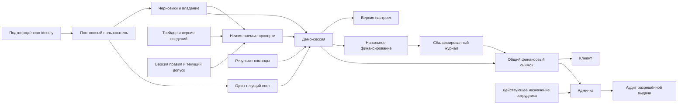

# Согласованная логическая модель БД первого сценария

28.10.2026 · **Все четыре блока приняты. Согласование логической модели первого сценария завершено.** Владелец принял заключительный блок целиком после PR №158 и отдельно подтвердил: код пока не начинать. [ADR-0064, разделы 26–29](../../decisions/0064_first_session_database_contract.md). Baseline итоговой фиксации: main `14fcbee996e563cd564ff1c0db649e9a439982dc`. Только логическая схема/контракт, без SQL, миграций и реализации.

## 1. Принятый объём

Принята общая логическая модель первого маршрута: вход → трейдер → настройки → проверка → явный запуск пустой демо-сессии → разрешённый просмотр этой же сессии в админке. PostgreSQL, схемы Auth/Shadow и модульный TypeScript-бэкенд остаются принятой основой. Два равноправных участника — «владелец 1» и «владелец 2».

[Data-model](data-model.md) задаёт поля, связи и сохранение; [commands](commands.md) — команды/чтения и смысл ответов; [auth-policy](auth-policy.md) — вход/доступ; [acceptance](acceptance.md) — проверки. Этот итог не создаёт альтернативные таблицы или второй API-контракт и не заменяет действующие продуктовые ADR.

## 2. Схема связей

Стрелки — отношения, не порядок запросов. Фактические кардинальности/служебные записи — ниже и в data-model. Админка не получает отдельную копию сессии, настроек или финансов.

| Группа | Сущности и кардинальности | Обязательные связи и ограничения |
| --- | --- | --- |
| Вход и доступ | User, AuthIdentity, AuthSession, LoginPolicyVersion; StaffPrincipal, Assignment, StaffLoginSlot | Identity уникальна по environment/provider/subject/realm; пользовательский и staff контуры отдельны. Несколько пользовательских login; один рабочий staff login. Удаление Auth не удаляет историю Shadow |
| Каталог и правила | Venue, Trader, TraderRevision, PolicyVersion и активные pointers/controls | Trader уникален в venue/source environment; revisions и опубликованные параметры неизменяемы. Текущий допуск проверяется отдельно от исторической версии |
| Настройка | SetupDraft → много SetupReview; DraftOwnership хранит смену владельца | У draft один текущий ввод/version и один текущий ownership; несколько независимых draft допустимы. Review хранит свою копию значений и версий. Claim не переписывает старое guest review |
| Запуск | User → один UserSessionSlot на environment/paper → ноль или одна текущая PaperSession | Слот общий для площадок. У session обязательные startedFromDraftId/startedFromReviewId; каждый источник используется максимум одной сессией по всей истории. Сессия принадлежит владельцу/среде своего слота |
| Настройки сессии | PaperSession → SettingsRevision | Начальная sequence=1; currentSettingsRevisionId ссылается на ту же session. В действующих настройках ровно один режим: F либо q |
| Виртуальные деньги | PaperSession → один initial FundingFlow → один начальный Journal → две JournalEntry | unit virtual_USD, точный баланс журнала ноль. Funding объясняет поступление и не прибавляется к ledger повторно. Проводки неизменяемы |
| Снимок | PaperSession → SessionSnapshot по sessionId/version | Начальная version=1, currentSnapshotVersion обязателен и относится к той же session. Q04/Q06 читают одну целую версию, просмотр не меняет version/asOf |
| Результат команды | CommandReceipt на environment/realm/постоянный actor/type/key | Один окончательный успех либо бизнес-отказ на key+payload. Другой payload — конфликт. Технический/неизвестный исход не становится окончательным бизнес-отказом |
| События | AuditEvent; OutboxEvent; ConsumerEventReceipt | Audit неизменяем. Outbox отдельно отслеживает доставку. Consumer receipt уникален по environment/consumer/eventId и фиксируется атомарно с локальным эффектом |

## 3. Общие поля и форматы

| Предмет | Единое правило |
| --- | --- |
| Собственные ID | UUID v4; ID ресурса назначает сервер, ключ команды клиент сохраняет до отправки. Внешний ID не теряет venue/provider/source/realm |
| Владелец и область | Обязательные типизированные ссылки; составные связи БД проверяют environment/owner/session/venue. Клиентский userId/role не доказательство доступа |
| Деньги | Нормализованные n/d, конечные целые, d>0, gcd=1, zero=0/1; до 64 цифр на компонент первого пустого демо. В API компоненты — строки. Без float, округления или обрезания для прохождения лимита |
| Проценты | Внутри integer в сотых процентного пункта: 3%=300. Общий DTO явно различает исходную строку формы и нормализованное значение; преобразование точное. Диапазоны/шаги ADR-0058 неизменны |
| Счётчики | version/sequence/generation — bigint, в API строки даже для «1». Переполнение останавливает изменение, не сбрасывает счётчик |
| Время | Серверные моменты UTC с миллисекундами; IANA-зона отдельно. Истечение при now >= expiresAt. Deadline 14 календарных дней вычислен при старте и сохранён с зоной/версией расчёта |
| Формат записи | Обязательный recordSchemaVersion text; первые review/settings/snapshot/receipt имеют v1 с независимыми линиями версий. Не равен счётчику изменений |
| Ввод и JSON | Числовой raw input до 64 Unicode code points; дополнительный JSON до 16 КиБ компактного UTF-8; C04/C06 до 64 КиБ полного тела, глубина 8, без дубликатов имён/сжатия |
| Необязательность | NULL только с определённым смыслом: свободный slot, неотозванный login, невыбранный F/q. У сохранённой session обязательные связи/суммы заполнены |

Реестр четырёх форматов находится в data-model §16. Закрепляем его смысловой состав: review — показанная проверка и её источники/срок; settings — полный выбранный режим и параметры/расчётные пределы; snapshot — одна версия состояния с суммами/счётчиками и временем данных; receipt — scope/key/fingerprint, окончательный исход и разрешённая ссылка либо безопасная причина. Неизвестный формат нельзя читать как знакомый или использовать как повод повторить команду. Поддержка исторических форматов проверяется по всем сохранённым записям на изолированной копии.

Полные машинные описания DTO/декодеров и физические имена колонок оформляются в рамках этих значений совместно с бэкендом. Это инженерная детализация, а не право изменить единицы, обязательность, продуктовые состояния или финансовую семантику. Конфликт с принятым правилом требует явного решения; обычные имена полей не возвращаются отдельной цепочкой вопросов владельцу.

## 4. Правила сохранения и чтения

- C04 сохраняет ввод, но не effective settings; expectedVersion проверяется до сравнения содержимого. No-op не повышает version и не продлевает TTL. Used draft закрыт для изменения.
- C05 создаёт неизменяемый review с точными параметрами и версиями. Гостевой review не разрешает запуск после входа без новой привязки/проверки. Review не резервирует деньги и не гарантирует будущий допуск.
- C06 повторно проверяет текущие условия/сроки после блокировок. Session, settings1, initial funding/journal, snapshot1, slot, used draft, audit/outbox и receipt фиксируются одной Serializable-транзакцией. Обязательные циклические связи и баланс проверяются до commit.
- Сохранение, claim, запуск, отзыв доступа и изменения controls используют общий порядок ресурсов data-model §22. Максимум 3 автоматические попытки C06 в общем бюджете 5 секунд только при подтверждённом serialization/deadlock rollback.
- Q04/Q06 возвращают тот же sessionId/settingsRevisionId/snapshotVersion. Q06 дополнительно проверяет действующее назначение и сохраняет audit разрешённой выдачи до ответа. Это не доказательство просмотра человеком.
- Неопределённый результат выясняется по исходному ключу. Worker использует lease и consumer dedup, 5 попыток с паузами 1/5/30/120 секунд; ошибка доставки не отменяет успешный запуск.
- Повреждённые данные не заменяются нулями. Restore/очистка не оживляют прежние доступы/команды; открытие работы после копии требует сверки по data-model §23.

## 5. Сверка с заданием бэкенда

Сверено с [backend-chat-brief](backend-chat-brief.md) и общими документами текущего main; это документальная сверка, не отдельное подтверждение другого чата и не тест API.

| Требование бэкенда | Согласование БД |
| --- | --- |
| Один модульный API/worker-проект, общие user/admin данные | Одна PostgreSQL БД; одинаковая идентичность session/settings/snapshot, отдельные права и DTO-проекции |
| C01–C03/C07 и вход | Постоянный user отделён от provider identity/login, email не даёт автообъединение аккаунтов, logout не завершает paper session |
| C04–C06 | Draft/version/ownership → review → атомарный start; точные параметры и ссылки, без принятия готового баланса из браузера |
| Q01–Q06 | Текущая авторизация, scope, общий snapshot и восстановление результата команды; protected data только после допустимой выдачи |
| Idempotency и outbox | Окончательный receipt отдельно от доставки; command key не меняется после сетевого сбоя, consumer marker предотвращает повтор локального эффекта |
| Две площадки в целевой модели | Venue/source-scoped идентификаторы, один пользовательский слот между площадками; первый fixture явно обозначен синтетическим |
| Первый пустой paper-срез | Нет торговых orders/fills/positions/signals и live-команд; служебное финансирование/аудит не создают торговую активность |
| Доказательства готовности | A01–A112 — план будущей проверки, не выполненная приёмка. Отдельно доказать совместимость Auth/passkey, разворот чистой test-БД, concurrency/crash/restore |

Безопасные ошибки и предлагаемые HTTP-ответы остаются в commands: отсутствие входа, недоступный ресурс, невалидное поле, устаревшая версия/review, занятый слот, повтор ключа с другим содержимым, временная недоступность. Сбой не выдаётся за бизнес-отказ; неизвестные данные — за нули. Точные маршруты/коды/машинные схемы согласуются в общем контракте, без второго набора в чате БД.

## 6. Итог согласования и граница следующей работы

Согласование логической схемы и правил сохранения **первого сценария завершено**. Все четыре блока приняты целиком; дополнительная серия вопросов по этой модели не требуется. Техническая детализация выполняется в рамках принятого общего контракта, а изменение продуктовых правил требует отдельного решения. Техническая реализация и её проверка возможны только по отдельному поручению; текущая инструкция — код пока не начинать. SQL, миграции, выбор/проверка конкретных Auth-библиотек, создание инфраструктуры и работающие интеграции не считаются выполненными или автоматически разрешёнными.

Существующие продуктовые параметры, сроки, доступы владельцев и правила будущей торговли не меняются. Непроверенные компоненты и предметные тесты остаются явными инженерными зависимостями, а не заявленной готовностью MVP. Документ является согласованным итогом проектирования первого сценария, а не отчётом о готовой БД или пройденной приёмке.
