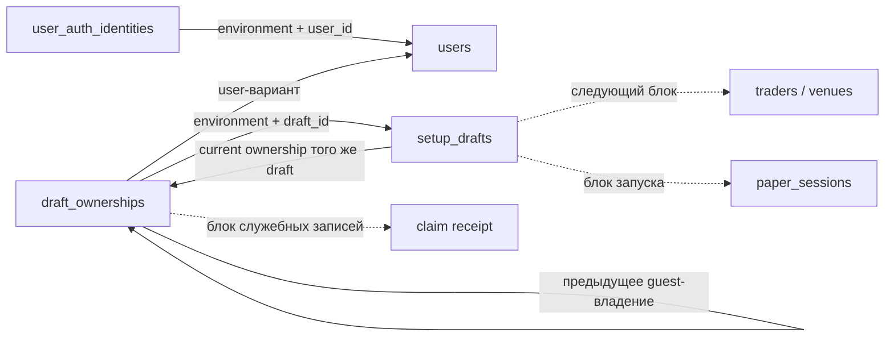

# Физическая схема БД первого сценария — согласованный документ

29.10.2026 · По поручению владельца после PR №177 завершена [точная карта ошибок API ↔ БД](database-error-field-map.md): контейнеры reasons/fieldErrors, закрытые params и источник ошибок Q03. Это уточнение документов в рамках T01–T17, без пересогласования C04. Прежние пометки о незавершённости именно этой карты ниже исторические; полные DTO/Auth/компоненты и испытания остаются отдельно.

29.10.2026 · Заключительный блок принят после PR №176 и отражён; [итог дополнения §§4–5](database-c04-addendum.md), [ADR-0064 §37](../../decisions/0064_first_session_database_contract.md). Реестры H02/H03, параметры H04–H06 и T01–T17 действуют вместе с физическими полями ниже. Исторические пометки «ещё выбрать код/бюджет» не отменяют последующее принятие. Полевая карта JSON/DTO, компоненты и предметные испытания остаются отдельно; только документы.

29.10.2026 · Приняты [блоки 1–3 дополнения после пакета бэкенда](database-c04-addendum.md): guest context до draft, historical guest_context_id, результат/атомарность C04 и last_input_receipt_id текущего ввода; [ADR-0064 §§34–35](../../decisions/0064_first_session_database_contract.md). Точные составные FK и post-claim поиск приняты блоком 3; ADR-0064 §36. Исторические §§30–34 сохранены, реализация не начата.

29.10.2026 · **Все четыре блока физической схемы и сводная передача приняты целиком. Согласование завершено.** [Итог — ADR-0064 §33](../../decisions/0064_first_session_database_contract.md); [сводная передача бэкенду](database-backend-handoff.md). Блок 1 принят после PR №161, заключительный блок — после PR №164. [Фиксация блока 1 — ADR-0064 §30](../../decisions/0064_first_session_database_contract.md). Согласованная логическая модель остаётся обязательной: [итог](database-final-review.md), [ADR-0064](../../decisions/0064_first_session_database_contract.md). Baseline: main `43a6991580e0a61e4210dfd167d0d994ccb63454`. Документ описывает будущие таблицы; SQL, миграций, кода приложения и созданной БД нет.

## 1. Четыре блока работы

| Блок | Содержание | Статус |
| --- | --- | --- |
| 1 | Общие соглашения, пользователь, привязка подтверждённой identity, черновик и владение | Принят 29.10.2026 |
| 2 | Площадки/трейдеры и revisions, правила/controls, неизменяемая проверка настроек | [Принят 29.10.2026](database-physical-catalog-review.md) |
| 3 | Сессия/слот/настройки, финансирование, журнал и общий финансовый снимок | [Принят 29.10.2026](database-physical-session-ledger.md) |
| 4 | Результаты команд, audit/outbox/consumer receipts, прикладной доступ сотрудников; сводная матрица ограничений/индексов и передача бэкенду | [Принят 29.10.2026](database-physical-operations-access.md); [сводная передача принята](database-backend-handoff.md) |

Это укрупнённые части физической детализации, не повторное согласование продуктовых правил. Бэкенда пока нет и он будет в другом чате. Внутренние таблицы Auth-провайдера не проектируются здесь по предположению. Четвёртый блок фиксирует прикладные связи доступа и зависимости; вход/API ещё не реализованы.

## 2. Общие соглашения проекта

- Прикладные таблицы — в схеме `shadow`; провайдерский Auth — отдельная граница. Имена таблиц/колонок в этом проекте — snake_case, логические имена из data-model сохраняют смысл. Имя колонки не задаёт имя будущего поля API.
- Для таблиц блока 1 принят составной первичный ключ `(environment, id)`. `id` — серверный UUID v4; `environment` — непустой серверный код среды из закрытой конфигурации, не параметр доверия из браузера. Составные ссылки включают environment. Дополнительный уникальный индекс только по id не нужен для описанных обращений.
- `uuid`, `text`, `bigint`, `timestamptz`, `bytea` ниже — типы PostgreSQL, не готовый DDL. `Да` означает NOT NULL плюс предметные проверки; `Нет` — только явно указанный смысл NULL. Неизвестный обязательный факт нельзя маскировать NULL.
- Серверные моменты сохраняются с согласованной миллисекундной точностью. UUID/постоянные идентификаторы и created_at не переписываются. Для изменяемой записи version начинается с 1, положительна и не обнуляется при переполнении; в API числовые версии — строки.
- Изменяемые строки имеют updated_at; неизменяемая история — created_at. Обязательные данные не прячутся в JSON. Размеры/режимы/сроки и правила точных чисел остаются из ADR-0064 и ADR-0058.
- Нет каскадного удаления пользователей, привязок владения, использованных черновиков и финансовой истории. Удаление истории отдельно; прекращение входа не означает удаление User.
- Полный перечень индексов будет сводиться после всех блоков. Здесь указаны только ключи/уникальность и конкретные кандидаты чтения; измеренная скорость не заявляется.

## 3. Блок 1: таблицы до проверки настройки

### 3.1. `shadow.users` → User

Постоянный пользователь Shadow. Входные cookies, OTP, passkeys и токены сюда не записываются; staff-идентичность не подменяется этой таблицей.

| Колонка | Тип | Обязательна | Смысл / правило |
| --- | --- | --- | --- |
| environment | text | Да | Область среды, часть PK |
| id | uuid | Да | Постоянный user ID, часть PK |
| status | text | Да | Принятый прикладной статус аккаунта; ограниченный словарь из общего контракта доступа, его физические коды — зависимость B1-D1 |
| locale | text | Да | Поддерживаемый язык `ru` либо `en`; язык не меняет финансовую идентичность |
| version | bigint | Да | Версия изменяемого пользователя и guard для зависимых изменений доступа; начально 1 |
| created_at | timestamptz | Да | Создание постоянного аккаунта |
| updated_at | timestamptz | Да | Последнее сохранённое изменение строки/guard |

Связи: один User → несколько подтверждённых identity links, несколько черновиков через DraftOwnership, будущие login/session/slot. Email не является PK и не является ключом слияния аккаунтов. Первичное создание User и его подтверждённой привязки согласуется с результатом входа; повтор verify разрешает того же пользователя через уникальную identity. Провайдерский verify и наша БД не объявляются одной общей транзакцией.

Если изменение дочерних identity/доступов влияет на разрешение действий, оно меняет и guard version пользователя в той же прикладной транзакции. Это сохраняет принятое правило об обнаружении устаревшего Serializable-снимка. Точный источник status и его синхронизация с Auth относятся к зависимости B1-D1; новые бизнес-статусы этим документом не вводятся.

### 3.2. `shadow.user_auth_identities` → пользовательская часть AuthIdentity

Это связь с уже подтверждённой личностью, не копия внутренней базы Auth. В первом сценарии пользователь входит через подтверждённый email; незавершённый challenge ещё не создаёт эту подтверждённую привязку.

| Колонка | Тип | Обязательна | Смысл / правило |
| --- | --- | --- | --- |
| environment | text | Да | Часть PK и области уникальности |
| id | uuid | Да | Собственный ID связи, часть PK |
| user_id | uuid | Да | FK `(environment, user_id)` → users |
| realm | text | Да | Для этой таблицы только `user`; staff-привязки проектируются отдельно |
| provider | text | Да | Код проверенного источника identity; не название, переданное браузером |
| provider_subject | text | Да | Непустой стабильный subject провайдера, сравниваемый по его документированному контракту |
| verified_email | text | Да | Подтверждённый email по принятому правилу нормализации; не глобальный уникальный ключ пользователя |
| email_verified_at | timestamptz | Да | Серверный момент подтверждённой проверки, не клиентская дата |
| version | bigint | Да | Версия изменяемых подтверждённых сведений, начально 1 |
| created_at | timestamptz | Да | Создание связи |
| updated_at | timestamptz | Да | Последнее сохранённое изменение подтверждённых сведений |

Уникальность: `(environment, realm, provider, provider_subject)` соответствует одному постоянному пользователю. Самовольное переназначение существующей identity другому user запрещено. Email нормализуется по auth-policy: trim краёв и согласованная нечувствительность к регистру, без удаления точек и `+`-части. Не вводится уникальность одного email между разными провайдерами и не выполняется автоматическое слияние.

Прямой FK к частной таблице конкретного Auth-провайдера сейчас не задаём: у него ещё нет выбранного и проверенного физического контракта. Провайдерская запись может исчезнуть, но это не должно каскадно удалить пользователя или историю Shadow. Существование строки связи не доказывает текущий полный вход, MFA или неотозванный login. Подтверждённый email читается только разрешёнными путями, в журналы технических ошибок целиком не копируется.

### 3.3. `shadow.setup_drafts` → SetupDraft

Одна строка — актуальное состояние одного черновика. Несколько независимых черновиков пользователя допустимы; отдельного «единственного черновика на пользователя» нет. FK на таблицы следующих блоков обозначены как будущие связи, а не уже созданные ограничения.

| Колонка | Тип | Обязательна | Смысл / правило |
| --- | --- | --- | --- |
| environment | text | Да | Часть PK и всех связей |
| id | uuid | Да | ID черновика, часть PK |
| current_ownership_id | uuid | Да | Текущее доказательство владения; FK `(environment, id, current_ownership_id)` → draft_ownerships `(environment, draft_id, id)` |
| version | bigint | Да | Версия сохранённого ввода C04, начально 1; +1 только при успешном изменении |
| last_input_receipt_id | uuid | Да | Успешный C04 created/updated, сохранивший текущую версию ввода; свой draft/result version/моменты совпадают. Не последний запрос и не unchanged receipt; FK (environment,last_input_receipt_id,id,version) → command_receipts(environment,id,result_draft_id,result_draft_version), принятый блоком 3 дополнения |
| locale | text | Да | `ru` либо `en` |
| step | text | Да | select_trader, configure, review; код шага не даёт права запуска |
| entry_context | text | Нет | catalog, trader_details, session_summary либо NULL; без произвольного redirect или секретов |
| venue_id | uuid | Нет | Площадка ещё не выбрана → NULL; будущий FK на каталог блока 2 |
| trader_id | uuid | Нет | Трейдер ещё не выбран → NULL; при наличии обязательна venue_id, будущая составная ссылка на трейдера той же площадки/среды |
| selected_mode | text | Нет | `fixed` либо `percent`; NULL = способ ещё не выбран |
| raw_budget | text | Нет | Исходный ввод B, до 64 Unicode code points |
| raw_fixed_amount | text | Нет | Исходный ввод F, до 64 code points |
| raw_copy_percent | text | Нет | Исходный ввод q, до 64 code points |
| raw_market_limit_percent | text | Нет | Исходный ввод p, до 64 code points |
| raw_loss_limit_percent | text | Нет | Исходный ввод d, до 64 code points |
| proposed_timezone | text | Нет | Проверенное имя IANA-зоны; NULL = ещё не задано; до review/start зона должна быть определена |
| last_saved_at | timestamptz | Да | Создание или последнее успешное изменение ввода C04; опора срока доступности |
| expires_at | timestamptz | Да | Согласованные 7 дней после сохранённого изменения; no-op/чтение не продлевают |
| used_at | timestamptz | Нет | NULL до запуска, после него серверный момент использования |
| used_by_session_id | uuid | Нет | NULL до запуска, после него та же session, которая ссылается на этот draft; будущая связь блока 3 |
| created_at | timestamptz | Да | Первоначальное создание |
| updated_at | timestamptz | Да | Последнее изменение строки, включая служебную привязку/использование; не заменяет last_saved_at для TTL |

NULL в raw-полях означает «поле ещё не задано», пустая строка — сохранённый пустой ввод; сравнение не склеивает эти состояния. `20` и `20.00` также различаются как ввод. Строки хранятся без trim/числовой нормализации; в UTF-8 допустимы только представимые строковые значения. Ошибки кодировки/недопустимые для text символы — ошибка формы запроса, не повод молча изменять строку.

Оба ввода F и q могут сохраняться для возврата в форму; effective settings получат только выбранный и проверенный режим в следующих блоках. Здесь нет нормализованных сумм, баланса, версии финансового снимка или флага «запуск разрешён». Результат валидации относится к конкретному review, а текущий допуск заново проверяется при старте.

`used_at` и `used_by_session_id` либо оба NULL, либо оба заполнены. После start ввод и привязка использованного draft неизменны. Состояние draft выводится: used имеет приоритет; иначе expired при now >= expires_at, иначе editable. Отдельный изменяемый статус expiry не хранится. Текущее время не включается в постоянно меняющийся CHECK: срок проверяет операция по серверным часам.

Версия C04 описывает ввод; актуальный ownership и признак использования проверяются отдельно при каждом доступе/старте. Служебная фиксация claim/used не продлевает срок ввода. Все участники гонок блокируют ту же строку draft по принятому порядку; невалидный короткий ввод не обходит ownership/version/used/expiry.

Принятый last_input_receipt_id обязателен уже при create. Каждая реальная правка меняет pointer, version и моменты ввода атомарно с новым key/receipt/details. Новый unchanged сохраняет свой receipt, но не меняет даже pointer/TTL; exact replay не создаёт нового CMD. При claim/used pointer прежний: результат может законно ссылаться на историческое guest ownership после перехода current ownership к user. Старый receipt version5 не ссылается на текущую изменяемую version draft и остаётся читаемым после version6 при текущем доступе. Не создаётся полная история raw. Запрет изменения ввода без результата требует проверки переходов и полноты от родителя; полный FK-набор принят блоком 3 дополнения и описан в физическом блоке операций §2.5.

### 3.4. `shadow.draft_ownerships` → DraftOwnership

Неизменяемая история того, на каком основании черновик принадлежал гостю либо пользователю. Историческая запись не даёт текущего доступа: её ID должен совпадать с current_ownership_id черновика.

| Колонка | Тип | Обязательна | Смысл / правило |
| --- | --- | --- | --- |
| environment | text | Да | Часть PK и всех связей |
| id | uuid | Да | ID записи владения, часть PK |
| draft_id | uuid | Да | FK `(environment, draft_id)` → setup_drafts |
| owner_kind | text | Да | `guest` либо `user` |
| owner_user_id | uuid | Условно | Заполнено только для user; FK на users той же среды |
| guest_context_id | uuid | Условно | Обязателен только для guest, иначе NULL; постоянный серверный ID Auth-контекста до первого C04; не секрет/самостоятельный допуск |
| guest_context_digest | bytea | Условно | Защищённое представление guest-доказательства; заполнено только для guest. Исходный bearer/secret не хранится |
| guest_digest_version | text | Условно | Версия способа получения/проверки digest, только вместе с guest_context_digest; алгоритм/размер зависят от B1-D2 |
| previous_ownership_id | uuid | Нет | NULL у первоначального владения; для claim ссылка на прежнее guest-владение того же draft/environment |
| claim_receipt_id | uuid | Нет | NULL у первоначального владения; при guest → user ссылка на сохранённый результат claim. Физическая таблица/составная проверка actor — блок 4 |
| created_at | timestamptz | Да | Момент фиксации доказательства владения |

Для guest обязательны guest_context_id, digest и его версия, owner_user_id пуст; для user обязателен owner_user_id, все три guest-поля пусты. Первоначальный draft можно создать гостевым или сразу пользовательским. Для первого сценария переход только guest → user после доказанного полного входа; переназначение между аккаунтами не добавляется.

Auth-адаптер устойчиво создаёт guest context до первого C04; proof этого контекста и draft-bound proof не взаимозаменяемы. Секреты остаются в Auth; в ownership сохраняются ID и версионированный digest конкретного draft. Нет проверки по digest ещё не созданного draft и нет фиктивного user/новой прикладной таблицы ради гостя. Конкретное служебное Auth-хранилище не имеет выдуманного здесь FK. Не вводится unique по guest_context_id: несколько drafts одного контекста не склеиваются. При чтении прежнего C04 после claim проверяется текущий user и конкретная historical ownership/claim/result цепочка, старый guest proof закрыт для переданного draft/результатов; ключ/история не переназначаются.

Предлагаемая уникальность `(environment, draft_id, owner_kind)` допускает максимум одну исходную guest-запись и одну user-запись для этого сценария. У guest previous/claim пусты; у user они либо оба пусты при первоначальном пользовательском создании, либо оба заполнены при claim. Для claim previous должен быть guest-записью того же draft. Эта межстрочная проверка и обязательный переход current pointer завершаются в одной транзакции, не одним CHECK отдельной строки.

Для FK текущего владельца принят уникальный ключ `(environment, draft_id, id)`. При создании draft и первого ownership обе строки получают ID заранее и сохраняются вместе; замкнутая ссылка проверяется до commit. Обязательный current_ownership_id не становится nullable ради порядка вставки. При claim новая ownership, current pointer, закрытие старого guest-допуска и результат claim сохраняются атомарно. Старый guest digest остаётся только историческим доказательством и больше не разрешает доступ.

## 4. Связи и проверяемые инварианты блока 1

| Инвариант | Где обеспечивается |
| --- | --- |
| Одна identity не создаёт двух User | Уникальность environment/realm/provider/subject плюс атомарное разрешение связи; не email-merge |
| Нельзя сослаться на пользователя/владение другой среды | Составные FK с environment |
| Текущий ownership принадлежит именно этому draft | FK по environment/draft/id; обязательная полнота до commit |
| Нет половины guest/user-варианта | NOT NULL для discriminator и строковые/условные проверки всех owner-полей |
| Claim не перехватывает чужой draft и не создаёт вилку владения | Проверка текущего доказательства под блокировкой draft, уникальность owner_kind, неизменяемая previous-связь, receipt того же результата |
| Числовой ввод не теряется и не становится настройками сам по себе | text с проверкой длины до 64 code points; без приводящего обрезания; effective settings отдельно |
| Устаревшая вкладка/повтор не перезаписывает данные | Expected version до сравнения, полный no-op без роста версии/TTL, общий порядок locks |
| Used и session-ссылка не расходятся | Парность used_at/used_by_session_id сейчас; составная связь и обратная согласованность с session — блок 3 |
| История не удаляется вместе с провайдерским Auth | Нет каскадного внешнего FK на provider, запрет каскадной очистки прикладной истории |

Межстрочные условия не заменяются CHECK с чтением другой таблицы. В реализации нужны надлежащие FK/unique и проверяемые ограничения/права записи для переходов. Конкретный SQL этого документа отсутствует.

## 5. Ключи и минимальные кандидаты индексов

Обязательные ключи описаны выше: PK всех четырёх таблиц, уникальность identity, ключ владения для составного FK и уникальность owner_kind на draft. Их назначение — целостность; не создавать второй одинаковый индекс поверх обеспечивающего ограничение.

Кандидат отдельного индекса `(environment, owner_user_id, draft_id)` у user-варианта ownership нужен только если общий запрос должен перечислять черновики пользователя; текущая ссылка всё равно проверяется соединением с current_ownership_id. Q03 по известному draft ID уже начинается с PK. Кандидат по `(environment, user_id)` у identity нужен для чтения связей/обработки аккаунта, если появится соответствующий запрос. Индексы по сырым значениям, времени expiry, email или каждой колонке «на всякий случай» не добавляем. Полный набор и будущие query plans — сводная работа после остальных блоков.

## 6. Зависимости от бэкенда — не отдельные вопросы владельцу

| ID | Что требуется от общего контракта | Что уже можно проектировать независимо |
| --- | --- | --- |
| B1-D1 | Источник/словарь статуса User, проверенная identity provider/subject и синхронизация подтверждённых сведений; условия полного входа и MFA | Постоянный User, уникальная прикладная identity-связь, отсутствие каскада и email-merge |
| B1-D2 | Формат гостевого доказательства, алгоритм/версия digest, его проверка и прекращение доступа при claim; без выбора криптографии по привычке | Раздельные guest/user варианты, current pointer, неизменяемая история и атомарный claim |
| B1-D3 | Сопоставление step/entry_context с существующим UX; точное представление raw-полей/NULL/пустой строки в DTO | Сохранение исходного ввода и ограничения C04; не новый сценарий интерфейса |
| B1-D4 | Таблицы будущих блоков для venue/trader/session/receipt и составные области ссылок | Колонки-ссылки и обязательный смысл связей; до полной схемы они явно обозначены зависимыми |

Сотрудники/назначения/входы и закрытые таблицы провайдера не смешиваются с обычным User. Пароли, коды, cookies и реальные данные участников не добавляются в проектные примеры. Передавать этот пакет другому чату автоматически не поручено.

## 7. Принятие блока 1 и продолжение

29.10.2026 владелец принял блок 1 целиком: общие соглашения, четыре таблицы, колонки, связи и ограничения. Зависимости B1-D1–D4 сохранены и не выдаются за решения будущего бэкенда. Блоки 2–4 также приняты; [итоговая передача](database-backend-handoff.md) объединяет всю схему. Согласование завершено; код, SQL и миграции не начинаются.

Техническая сверка 29.10.2026: [PostgreSQL — Constraints](https://www.postgresql.org/docs/current/ddl-constraints.html) и [Character Types](https://www.postgresql.org/docs/current/datatype-character.html). Для raw-ввода выбран text с отдельной проверкой длины: приводящее обрезание ограниченного varchar не должно менять пользовательский ввод. Настоящие ограничения/гонки/планы запросов ещё не испытывались.

## 8. Дополнение C04: принятые связи текущего и исторического владения

29.10.2026 · Блок3 принят после PR №172. Target/result FK C04 используют имеющийся unique draft_ownerships(environment,draft_id,id). Для current input используется unique receipts(environment,id,result_draft_id,result_draft_version); draft ссылается всеми обязательными компонентами. Отложенная проверка дополнительно требует C04/succeeded/created либо updated и равенство моментов ввода. Receipt со старой result version не имеет FK на изменяемую version draft. Проверки новой операции не заставляют прошлую историю равняться текущему вводу.

При новом C04 проверяются current ownership и proof/полный вход. После claim для чтения старого C04 допускается именно historical guest ownership по подтверждённой claim-цепочке текущего user; это исключение для восстановления результата, не разрешение редактировать по прошлому владению. Успех использует result ownership, rejected update — проверенную target ownership. Rejected create без draft не имеет такой цепочки. Claim/used не меняют last_input_receipt_id/version/TTL. Полный порядок и неоднозначный поиск — [операции §2.6](database-physical-operations-access.md), [дополнение §3.5](database-c04-addendum.md). SQL/Auth-процедуры и испытания не выполнены.

## 9. Итоговое отражение H02/T01–T17 для ввода и владения

Реестр — first-session-registry-v1. Guest digest guest-hmac-sha256-v1 относится к доказательству конкретного draft; постоянный Auth context до create имеет отдельный защищённый протокол, ещё не реализованный. Realm/status/assurance/providers/revoke reasons читаются по [реестру](backend-code-registry.md), не задаются клиентом или вымышленным identity status. Environment — точная доверенная конфигурация, paper не автоматически имя среды.

Raw сохраняется без trim/NFC: NULL, пустая строка, 20, 20.00 различаются. Числовой парсер принимает ASCII digits, одну точку/запятую с цифрами с обеих сторон, ведущие/конечные нули; не принимает пробелы/знаки/экспоненту/валюту/процентный знак. 3.5=3,5; 1,000=1. Короткая abc-строка допустима C04 с ошибкой; JSON number вместо raw-строки — ранний структурный отказ. До 64 code points, без округления и defaults; полный набор сохраняемых полей, не PATCH.

Raw loss-поле отображается как rawDailyBuyLimitPercent, смысл — дневной лимит новых покупок. Список fieldErrors и приоритеты приняты T02–T04; исходный result не меняется при replay. Last_input_receipt_id не указывает на последнюю unchanged попытку. Происхождение ошибок Q03 после изменения policy требует ещё точной полевой карты, исторические ошибки не объявляются новой проверкой.

C04 и claim имеют каждый бюджет 5s/максимум 3 подтверждённых serialization/deadlock rollback-попытки с паузами 50–150 мс внутри общего бюджета (T05/T12). Unknown сначала сверяется; повтор claim получателем читает исходную цепочку без действительности уже закрытого guest proof. C04 unknown сохраняет исходный key. Свой used/expired/stale draft даёт окончательный отказ после допуска; чужая/скрытая цель — ранний отказ без CMD. Точные DTO и Auth-протокол остаются остатком; новых таблиц/колонок для секретов нет.

## 10. Источник ошибок Q03

[Карта §5](database-error-field-map.md) закрепляет Q03.fieldErrors из details succeeded C04, на который указывает last_input_receipt_id. Обязательная API-проекция fieldErrorsSource содержит receiptId/draftVersion из этой цепочки; это не новые колонки. Pointer должен вести на created/updated того же draft/environment/version. Unchanged и C05 его не меняют. Чтение не пересчитывает исторические ошибки по новой policy; для новой проверки используется C05. Повреждённый источник закрывает весь Q03 технической ошибкой, без подстановки [].
