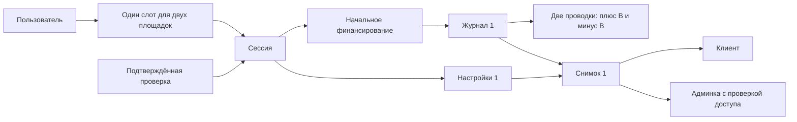

# Физическая схема БД — блок 3: сессия, настройки и виртуальный учёт

29.10.2026 · Заключительный блок принят после PR №176 и отражён; [итог дополнения §§4–5](database-c04-addendum.md), [ADR-0064 §37](../../decisions/0064_first_session_database_contract.md). Реестры H02/H03, параметры H04–H06 и T01–T17 действуют вместе с физическими полями ниже. Исторические пометки «ещё выбрать код/бюджет» не отменяют последующее принятие. Полевая карта JSON/DTO, компоненты и предметные испытания остаются отдельно; только документы.

29.10.2026 · Принят блок3 [дополнения C04](database-c04-addendum.md): общие command_receipts теперь типизированы C04/C06. Обязательные начальные ссылки этого блока на (environment,receipt,session) сохраняются: у C04 result_session_id всегда NULL, поэтому C04/rejected не могут удовлетворить C06-связи. До commit проверяется полный START с user actor и тем же succeeded C06 receipt; связь snapshot через session/settings сохранена. Использование draft не меняет last_input_receipt_id/version/TTL. Реестры/время H02–H06 — заключительная сверка; SQL/испытаний нет.

29.10.2026 · **Блок 3 принят целиком 29.10.2026 после PR №163.** [Фиксация — ADR-0064 §32](../../decisions/0064_first_session_database_contract.md). Блоки [1](database-physical-design.md) и [2](database-physical-catalog-review.md) приняты. Baseline: main `ab94c39b099f4d2b40f39425de9c5d4cdb387901`. Основание — [ADR-0064](../../decisions/0064_first_session_database_contract.md), [логическая модель](data-model.md), [команды C06/Q04/Q06](commands.md) и [задание бэкенда](backend-chat-brief.md). Только документ: SQL, код, миграции, БД и развёртывание не создаются.

## 1. Состав и границы

Семь таблиц в shadow: user_session_slots, paper_sessions, settings_revisions, funding_flows, journals, journal_entries, session_snapshots. Сессия пользователя и её представление в админке используют одни записи. Прикладной вход Auth не является paper-сессией. Здесь нет таблиц ордеров, резервов, позиций, сигналов и реальных кошельков «на будущее»; торговые команды и управление жизненным циклом не добавляются.

У каждой таблицы собственный серверный UUID v4 и PK `(environment, id)`. Все FK ниже включают environment; перечисленные вместе поля — отдельные колонки. Денежная пара `*_n/*_d` — два numeric без объявленного scale: конечные целые, d>0, gcd=1, ноль=0/1, до 64 цифр на компонент без знака. Переполнение/невалидность отклоняют операцию без округления. У денежных сумм знак оговорён отдельно. Проценты — integer в сотых процентного пункта; P=B×p/10000, D=B×d/10000. Версии/sequence/generation — bigint, в API строки. Серверные моменты — timestamptz с миллисекундной точностью, IANA-зона хранится отдельно.

Неизменяемы settings, funding, journals, entries и snapshots. Изменяемы только текущие указатели/состояние session и slot по разрешённым операциям; их идентичность/источники/владелец неизменны. История не удаляется каскадом и не истекает вместе с draft/review/login.

## 2. `shadow.user_session_slots` — одна текущая сессия

| Колонки | Тип | Обязательность / смысл |
| --- | --- | --- |
| environment, id | text, uuid | Да; PK |
| user_id | uuid | Да; FK → users своей среды |
| mode | text | Да; только paper |
| generation | bigint | Да; положительное поколение состояния слота |
| current_session_id | uuid | NULL означает доказанно свободный слот, иначе FK на session того же user/environment/mode |
| created_at, updated_at | timestamptz | Да; серверные моменты |

Unique(environment, user_id, mode), **без venue**. Дополнительный ключ `(environment, id, user_id, mode)` нужен для обратной ссылки session. Для current_session_id используется FK `(environment, current_session_id, id, user_id, mode)` на ключ paper_sessions `(environment, id, slot_id, user_id, mode)`; заполненный указатель не может вести к другой сессии/владельцу слота.

Предлагаемое точное правило generation замыкает B2-D4: первая сохранённая строка получает generation=1; если создаётся сразу с успешной сессией C06, это уже поколение 1 занятого слота, без промежуточного опубликованного пустого состояния. Каждая последующая смена current_session_id, включая будущее разрешённое освобождение, увеличивает generation на 1; no-op/чтение не увеличивает. Переполнение запрещает изменение. После первого появления строка не удаляется и generation не сбрасывается, поэтому занять→освободить не возвращает старое поколение.

Review различает отсутствующую строку (`absent`, generation NULL) и существующую свободную (`present`, конкретное поколение). C05 не создаёт слот. C06 при absent защищает отсутствие уникальным резервированием внутри той же транзакции; появившаяся после review строка делает review устаревшим даже при current_session_id=NULL. При present сравнивает generation и проверяет отсутствие текущей/блокирующей сессии. Полная отмена транзакции не оставляет резервирование. Если при обработке достигнуто резервирование нового слота, но затем получен окончательный бизнес-отказ без сессии, строка сохраняется с generation=1 и NULL pointer вместе с receipt; это не запуск и требует новой проверки перед новым намерением. Выбранный исход отражается в receipt, а неизвестный commit не считается отказом.

Для общего DTO предлагается явный expectedSlotState: absent либо present с generation-строкой; наличие/поколение берутся из review, не доказываются браузером. Окончательное имя поля согласуется с бэкендом. Слот не освобождается из-за logout, TTL, пустого snapshot, ошибки чтения, срока оценки или одного STOPPED. Строгое завершение требует [ADR-0051](../../decisions/0051_strict_session_completion_and_paper_reset.md); команды завершения/reset в первом срезе отсутствуют. Неизвестное состояние закрывает новый запуск, а не признаётся свободным.

## 3. `shadow.paper_sessions` — постоянная сессия

| Колонки | Тип | Обязательность / смысл |
| --- | --- | --- |
| environment, id | text, uuid | Да; PK |
| user_id, slot_id | uuid | Да; пользователь и слот; FK `(environment, slot_id, user_id, mode)` на user_session_slots |
| mode | text | Да; paper |
| started_from_draft_id, started_from_review_id, started_from_ownership_id | uuid | Да; неизменяемые источники запуска; составной FK на review того же draft/ownership |
| venue_id, catalog_source_id, trader_id, trader_revision_id | uuid | Да; полный scope выбранной trader_revisions из блока 2 |
| data_origin | text | Да; происхождение использованной revision, первый стенд: synthetic |
| lifecycle, control_state | text | Да; active / copying_not_connected для первого запуска; не означает подключённую торговлю |
| version | bigint | Да; от 1, guard изменяемой session |
| started_at | timestamptz | Да; серверный момент успешного допуска после повторной проверки сроков |
| iana_timezone | text | Да; проверенная зона подтверждённого review, неизменна после старта |
| evaluation_deadline_at | timestamptz | Да; сохранённая UTC-граница оценки |
| deadline_calculation_version, timezone_database_version | text | Да; paper-evaluation-deadline-v1 и фактическая закреплённая версия tzdb |
| current_settings_revision_id | uuid | Да; FK на settings именно этой session |
| current_snapshot_version | bigint | Да; FK `(environment, id, current_snapshot_version)` → session_snapshots(environment, session_id, version) |
| current_ledger_sequence | bigint | Да; последняя опубликованная sequence журнала своей session; в первом запуске 1 |
| initial_funding_flow_id | uuid | Да; FK на начальное финансирование именно этой session |
| start_receipt_id | uuid | Да; ссылка на окончательный успешный результат C06, физическая таблица в блоке 4 |
| created_at, updated_at | timestamptz | Да; серверные моменты; чтение не меняет updated_at |

Unique(environment, started_from_draft_id) и unique(environment, started_from_review_id) действуют по всей истории, без фильтра active/expiry. Составной FK `(environment, started_from_review_id, started_from_draft_id, started_from_ownership_id)` → setup_reviews(environment, id, draft_id, ownership_id). До commit дополнительно проверяются user ownership, точное совпадение выбранной trader revision/источника с review, разрешённый review и параметры. Эти проверки не заменяются отдельными несвязанными FK.

Дополнительные unique для обратных ссылок: `(environment, id, slot_id, user_id, mode)`; `(environment, id, started_from_draft_id)`; `(environment, id, start_receipt_id)`. Draft `(environment, used_by_session_id, id)` ссылается на session `(environment, id, started_from_draft_id)`; used_at заполнен вместе с этим указателем. End-of-transaction проверка первого запуска требует обратную отметку именно исходного draft, used_at=started_at и current_session_id своего слота, равный новой session.id. Проверка текущего pointer при создании не требует держать все исторические сессии текущими после будущего разрешённого завершения. Истечение исходного review после запуска не делает сессию недействительной.

В первом срезе допускается создание согласованного состояния «активная пустая демо-сессия, копирование не подключено». Точные machine codes lifecycle/control_state и их отображение — B3-D1, не новая продуктовая модель. EMPTY хранится в наполненности snapshot, не как замена lifecycle. Полная таблица переходов pause/stop/reset не вводится; неизвестный или неподдерживаемый код не превращается в active/free. Нулевые суммы сами по себе не доказывают строгий финал.

Срок оценки — 14 календарных дней в закреплённой зоне, не 336 часов. При пропуске целевого местного времени берётся первый существующий момент после пропуска, при повторении — первое вхождение. Deadline, версия расчёта и версия базы зон сохраняются с session; поездка, повтор запроса или новая база зон не пересчитывают срок. Выбор/проверка библиотеки остаются работой бэкенда; сохранение версии базы зон делает расчёт воспроизводимым и не меняет правило.

## 4. `shadow.settings_revisions` — полные версии настроек

| Колонки | Тип | Обязательность / смысл |
| --- | --- | --- |
| environment, id | text, uuid | Да; PK |
| record_schema_version | text | Да; v1, независима от sequence |
| session_id | uuid | Да; FK на paper_sessions |
| sequence | bigint | Да; от 1; unique(environment, session_id, sequence) |
| previous_revision_id | uuid | NULL только при sequence=1; иначе ссылка на предыдущую версию своей session |
| budget_n, budget_d | numeric | Да; положительный B |
| sizing_mode | text | Да; fixed либо percent |
| fixed_amount_n, fixed_amount_d | numeric | Оба обязательны при fixed, иначе оба NULL |
| copy_percent | integer | Обязателен при percent, иначе NULL |
| market_limit_percent, loss_limit_percent | integer | Да; p/d в сотых процентного пункта |
| effective_market_limit_n, effective_market_limit_d; effective_loss_limit_n, effective_loss_limit_d | numeric | Да; точные положительные P/D |
| policy_version_id | uuid | Да; FK на неизменяемую paper_policy_versions своей среды |
| calculation_version | text | Да; paper-settings-calculation-v1 для первой policy |
| signal_max_age_seconds | integer | Да; 30 по policy v1, не клиентская настройка |
| command_receipt_id | uuid | Да; результат создавшей версии команды, блок 4 |
| actor_user_id | uuid | Да; постоянный user, для первого C06 владелец session |
| created_at | timestamptz | Да; серверный момент создания версии |

Unique(environment, session_id, id) для current pointer/previous/snapshot; unique(environment, session_id, command_receipt_id) запрещает вторую revision той же команды в session. Первая sequence=1, previous=NULL; последующая должна ссылаться на sequence−1 своей session и сохраняться вместе с изменением current pointer. Это описание версий по [ADR-0056](../../decisions/0056_active_session_budget_flows_and_settings_revisions.md), не разрешение реализовать изменение активной сессии сейчас.

Начальная версия — точная копия валидных выбранных параметров подтверждённого review и той же policy/calculation version: B, выбранный F либо q, p/d, P/D. Неактивный raw-ввод остаётся в draft/review; здесь нет второго действующего способа. Проверяются диапазоны/шаги и fixed-граница принятой policy без автоматической замены budget на 200. Будущая политика не меняет историческую revision. При переносе current pointer принадлежащая ему revision должна совпадать с settings текущего snapshot; сохранение не публикует смешанное состояние.

## 5. `shadow.funding_flows` — объяснение начального финансирования

| Колонки | Тип | Обязательность / смысл |
| --- | --- | --- |
| environment, id | text, uuid | Да; PK |
| session_id | uuid | Да; FK на session |
| kind | text | Да; initial_paper_funding в первом срезе |
| amount_n, amount_d | numeric | Да; положительный B начальной settings revision |
| unit | text | Да; virtual_USD |
| journal_id | uuid | Да; FK на журнал той же session |
| command_receipt_id | uuid | Да; тот же успешный C06, что у session/settings/journal |
| created_at | timestamptz | Да; серверный момент |

Unique(environment, session_id, kind) обеспечивает не более одного initial flow, unique(environment, journal_id) — одно объясняющее финансирование на журнал. Unique(environment, session_id, id) для session/journal. Обязательный initial_funding_flow_id у session и проверка kind до commit обеспечивают наличие, а не только верхнюю границу. Initial flow не прибыль/убыток, не движение реального кошелька и не ΔB активной сессии; отметка «Баланс изменён» при первом финансировании не ставится.

FundingFlow объясняет происхождение записи ledger. Повторно прибавлять его amount к уже рассчитанному по проводкам cash/equity запрещено. Будущие пополнения/изъятия требуют отдельного расширения видов и проверки ADR-0056; этот документ не добавляет такую команду.

## 6. `shadow.journals` — неделимые операции учёта

| Колонки | Тип | Обязательность / смысл |
| --- | --- | --- |
| environment, id | text, uuid | Да; PK |
| session_id | uuid | Да; FK на session |
| sequence | bigint | Да; порядок операций ledger своей session, начальная 1 |
| kind | text | Да; initial_paper_funding в первом срезе |
| unit | text | Да; virtual_USD |
| funding_flow_id | uuid | Да для initial; FK на flow своей session |
| command_receipt_id | uuid | Да; успешный C06, блок 4 |
| created_at | timestamptz | Да; серверный момент |

Unique(environment, session_id, sequence), unique(environment, funding_flow_id), unique(environment, session_id, command_receipt_id) для нынешнего одного журнала запуска. Unique(environment, session_id, id) и unique(environment, session_id, id, unit) обслуживают FK. Взаимные ссылки flow.journal_id и journal.funding_flow_id замыкаются до commit и проверяются на совпадение. Current ledger pointer session ссылается на `(environment, session_id, sequence)`; в одном запуске создаётся только sequence=1.

Ledger sequence считает **операции-журналы**, не отдельные проводки, wall-clock время или глобальную sequence БД. Будущее увеличение выполняется под guard session в одной транзакции с журналом и проекцией; rollback не публикует частичный журнал или передвинутый pointer. По первому срезу не требуется ни глобальный счётчик, ни порядковый номер финансового события между разными пользователями.

## 7. `shadow.journal_entries` — две уравновешенные проводки

| Колонки | Тип | Обязательность / смысл |
| --- | --- | --- |
| environment, id | text, uuid | Да; PK |
| session_id, journal_id | uuid | Да; FK `(environment, session_id, journal_id, unit)` → journals |
| line_number | integer | Да; 1 либо 2 у initial journal |
| account_code | text | Да; paper_cash либо virtual_funding_source в первом срезе |
| amount_n, amount_d | numeric | Да; signed точная величина; нулевые initial entries запрещены |
| unit | text | Да; virtual_USD, совпадает с journal |
| created_at | timestamptz | Да; серверный момент |

Unique(environment, journal_id, line_number) и unique(environment, journal_id, account_code). Для initial journal ровно две строки: line 1, paper_cash, +B; line 2, virtual_funding_source, −B. Счёт определяется закрытым account_code **внутри конкретной session**, не внешним user/wallet ID. Отдельный редактируемый справочник счетов для этих двух кодов не нужен. Источник доказательства — journal → funding → исходная команда/review; внешняя строковая evidence-ссылка не заменяет эту цепочку.

Проверка до commit требует обе строки, те же session/unit, равные нормализованные знаменатели и противоположные числители, а также +B, равный начальному funding/settings. Это доказывает нулевой точный баланс пары без округляющего деления numeric. Сумма всех двух счетов равна нулю; пользовательский cash берётся только с paper_cash. Контрсчёт funding не вычитается из equity пользователя и не является его долгом/убытком.

Нельзя дописать третью строку после публикации журнала или исправить одну проводку «на месте». Права записи и ограничения запрещают UPDATE/DELETE финансовой истории и расширение опубликованного initial journal. Будущая коррекция отдельной операцией требует собственного контракта; первый срез её не реализует.

## 8. `shadow.session_snapshots` — общий финансовый снимок

| Колонки | Тип | Обязательность / смысл |
| --- | --- | --- |
| environment, id | text, uuid | Да; PK |
| session_id | uuid | Да; FK на session |
| record_schema_version | text | Да; v1, не числовой version |
| version | bigint | Да; начальная 1; unique(environment, session_id, version) |
| session_version | bigint | Да; историческая версия состояния session при построении; не FK на изменяемую version |
| settings_revision_id | uuid | Да; составной FK на settings своей session |
| ledger_sequence | bigint | Да; составной FK на `(environment, session_id, sequence)` journals; начальная 1 |
| projection_calculation_version | text | Да; paper-empty-snapshot-v1 для первого снимка, отдельная от формата и policy |
| lifecycle, control_state | text | Да; active / copying_not_connected в первом снимке |
| content_state | text | Да; EMPTY для первого запуска |
| data_origin, coverage_state | text | Да; synthetic / no_trade_data в первом снимке; не покрытие реального рынка |
| unit | text | Да; virtual_USD |
| initial_funding_n, initial_funding_d | numeric | Да; B по initial flow/журналу, поясняющая величина, не второе зачисление |
| free_n, free_d; reserved_n, reserved_d | numeric | Да; B/0 соответственно при старте |
| position_cost_n, position_cost_d; position_value_n, position_value_d | numeric | Да; обе величины 0/1 при доказанном отсутствии позиций |
| equity_n, equity_d | numeric | Да; B при старте |
| trading_result_n, trading_result_d | numeric | Да; 0/1 при первом EMPTY; не включает funding |
| trade_count, position_count, order_count | bigint | Да; неотрицательные счётчики, все 0 при первом запуске |
| as_of, created_at | timestamptz | Да; время данных и создания записи, неизменяемы |

В первом EMPTY все суммы неотрицательны; потенциально signed trading_result не расширяет текущий расчёт за пределы нуля. Нет колонок «готовый score», выдуманной вероятности прибыли или доходности после движений бюджета. Coverage сообщает отсутствие данных для оценки. Все поля snapshot заполняются из одного состояния БД, не приходят от браузера; расхождение с journal/settings/flow отклоняет весь запуск.

Для текущего снимка session.current_settings_revision_id=settings_revision_id, current_ledger_sequence=ledger_sequence и session.version=session_version; lifecycle/control_state также совпадают. Эти отношения проверяются при публикации, а не FK на изменяемые номера для всех прошлых snapshots. Исторические снимки сохраняют прежние версии. Денежный расчёт первого запуска: free=сумма paper_cash, reserved=positionCost=positionValue=0, equity=free+reserved+positionValue=B, tradingResult=equity−initialFunding=0. Последняя формула ограничена первым пустым запуском и не задаёт методику доходности последующих этапов.

Версия снимка растёт только при изменении входящих данных/состояния. Создание нового snapshot и перенос current pointer атомарны; pointer той же session идёт только вперёд, тот же version — no-op, меньший запрещён. Подмена текущей settings/ledger/state без соответствующей публикации snapshot не допускается. В этом срезе после старта таких изменяющих команд нет; административный аудит чтения не повышает session/snapshot version.

Q04/Q06 читают именно `(session_id, current_snapshot_version)`, а settings — по ссылке выбранного снимка в согласованной транзакции. Нельзя брать max(created_at), смешивать суммы разных версий или заново рассчитывать snapshot на чтении. Для стартовой записи предлагается as_of=started_at; created_at фиксирует построение после записи исходных данных в той же транзакции. Время ответа не заменяет эти моменты. Нет/повреждён обязательный снимок — недоступность после проверки прав, без автоматического EMPTY/ремонта/повторного funding/освобождения слота. Q06 сохраняет audit разрешённой выдачи до ответа, как принято; блок 4 детализирует audit.

## 9. Связи и публикация одной операцией

Диаграмма показывает зависимости, не очередность блокировок. C06 сохраняет прежний Serializable/lock order: controls → текущий доступ → ключ команды → слот → draft/ownership → session и дочерние записи. Сроки перепроверяются после ожидания непосредственно перед созданием. Новый запуск сохраняет session, settings1, initial flow/journal/две entries, snapshot1, pointer/generation слота, used draft, успешный receipt, audit и outbox **в одной транзакции**; worker не создаёт стартовый баланс или снимок позднее. Ответ только после commit. Повтор исходного успешного ключа возвращает прежнюю session без новой generation/проводки; другой ключ не обходит уникальность draft/review и занятого слота. Unknown outcome разрешается по исходному ключу, не становится новой session-state.

Предлагаемый механизм целостности: обычные NOT NULL/локальные CHECK/unique и составные FK; циклические FK проверяются отложенно до commit. Межстрочная полнота initial-комплекта, зеркальные ссылки flow/journal/draft, равенство review/settings/funding и баланс двух entries проверяются отложенными constraint triggers. Проверки ставятся на **все затрагивающие инвариант пути**, включая создание родителя без дочерних строк; одних триггеров entries недостаточно. Прикладные роли не могут отключать их/изменять схему или обходить разрешённый путь записи. Неизменяемость/монотонность требуют отдельной защиты UPDATE/DELETE и сравнения прежнего состояния; deferred FK не обеспечит её сам.

Это выбор механизма для будущей реализации, не написанный SQL. Триггер не заменяет Serializable, guards и тесты гонок. Точные функции, права и закрытие ссылок receipt/audit/outbox — блок 4 и реализация. После восстановления копии целостность проверяется отдельно: сам факт успешной загрузки не доказывает срабатывание всех бизнес-проверок.

## 10. Ключи, контрольные примеры и зависимости

| Требование | Защита в проекте |
| --- | --- |
| Один текущий слот на пользователя для двух площадок | Unique environment/user/paper и current FK с owner/slot |
| Один draft/review не запускается повторно никогда | Два исторических unique в session, обратный used FK |
| Все дочерние записи своей session | Составные FK environment/session/resource; обязательные current pointers |
| После commit нет session без начального комплекта | Обязательные pointers, deferred FK и проверки полноты из §9 |
| Финансирование и учёт ровно один раз | Unique initial kind/flow/journal/command, совпадение сумм, две неизменяемые entries |
| Нет старого свободного слота после occupy/release | Неудаляемый slot и растущая generation, проверяемый absent/present |
| Клиент и админка показывают одну версию | Общий сохранённый snapshot и ссылки на его settings/ledger; актуальные права отдельно |

Индексы PK/unique не дублируются. Текущая сессия находится через unique slot, snapshot через unique session/version; история журнала — через unique session/sequence, строки через unique journal/line. Дополнительные индексы по user/session/FK/времени рассматриваются для конкретных запросов и планов в блоке 4. Не индексировать каждую сумму или все даты заранее.

Контрольные примеры документа (не выполненные DB/API-тесты):

- B=200, F=20 либо q=3%, p=10%, d=15% → P=20/D=30; flow=200, journal1: +200/−200; snapshot1: free/equity=200, остальные суммы и торговые счётчики=0. Слот первого запуска generation=1.
- B=300, те же p/d → P=30/D=45; flow/cash/equity=300, без подмены на preset200. Сумма контрсчёта не уменьшает equity.
- Два запуска с разных площадок одного пользователя → не более одной текущей session; один receipt повторно не создаёт funding. Два разных ключа с одним draft/review также не обходят ограничения.
- Пропущенная/третья entry, чужой journal/settings/review, несовпавший B, незаполненный snapshot pointer → весь commit отклоняется; нет опубликованной половины сессии.
- Occupy/release и старый review; guest review после claim; истёкший review после ожидания; DST gap/overlap; потерянный ответ после commit; повреждённый снимок → принятые отказы/восстановление, без самовольного нового запуска.

| ID | Оставшаяся детализация | Граница |
| --- | --- | --- |
| B3-D1 | Машинные коды lifecycle/control/coverage, реестр projection calculation и точные DTO | Смысл ACTIVE/EMPTY/неподключённого копирования и общего снимка уже принят; новые состояния продукта не придумываются |
| B3-D2 | Полные FK receipt/actor/audit/outbox и их end-of-transaction полнота | Блок 4; command_receipt_id не подменяется одним clientCommandId без scope |
| B3-D3 | Проверенная библиотека времени, версия tzdb и общий deadline calculation registry | Бэкенд; 14 календарных дней и правила DST не пересматриваются |
| B3-D4 | Реализация и испытания constraint triggers/прав записи/драйвера точных чисел/конкуренции | До кода определён проект механизма; проверки A01–A112 не объявляются выполненными |

B2-D4 закрывается этим предложением по generation/absent и физическим slot/session/settings связям; имя DTO остаётся совместной технической детализацией. B1-D4 закрывается для session и источников, но receipt остаётся до блока 4. Документ не требует начать бэкенд в этом чате.

Технические основания проверены 29.10.2026: [PostgreSQL Constraints](https://www.postgresql.org/docs/current/ddl-constraints.html) — CHECK строки не доказывает межстрочную полноту/баланс; [Constraint triggers](https://www.postgresql.org/docs/current/sql-createtrigger.html) — допускают отложенную проверку до конца транзакции. Версия развёртывания этим чтением не выбрана.

**Блок 3 принят целиком**, включая явные инженерные зависимости. [Заключительный блок 4](database-physical-operations-access.md) и [сводная передача бэкенду](database-backend-handoff.md) также приняты; согласование физической схемы завершено. Код и SQL по-прежнему не начинать.

## 11. Итоговые форматы, календарь и проверяемость H02/H05/H06

Settings/snapshot имеют независимые record_schema_version=v1. Единица virtual_USD, initial flow/journal initial_paper_funding, счета paper_cash/virtual_funding_source. Все n/d обязательного финансового снимка точны; исходные B/free/equity, нули и счётчики не меняются. Процентные integer БД — сотые п.п., API decimal-строки; loss_limit/effective_loss_limit отображаются как dailyBuyLimitPercent/effectiveDailyBuyLimit. Partial Q06 — разрешённая проекция общего полного snapshot, не новый сохранённый формат и не NULL/ноль закрытых сумм.

Deadline: +14 местных календарных дней; overlap первое вхождение, gap первый существующий момент после пропуска. Для пропуска 02:00→03:00 целевые 02:30 дают 03:00. Сохраняются UTC deadline/IANA zone/алгоритм/tzdb; чтение/новая библиотека не пересчитывает историю. Кандидат @js-temporal/polyfill 0.5.1 (upstream prerelease) требует совместного закрепления/испытаний Node/ICU/фактической tzdb/образа; стандартный compatible не доказывает правило gap. Библиотека не установлена.

Кандидаты БД/драйвера — PostgreSQL 17.11 / pg 8.23.1; совместимость с Auth/Node/образами не доказана. BigInt и сокращённые дроби без промежуточного float, numeric без округляющего scale, bigint/numeric строки в драйвере, одно соединение на транзакцию. Локальные ограничения и отложенная полнота от родителя дополняют разрешённые процедуры/guards/Serializable, не заменяют испытания. Runtime не владеет таблицами и не отключает ограничения. Новых индексов без запроса/плана не добавляется.

C06: приоритет новой допущенной команды DRAFT_USED→DRAFT_EXPIRED→VERSION_CONFLICT→SESSION_NOT_SETTLED→CURRENT_SESSION_EXISTS→CAPABILITY_UNAVAILABLE→REVIEW_EXPIRED→REVIEW_STALE→SETUP_INVALID; только доступные достоверно установленные факты, technical failure не business refusal. Точный старый key возвращает прежний исход без нового funding даже после исчезновения причины отказа; новый ключ только новое явное намерение. HTTP 201 только после полного commit, replay успеха сохраняет исходный 201; HTTP не новая финансовая колонка.

M02 — будущие состояния только управляемые изолированные fixtures; M03 — тестовая публикация полного snapshot и отдельные повреждённые копии. Они не расширяют допустимый lifecycle C06 и не вводят рабочие endpoints обхода FK. H06: согласованный backup Auth+Shadow/WAL и полный format scan описаны в дополнении §4.6; существующие финансовые записи/история не удаляются ради восстановления или совместимости.
